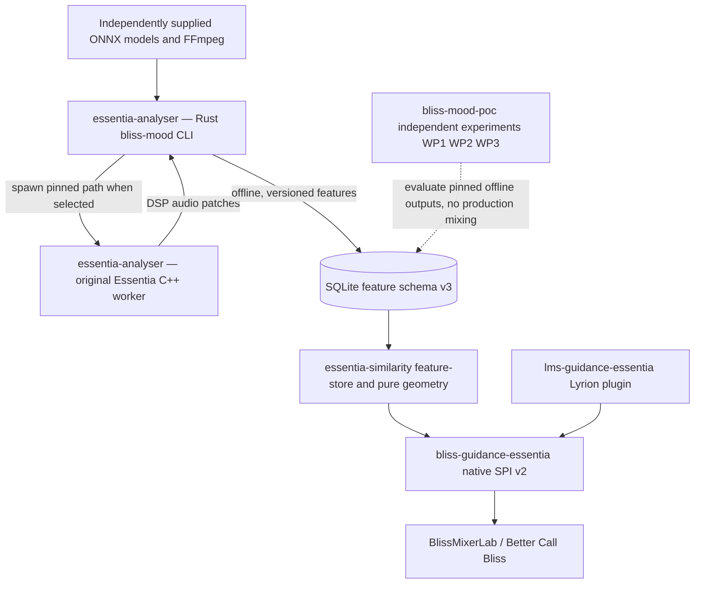

# Five-repository Essentia ownership and analyser extraction — 30 October 2026

> **IMPLEMENTATION VERIFIED AND MERGED — 30 OCTOBER 2026:** [`chrober/essentia-analyser` PR #1](https://github.com/chrober/essentia-analyser/pull/1) is **MERGED** into `main` as `bb88fc5b7ae1cf3080009e36cf593671d0e0aea2`. The original scanner/worker source extraction was verified against frozen original `bliss-mood-poc/main` `9a9ca062f9bf5adacb640f89c9dc8cf29895f951`: 108 source files byte-identical, Cargo.toml repository URL only changed, and separately added new README/provenance/safe CI. Both [Linux and Windows CI run 41107568434](https://github.com/chrober/essentia-analyser/actions/runs/41107568434) **PASS** including Rust tests, actual C++ IPC test fixture, and CLI builds; [PR CI 41107601140](https://github.com/chrober/essentia-analyser/actions/runs/41107601140) also PASS. This is a **source-code cutover**, not a verified new official C++ Essentia binary build, listening-quality validation, or public third-party native release. The historical scanner implementation and all WP1/WP2/WP3 experiments remain in `bliss-mood-poc`; **new analyser development belongs in `essentia-analyser`**. Existing executable names and SQLite v3/IPC remain unchanged. Third-party native Windows/FFmpeg/Essentia/ONNX distribution remains **BLOCKED** pending license review.

## Agreed project boundaries

The user explicitly decided that the existing Rust audio-feature scanner **including the original C++ Essentia worker** must have its own repository, while `bliss-mood-poc` remains the long-term **general research laboratory**. This does **not** call for deleting or renaming the old repository, discarding the WP1/WP2/WP3 experiments, or mixing the audio-inference and runtime-similarity codebases.

| Repository | Owner | Current milestone |
| --- | --- | --- |
| [`chrober/essentia-analyser`](https://github.com/chrober/essentia-analyser) | Offline audio decoding, native Essentia C++ worker, ONNX inference, model provenance, fixed/`auto` worker parallelism, SQLite-v3 feature output | [merged PR #1](https://github.com/chrober/essentia-analyser/pull/1): complete source extraction from immutable original scanner `main` `9a9ca062f9bf5adacb640f89c9dc8cf29895f951`; own safe CI |
| [`chrober/essentia-similarity`](https://github.com/chrober/essentia-similarity) | Standalone pure Rust General similarity core, read-only feature-store and shadow CLI, later independent Personal Metric | Already on `main`; [bootstrap PR #1 merged](https://github.com/chrober/essentia-similarity/pull/1) |
| [`chrober/bliss-mood-poc`](https://github.com/chrober/bliss-mood-poc) | Independent WP1 General / WP2 Personal / WP3 Bliss↔Essentia feature experiments, scientific benchmark artifacts, alternate scoring hypotheses | **Retain permanently**; current `feat/general-pairwise-similarity-research` research branch remains intact |
| [`chrober/bliss-guidance-essentia`](https://github.com/chrober/bliss-guidance-essentia) | Native Guidance SPI v2 plugin adapter to the independent similarity library | [Draft PR #1](https://github.com/chrober/bliss-guidance-essentia/pull/1), working validated *shadow-neutral* protocol, zero active guidance |
| [`chrober/lms-guidance-essentia`](https://github.com/chrober/lms-guidance-essentia) | Installable Lyrion provider/UI/configuration using the native Guidance provider | [Draft PR #1](https://github.com/chrober/lms-guidance-essentia/pull/1), **documentation only** |

## Runtime and data-flow separation

**Scanner and similarity do not need to be co-located in one Git repository, binary or running process.** Runtime similarity must not launch Essentia C++ or ONNX or overwrite the feature sidecar; it consumes a validated compatible read-only version. The Lyrion/native host still owns the exact LMS/Bliss candidate ID → feature `track_file` mapping and hard eligibility constraints.

## Verified initial analyser migration

- The original `bliss-mood-poc/main` source is frozen at `9a9ca062f9bf5adacb640f89c9dc8cf29895f951`. **Do not use** the unrelated, widely diverged `feat/general-pairwise-similarity-research` branch as the source of the entire scanner: it does not contain the complete native C++ worker tree.
- The new analyser [Draft PR #1](https://github.com/chrober/essentia-analyser/pull/1) includes the complete 12 Rust `src/` modules, 9 native/CMake/fixture files, 35 source scripts, 16 Python tests, 32 historical technical documents, Cargo.lock, model registry, old MIT LICENSE and .gitignore. **109 files imported.** Git blob SHA verification shows 108 are **byte-identical**; `Cargo.toml` differs only in the target repository URL. The extraction adds a README, provenance document, and carefully scoped new scanner CI.
- **No destructive move:** the source remains in `bliss-mood-poc` for historical research reproducibility. After validated acceptance, new scanner fixes should be developed in `essentia-analyser`, and research should use pinned analyser versions and datasets.
- **No executable rename during migration:** Rust CLI remains `bliss-mood(.exe)`, native C++ worker remains `bliss-essentia-worker(.exe)`. Future CLI rename to `essentia-analyser` must be a separate compatibility PR. They are separate executables built with different prerequisites, but belong to one *analyser* repository.
- The previous scanner's **13 workflow definitions are intentionally not activated** in the public new repository. Some prior workflows upload development/native artifacts; the independent analyser CI only builds/tests the Rust source and a synthetic original-protocol C++ fixture, with no third-party model/native package redistribution. Follow [license and release qualification](https://github.com/chrober/essentia-analyser/blob/feat/initial-analyser-extraction/docs/release-qualification-gates.md): native Essentia/FFmpeg/model license and Windows dependency notice gaps mean redistribution approval is BLOCKED.
- A passing synthetic protocol fixture and Rust CI does not, by itself, prove an upstream Essentia C++ build, package portability, real-song source parity or production approval. These remain distinct gates.

## Near-term acceptance

1. Wait for independent Linux and Windows cargo/protocol CI; fix only extraction regressions in the new analyser draft branch. Preserve original `Cargo.lock` and schema/IPC/CLI.
2. Add exact provenance and source/feature database parity test using existing bounded fixtures; do not rescan personal music unless explicitly authorized.
3. Mark analyser PR ready/merge only when extraction parity, review and CI pass. **Do not automatically enable source workflow ZIP uploads**.
4. Separately evaluate a backwards-compatible CLI binary rename, and packaging strategy, **after** independent source-and-license audits.
5. Continue the WP1 General Metric human-quality evaluation, WP2 authentic Personal Metric learning and WP3 Bliss23↔Essentia teacher/feature study in `bliss-mood-poc`, consuming pinned scanner outputs.
6. Integrate `bliss-guidance-essentia` into BlissMixerLab only once verified exact identity mapping exists; no live queue changes or active similarity contribution before metric validation.

This document records the user's repo-separation decision and the extraction implementation; it does not claim that public third-party binary distribution is legally approved.
