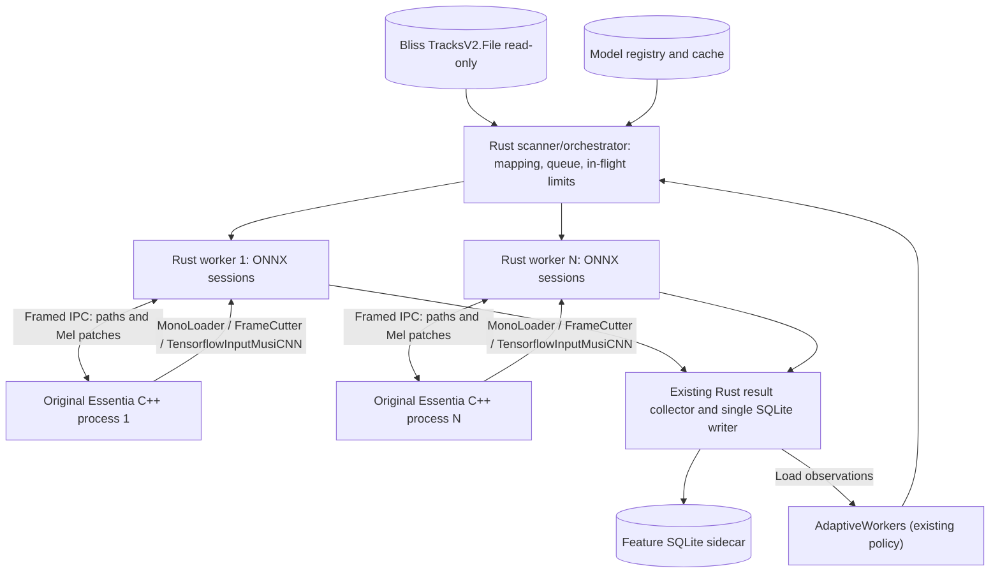
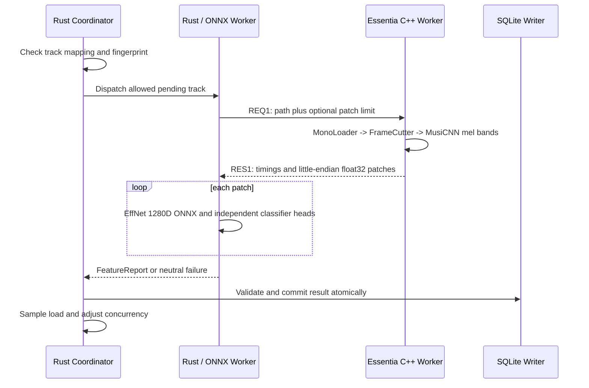
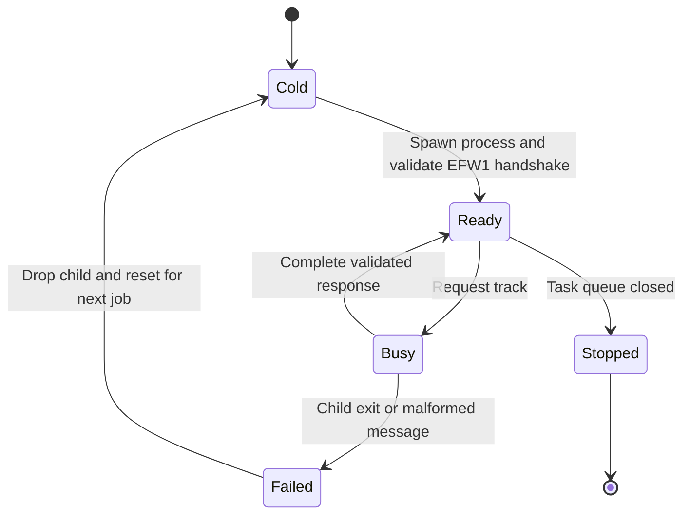

# Essentia C++ frontend behind existing Rust worker orchestrator

**Status:** experimental opt-in, not production-ready (2026-10-19).
**Decision:** set aside essentia-rs; reuse original Essentia C++ algorithms directly while keeping the existing Rust scheduler, adaptive worker policy, ONNX Runtime, model registry and single SQLite writer. Do not merge into main without explicit user instruction.

## Architecture

Each Rust worker owns one long-lived C++ subprocess and its own reused ONNX sessions. Child processes are **single-threaded for Essentia**, so we do not assume its C++ algorithms are thread-safe. The Rust frontend remains the unchanged default and test reference.

## Processing flow

## Worker lifecycle

## Native Essentia responsibilities

Use **original** C++ algorithms:
- MonoLoader: 16 kHz mono, downmix=mix, resampleQuality=4.
- FrameCutter: centered frames, size=512, hop=256, startFromZero=false.
- TensorflowInputMusiCNN: 96 log-compressed mel bands per frame.
- Patch assembly: 128 mel frames, hop=62, row-major Float32.

Do **not** bring TensorFlow into the worker; existing Rust ONNX Runtime performs EffNet plus 87-genre/56-mood/2-voice heads. No new audio tags or changes to bliss.db.

## Framed binary IPC contract (version 1)

The C++ process writes **EFW1** (four ASCII bytes) exactly once on startup.
Every Rust request writes: **REQ1**, u32-LE UTF-8 path length, u32-LE patch cap
(0 means full available audio), exact path bytes.
Every C++ reply writes: **RES1**, u8 status (0=success, 1=error),
u32-LE count, u64-LE decode-ns, u64-LE feature-ns. For success, count
specifies number of patches and the body has exactly count×128×96 little-endian
f32 values. For error, count specifies bounded UTF-8 error message bytes.
Stdout is *only* protocol data; stderr is diagnostic. Path lengths, patch
counts and data validity are bounded, no shell expansion, no text float arrays,
and malformed replies invalidate that worker. The native executable is
explicitly configured, never downloaded or executed automatically.

## Licensing and native dependency provenance

The original Essentia C++ library is **AGPLv3** licensed, and its
dependencies and the separately downloaded model weights have their own
conditions. Shipping an Essentia-linked child process with an MIT Rust
application requires an explicit legal/distribution review. Splitting
into processes does not by itself remove license obligations.

The experimental cache fingerprint includes the native **executable**
SHA-256, but not the versions or SHA-256 checksums of dynamically
loaded libessentia, FFmpeg and libsamplerate. Before real deployment we
must pin the complete native dependency set, or hash the installed
native deployment at runtime, to avoid cache aliasing after a library
update.

## Native build and transport CI

The `.github/workflows/native-essentia-cpp.yml` job builds a **pinned
original MTG/essentia C++ revision** and tests the real native worker
against a synthetic WAV and multiple sequential jobs. The normal Rust
CI separately builds a no-Essentia C++ protocol fixture, verifying
the Rust process orchestration even where Essentia is unavailable.
Both gates remain independent of full feature/model numerical parity.

## Proven resource diagnostics (Windows and Linux)

The orchestrator now tracks the PIDs of **only** the native C++ workers it
spawns. Child PIDs are registered immediately after spawn and unregistered
after kill/wait. At each ordinary scan resource observation, the report
captures the Rust process and its currently registered children:

- `process_tree_working_set_max_mib` and
  `process_tree_private_bytes_max_mib`: combined observed resident
  and private memory across Rust plus all native worker processes.
- `native_child_working_set_max_mib` and
  `native_child_private_bytes_max_mib`: child-process-only estimates.
- `native_child_processes_max`: maximum registered native subprocesses.
- `process_tree_incomplete_samples`: samples where a registered child
  exited before its OS memory counters could be read. Incomplete samples
  are excluded from memory high-water estimates.

On **Windows**, working set and private bytes come from
`GetProcessMemoryInfo` for each worker's PID. On **Linux**, resident bytes
come from `/proc/PID/status` (`VmRSS`) and private bytes from
`/proc/PID/smaps_rollup` (`Private_Clean` + `Private_Dirty`).
Unavailable or permission-restricted counters are not fabricated. Other
operating systems continue to report optional missing values.

Memory samples reflect **individual observation instants**, not the
kernel's lifetime peak, and summed RSS can double-count pages shared by
multiple processes. This is an upper-leaning diagnostic footprint, not
a unique physical-memory-usage measurement.

The adaptive controller already uses **system-wide physical RAM load**,
which includes native C++ workers automatically; its conservative CPU/RAM
thresholds and minimum-completed-song / cooldown gates are unchanged.
The new process-tree diagnostics therefore **do not claim a different
adaptive algorithm**. Evaluate whether additional process-specific budget
guards are necessary only after fixed 1/2/4/6-worker benchmarks.

## Native numeric parity result

The first complete original Essentia C++ DSP/Mel patch comparison is
green: GitHub Actions run
[39295089664](https://github.com/chrober/bliss-mood-poc/actions/runs/39295089664)
compared **49,152 coefficients across four 128x96 EffNet patches**
generated by the pinned original C++ `TensorflowInputMusiCNN` and the
existing Rust Mel source. Mean absolute error **1.7774358e-7**,
maximum absolute error **8.4042549e-6**, both below the `1e-3`
regression gate. The fixture is a deterministic mono 16 kHz PCM16 WAV.
This proves DSP parity for that fixture, not every codec, all lengths,
classifier-head quality or Pi compatibility.

## Provenance and rollout gates

The new frontend uses an **independent preprocessing identity** and
incorporates the SHA-256 of the actual executable into model provenance.
No alternative worker may reuse a Rust feature cache identity without
numerical parity. All classifications remain experimental and unvalidated.
Unchanged Rust default preserves prior CLI outputs, model fingerprints,
cache behavior and logging.

The existing adaptive policy changes only the number of in-flight songs,
never cancels an active analysis. Process-tree RAM observation is now
implemented for Windows/Linux, but **physical budget validation and
performance benchmarking remain outstanding**. Crashed or timed-out
children fail their song rather than silently falling back to Rust.
A bounded hard timeout and kill/restart supervisor is implemented; actual
Windows and ARM64 native runtime still require separate testing.

The essential validation sequence:
1. Protocol tests without Essentia; check malformed, oversized and truncated output.
2. Native C++ worker build against pinned Essentia, single-song and multi-song smoke.
3. Patch-count and full Mel coefficient parity against existing Rust reference on
   WAV, FLAC and MP3 synthetic audio; then 1280D embeddings and all classifier heads.
4. Windows and Linux packaging; Pi/aarch64 compatibility and C++ dependency audits.
5. Fixed 1/2/4/6 workers vs prior fixed/adaptive benchmarks: throughput,
   process-tree private memory, startup time and NAS I/O.
6. Validate hard timeout/restart and process-tree RAM diagnostics under
   native Windows and ARM64; then benchmark memory ceilings on the Pi.

The original C++ algorithms are documented at:
- https://essentia.upf.edu/reference/std_MonoLoader.html
- https://essentia.upf.edu/reference/std_FrameCutter.html
- https://essentia.upf.edu/reference/std_TensorflowInputMusiCNN.html

This branch deliberately does not modify BlissMixerLab or merge any repository's main.
