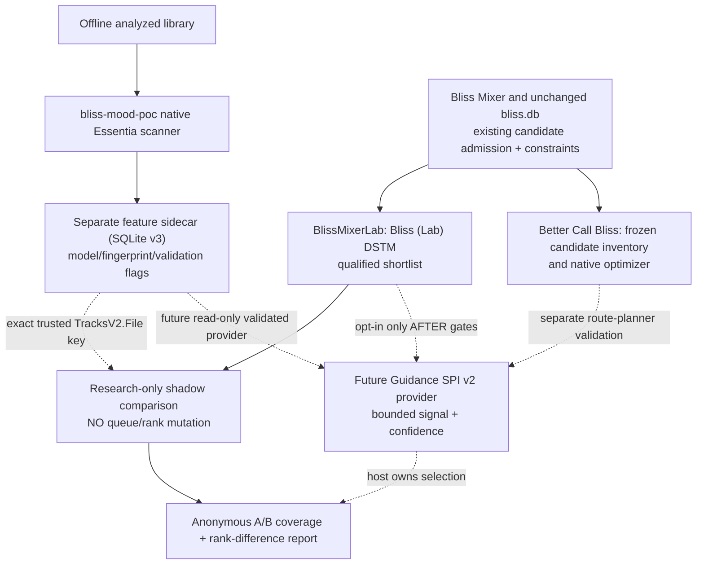

# From WP1/WP2/WP3 research to useful Lyrion playlists: cross-repository integration decision (30 October 2026)

> **IMPLEMENTATION UPDATE — 30 OCT 2026:** P1 technical sub-slice is now real code: [standalone Rust geometry + read-only SQLite-v3 shadow CLI](lyrion-rust-similarity-engine-shadow-first-slice-20261030.md) using existing strict `src/feature_lookup.rs`, with [Linux/Windows Cargo tests PASS](https://github.com/chrober/bliss-mood-poc/actions/runs/41085597284). It supports versioned affine cosine/centered cosine for Genre87/Mood56 only and produces anonymous rank-delta aggregates, **never playlists**. Actual model scoring is on fictional, temporary source-compatible SQLite v3 fixtures; real-song audio-feature validation, independent General Metric quality, *LMS urlmd5/candidate ↔ exact `TracksV2.File` resolver*, SPI v2 JSONL service/provider package, real Lyrion shadow UI, Pi performance and personal mode are **not implemented**. Existing P0–P6 go/no-go gates remain binding. This is a safe implementation advance, not P2 delivered or authorization for a shipped plugin. See full [CLI request schema and restrictions](lyrion-rust-similarity-engine-shadow-first-slice-20261030.md).

**Status:** Evidence-based product architecture and a small **synthetic shadow-only integration contract**. **NOT** a released Lyrion feature, running SPI v2 plugin, certified General Metric, merged pull request, measurable acoustic improvement or approval to modify production repositories. Applies only to the isolated `feat/general-pairwise-similarity-research` branch.

## 1. Real, inspected product boundaries (as of 30 Oct 2026)

This decision is based on current source/README/API inspection, **not an assumed integration surface**.

| Existing maintained system | Verified behavior | Proposed research-to-product role |
| --- | --- | --- |
| [`chrober/bliss-mixer`](https://github.com/chrober/bliss-mixer), default `master` | `/api/mix` returns Bliss-selected DSTM tracks; `/api/list` returns similar tracks. Rust mixer owns its static/adaptive/learned 23D scoring, existing `bliss.db`, candidate filters and repeat constraints. Optional `/api/guidance/score` hosts bounded provider scoring against an *already Bliss-qualified* candidate set; no general Essentia scorer is currently registered. | **Baseline, safe fallback and candidate authority**. Do not change its API, `bliss.db` or original Bliss installation for the first vertical slice. |
| [`chrober/lms-blissmixer-lab`](https://github.com/chrober/lms-blissmixer-lab), default `main` | Separate **Bliss (Lab)** DSTM provider; `Create bliss mix (Lab)`, `Similar tracks (Lab)` and per-artist variants. Experimental settings and 23D Bliss preference survey. Already discovers enabled Guidance providers, with existing native scoring request. | **First user-facing experimental host.** Start with no-playback-change *shadow report* beside real Bliss candidate order, then optionally an explicit opt-in A/B provider once safety and actual model quality gates pass. |
| [`chrober/lms-better-call-bliss`](https://github.com/chrober/lms-better-call-bliss), default `main` | Captures playlist/queue inputs; Rust [`bliss-playlist-optimizer`](https://github.com/chrober/bliss-playlist-optimizer) optimizes routes and bridges; user previews results before saving/applying. It discovers the same host-neutral Guidance SPI providers. Original route feasibility, repeat and virtual-library rules remain hard. | **Second, separate product-quality test**: compare completed routes and transitions on a *frozen identical seed/candidate inventory* and constraints. Never mistake pairwise neighbor score for a verified good route. |
| [`chrober/bliss-playlist-guidance-spi`](https://github.com/chrober/bliss-playlist-guidance-spi), current `SPI.md` and JSONL v2 schema | **`describe` → `prepare` → `score` → `close`**; existing native `bliss-mixer` and optimizer are hosts. Provider emits bounded signed signals and confidence, never admits candidates, modifies playlist, or overrides hard filters. Trusted local resources and hash-bound evidence are host-configured, not inferred from browser input. | **Reuse the existing integration seam** for a future Mood/Genre/Embedding provider, not a new network scoring API or plugin-to-plugin database write. |
| [`chrober/bliss-learner`](https://github.com/chrober/bliss-learner) | Experimental 23D Bliss learned matrix and older triplet workflow, separately surfaced by Lab. | WP2 reference only; existing `learnedblend` adjusts learned-vs-variance **Bliss** adaptive weighting and is **NOT** the new General-vs-Personal 0–100% influence. |
| This research repo `chrober/bliss-mood-poc` | Offline native Essentia scanner can write **separate SQLite feature schema v3**, including 87D Genre and 56D Mood heads, with model fingerprints. Actual model selection/quality gate remains unfinished and stored `validated_against_essentia` flags may still be false. | **Offline feature producer only**. No ONNX, decoded audio, neural inference or scanner work at playlist runtime; trusted local read-only sidecar. |

### The actual user benefits we intend to test, not yet claim

1. **`Bliss (Lab)` DSTM / radio:** If Bliss proposes 30 admissible continuations, optional local features may distinguish stylistic, mood/energy and acoustic-timbre coherence **among those same candidates**, offering a more coherent continuous mix without changing user repeat/library restrictions. *Unproven benefit until same-pool and later listening evaluation.*
2. **`Similar tracks (Lab)`:** Additional opt-in research ranking of the same qualified nearest-neighbor list; compare candidate rank, ties and unavailable features. A separate **feature-first/hybrid retrieval** may eventually discover relevant tracks outside the Bliss candidate pool, but this **is not supported by SPI v2 alone**.
3. **`Better Call Bliss` playlist/queue preview:** The same source may express *transition-context* preferences to the native route optimizer. Compare whether an existing playlist is smoother or needs fewer/no extra bridge tracks, **only among already valid, fully verified routes**; reject a new order that violates hard feasibility or meaningfully harms existing acoustic quality. It remains a different experiment from DSTM.
4. **WP2 future personalization:** A separately identified user model can adjust a calibrated General score at user-requested 0–100% personal influence. Until actual personal calibration/quality/coverage passes, the effective personal influence is 0%, even at a stored 100% slider. **Do not conflate this slider with Lab's pre-existing `learnedblend`.**
5. **WP3 Bliss-only fallback research:** If a teacher model eventually shows that cheap, validated Bliss23 features approximate a helpful Essentia dimension *and* independently improve human music quality, that may support a lower-overhead Bliss-only option. Current WP3 teacher prediction is **not** human perceptual evidence.

## 2. First controlled integration: Bliss-first, provider, opt-in, shadow

**Deployment order is not a winner declaration**. The SPI v2 route is Bliss-first because the candidate bounds already exist and the blast radius is small. Later compare Bliss-first vs feature-first vs hybrid retrieval, with the *same* eligibility, full frozen seed, source constraints and evaluation endpoints. The initial provider must never promise to retrieve a new song or accept an acoustically invalid edge.

**Canonical identity is an unresolved adapter task.** Research schema v3 uses exact `track_file` matching the original `TracksV2.File`, never `rowid`, normalized artist/title or guessed paths. SPI v2 permits `database_file` but Lab's identity artifact currently often carries only `candidate_id` and `lms_urlmd5`. An exact host-owned resolver must be implemented and proven for DSTM, CUE-synthetic file identities and the Better Call Bliss inventory before any source sidecar join is safe. A missing/ambiguous identity must yield neutral guidance for the **whole comparable query**, not a misleading partial boost.

**Model readiness is also unresolved.** Synthetic inference-parity experiments do not certify the stored Essentia audio values. A feature row with false `validated_against_essentia`, stale fingerprint, missing exact seed/candidate match, nonfinite vector, changed class order, incorrect dimension or uncalibrated score is not a production-ready feature. A Lab-only explicit *unvalidated research preview* can inspect it while staying disabled for playback, with visible warnings; it cannot silently turn unvalidated data into real guidance.

## 3. A minimal executable shadow-only safety contract

The new [research shadow contract](../scripts/research_lyrion_general_shadow_contract.py) is **offline in-memory code, not an SPI provider**. It accepts an already-admitted, bounded (2–50) Bliss candidate batch, each candidate's original contiguous rank and explicit exact-identity, feature availability, fixed scorer fingerprint, numeric score and actual Essentia reference-validation flags. It refuses non-shadow commands, duplicate candidates and invalid rank/flag types; it never emits file IDs, model scores, filenames or individual rank lists.

- All original candidate-eligibility and Bliss ranking are **immutably retained**. Any single candidate with missing exact identity, missing sidecar feature, incompatible fingerprint, invalid score, failed source parity or host admission violation causes **full-cohort neutral shadow fallback**. Fail closed instead of quietly mixing different scoring populations.
- A complete eligible batch can be **compared** using a frozen higher-is-more-similar bounded [0,1] score, deterministic existing-Bliss-order tie breaks and aggregate rank-change/top-5-overlap measurements. This is only algorithmic plumbing; **no actual General score function is selected or validated** and the output cannot be applied to a queue.
- If some feature rows are unvalidated, a separate **explicit experimental preview opt-in** may allow *shadow only* computation and always reports unvalidated experimental status. A production provider will require its own stronger audit and will not inherit that preview exception.
- The code never reads an actual Lyrion database or makes network calls; synthetic tests are required. The sole purpose is to establish a runnable contract for future Lab instrumentation and avoid accidentally treating a score-only experiment as deployed behavior.
- Query-level fallback is not equivalent to approving admission for a track. The existing host continues its full original selection when a provider lacks comparable evidence. Multi-source/ranked routes in Better Call Bliss need their own frozen edge-level context; do not reuse the same query algebra without explicit optimizer compatibility tests.

## 4. Practical staged milestones with independent go/no-go gates

| Stage | Concrete change / user-visible result | Evidence required before proceeding | State |
| --- | --- | --- | --- |
| P0 - Original system baseline | Capture unchanged Lab DSTM shortlist/order, existing Better Call Bliss preview, hard constraints, latency and queue/route IDs, with **no feature provider** | Exact, frozen seed/queue/library and only anonymized aggregate report | Existing host capability; **new A/B run not yet done** |
| P1 - Read-only identity and sidecar readiness | Implement a strict host-owned `TracksV2.File` resolver and per-request `feature_tracks` lookup in separate SQLite v3; report cache/version/provenance and missing-track counts | No false-positive joins, unchanged `bliss.db`, no per-request inference, whole-query neutral on mismatch; actual real-song Essentia validation gate | **BLOCKED by missing adapter and real validation** |
| P2 - Lab shadow trial (first user-visible vertical slice) | New optional provider **off by default**, computes sidecar-only candidate signals for the same Bliss pool; Lab displays original vs proposed rank and reasons for neutral fallback; NO modified DSTM tracks until approved | 100% original hard-eligible set retained, finite bounded signals, no new candidates, fallback/timeout/invalid vector tests, Pi/Linux/Windows resource budget measured; full-query coverage quantified | Synthetic contract implemented, **no plugin, no real runtime test** |
| P3 - Lab opt-in actual A/B | Side-by-side Bliss-only and *already selected/versioned* General rerank, exact same candidates, constraints and seed; enable only in Lab experimental prefs | Human listening endpoint independently assessed, no increased forbidden repeats, candidate coverage and Pi latency acceptable; rollback verified | **NOT authorized; General Metric unselected** |
| P4 - Better Call Bliss preview integration | Add same independently qualified signal as **optional edge-context guidance** to a frozen optimizer request; compare resulting preview route order and required bridge tracks | Whole-route validity preserved, directed vs symmetric scoring distinct, provider failure neutral, no playlist write before user accepts; route quality vs Bliss-only independently evaluated | **Not implemented** |
| P5 - Feature-first/hybrid candidate search | New host-owned candidate-admission/index contract, union/dedupe and common hard eligibility, not a Guidance SPI loophole | Candidate recall gain, no relaxation of constraints, artist/recording/snapshot provenance and equal-latency A/B | **Future comparative architecture**, not decided |
| P6 - Optional Personal layer | User-only, separately gated Personal score and personal influence slider, 0–100%; run-wide General fallback | Real grouped training/validation/heldout quality, score calibration, user-data isolation, ineligible/stale case tests | WP2-P3/P4 **fictional-only engineering**, no real activation |

The first **valuable, low-risk visible outcome** is P2 (Lab shadow preview with actual music). It gives a user a concrete comparison, visibility into unavailable features and a measured candidate-impact delta **without altering current mixes**. P3/P4 should be judged by real playlist/transition utility, not merely by a higher cosine or a synthetic improvement.

**What to measure in P2/P3/P4:** eligible pool size; exact feature join rate on seed and candidate side; full-query feature coverage, model/score version, neutral fallback reasons; signed rank delta and top-k overlap; song/album/artist repetition; source and virtual-library violations (must be zero); cache throughput, p95/p99 request time and peak RAM on target platforms including Raspberry Pi; route feasibility, unmodified user playlist until approval; retrospective objective drift and blinded perceived mood/genre/timbre/transition coherence. Keep Genre, Mood/Energy, Timbre, directed transition suitability separate. Record proposed gains and quality uncertainty independently of user votes or private music identities.

## 5. Minimum change set and owner map

**In this research branch only, now:** a product-grade decision record, the synthetic fail-closed shadow batch contract and automated tests. No claim of running Lab/BCB integration.

**When product work is separately approved:**
1. **`bliss-mood-poc`**: validated, provenance-fingerprinted *offline* feature sidecar (full real-song Essentia parity), package/license review and compatibility probe. Keep runtime source database separate.
2. **New independent experimental Lyrion guidance-provider project** (repository undecided): implement the existing JSONL SPI v2 `describe/prepare/score/close` contract, trusted read-only sidecar, separate Genre/Mood/acoustic channels and neutral failure, no candidate admission or source audio. Avoid burdening `bliss-mixer` with Essentia inference.
3. **`lms-blissmixer-lab`**: only the exact file identity resolver and opt-in shadow instrumentation first; settings clear about **experimental General score**, completely separate from its existing adaptive `learned_blend`; no default routing change.
4. **`lms-better-call-bliss` / `bliss-playlist-optimizer`**: reuse the provider contract *after* the Lab candidate proof, with independent optimizer edge/route-specific checks and user preview; preserve every existing feasibility rule and queue write confirmation.
5. **`bliss-mixer`**: no change required for the initial Bliss-first vertical slice; review new candidate-source API only if feature-first/hybrid demonstrably helps.
6. **`bliss-learner`**: unchanged; maintain the distinction between current Bliss23 learned matrix and future optional calibrated General/Personal learning.

## 6. Scientific evidence and no-go list

Current WP1 descriptive human evidence: MTT 293 majority-decisive triplets, Mood Centered Cosine 193/293 vs Mood Cosine 192/293 but actual paired correctness missing; local eleven deliberately selected, single-listener song pairs with Mood Centered/Next Track rho 0.769 and Embedding1280/Timbre rho 0.766 (LOO robust within this small study); CCMSim public 1,130 labeled pairs from other cultures, but not scored by our models and heavily single-annotator; E5 clip-disjoint only 40 primary test pairs; E7 external published third-party scorer replay, not an Essentia/Bliss quality test. MTT global fusions remain unmeasured on original audio; FMA official TEST still untouched. **No WP1 General Metric chosen, no certified General-vs-Personal calibration**.

Do not invent a predicted improvement, force new listening now, automatically deploy synthetic fake-model comparisons, silently treat a cheap Bliss23 proxy as ground-truth mood, train WP2 from 12 old human pair votes, fetch restricted audio, let an SPI provider admit disallowed tracks, change the main branch, modify production Lyrion installations, or merge Draft PR #16 solely because the sidecar can be read.

**Next decision:** Approve P1 read-only identity/feature-compatibility proof and a **separate** P2 Lab shadow-only proof. Reserve P3/P4 actual playlist reranking until feature validation, metric selection and independently useful user-facing quality checks exist.
