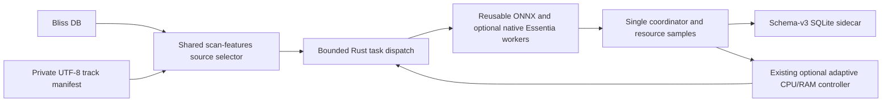

# Explicit track-manifest analysis using the existing adaptive worker scanner

**Status:** experimental implementation on `feat/manifest-batch-adaptive-worker-analysis`; based on the exact PR #17 C++/Rust backend. This is **not** a release qualification or a measured performance improvement. PR #16 remains unaffected.

## Problem and scope

Research and dataset utilities have historically spawned a new `analyze-features` process for every track. `--threads 1` prevents intra-track ONNX oversubscription, but does not parallelize tracks or reuse ONNX sessions across separate processes. The existing `scan-features` scheduler already has reusable per-worker ONNX sessions, bounded in-flight dispatch, one transactional SQLite coordinator and an optional resource-guard controller.

The new `--tracks-file` source allows an **explicit cohort** to enter that existing scheduler **without manufacturing a Bliss database**. It persists genre/mood/voice classification features in a separate schema-v3 SQLite sidecar. It does **not** yet produce 1280D per-patch Embeddings; that requires a separate output contract and new parity evidence. No change to `analyze-features`, existing `--bliss-db` scans or the original Bliss DB.

### Source manifest

- UTF-8 plain text, one exact **source-root-relative** track key per line; empty lines ignored. The order in the manifest is preserved for *dispatch*, not for asynchronous completion.
- Forward slash separators; no absolute paths, drive designators, backslashes, leading/trailing whitespace, empty path components, `.`, `..` or duplicate keys.
- Existing symlink targets are checked against the canonical source root before work starts. Missing files are subsequently counted by the scan's normal error/limit mechanism. Source audio is read-only.
- Maximum 100,000 selected keys to avoid unbounded input. Use modest samples first. Manifest filenames can be private; never commit a real cohort or track-specific logs.
- `--tracks-file` requires `--source-root` and is mutually exclusive with `--bliss-db`; `--library-root` is Bliss-only. `--only-track` and `--max-new` remain supported.

Example manifest, using **synthetic filenames only**:

```text
example-artist/example-album/01-test.wav
example-artist/example-album/02-test.flac
```

### PowerShell example (Windows, separate sidecar)

Use the verified binary for the selected commit after successful GitHub Actions checks. Never compile Rust locally on the user's Windows machine. Supply your own private paths locally; do not paste absolute paths or the manifest into public CI.

```powershell
& {
    $ErrorActionPreference = 'Stop'
    $exe = 'C:\path\to\verified\bliss-mood.exe'
    $manifest = 'C:\private\selected-tracks.txt'
    $sourceRoot = 'C:\private\test-audio'
    $sidecar = 'C:\private\manifest-features-new.db'
    $models = 'C:\private\official-models'
    foreach ($p in @($exe, $manifest, $sourceRoot, $models)) {
        if (-not (Test-Path -LiteralPath $p)) { throw "Missing prerequisite: $p" }
    }
    if (Test-Path -LiteralPath $sidecar) { throw 'Refusing to overwrite an existing sidecar' }

    & $exe scan-features --tracks-file $manifest --source-root $sourceRoot `
        --db $sidecar --models-dir $models --models moodtheme,genre,voice `
        --threads 1 --workers 4 --max-new 100 --max-errors 5 --json
    if ($LASTEXITCODE -ne 0) { throw "Analysis failed with exit code $LASTEXITCODE" }
}
```

For optional resource-aware adjustment add `--adaptive-workers --min-workers 2 --max-workers 4` while starting at `--workers 3`. Adaptive mode is **not** a measured throughput optimizer. Start with fixed 1, 2 and 4 worker runs on independently copied sidecars; use identical manifest/model/audio SHA hashes. Do not use 8+ workers uncritically on hosted CI machines.

For a dry-run (no ONNX inference or SQLite writes), append `--dry-run` and omit `--adaptive-workers`. Dry-run still validates the selected catalog and source mapping.

### Implementation and invariants



The classification calculations, native-backend preprocessing fingerprint, model hashes, persistence transaction and ONNX single-environment contract are **unchanged**. The existing scheduler does not terminate jobs when lowering concurrency; it dispatches fewer *new* jobs until outstanding work drains. Completed tracks are resumed through existing file size/mtime and model identity checks. A failed track can be retried safely after fixing the input; the existing `--max-errors` gate still applies.

**Limitations:** The source-root containment precheck runs before analysis but does not make an adversarial filesystem immune to time-of-check/time-of-use races. A private audio collection must be controlled by the user. Feature output ordering in SQLite must be queried by explicit track key/order; asynchronous worker completion is nondeterministic. Model numerical parity is inherited from the unchanged implementation, but the newly introduced manifest route still requires CI and a follow-up known-song comparison. No controlled wall-time/CPU/RAM numbers have yet been collected for the new option.

## Validation and next work

1. Rust unit test: accepted order, duplicates, traversal, absolute paths and backslashes. Run `cargo test --locked`, `cargo clippy --locked --all-targets -- -D warnings` and `cargo fmt --check` in CI.
2. CI integration test: generate synthetic audio plus official verified models, compare fixed 1 vs fixed 2 vs adaptive results and inspect schema-v3 cohorts independent of completion order (pending).
3. Use the same controlled public dataset cohort for sequential/fixed/adaptive AB/BA benchmarking; split cold/warm cache and model load/decode/preprocess/inference timing. Do not conflate synthetic CI smoke times with production performance (pending).
4. Expose optional 1280D per-patch embedding export through a single-process batch output interface with capped memory, atomic files, per-track provenance, verified resume and a compatibility test with the local PR #16 research validator (pending).
5. Integrate the reviewed changes into the relevant long-term branch only after PR #17's license/distribution release gates are separately resolved.

## Branch boundaries

This is a stacked PR on `feat/essentia-cpp-worker-backend`, keeping Rust-v5 and the optional original C++ frontend available. It does **not** update PR #17 or its native redistributable artifacts and does **not** change PR #16's frozen research exporter. The new option is unavailable in binaries produced from `main` or from PR #17's original head.
