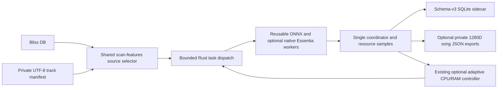

# Explicit track-manifest analysis using the existing adaptive worker scanner

**Status:** experimental implementation on `feat/manifest-batch-adaptive-worker-analysis`; based on the exact PR #17 C++/Rust backend. This is **not** a release qualification or a measured performance improvement. PR #16 remains unaffected.

## Problem and scope

Research and dataset utilities have historically spawned a new `analyze-features` process for every track. `--threads 1` prevents intra-track ONNX oversubscription, but does not parallelize tracks or reuse ONNX sessions across separate processes. The existing `scan-features` scheduler already has reusable per-worker ONNX sessions, bounded in-flight dispatch, one transactional SQLite coordinator and an optional resource-guard controller.

The new `--tracks-file` source allows an **explicit cohort** to enter that existing scheduler **without manufacturing a Bliss database**. It persists genre/mood/voice classification features in a separate schema-v3 SQLite sidecar. With explicit `--embedding-dir` it also exports **one pooled, L2-normalized 1280D Discogs-EffNet embedding per song**. This reuses the f64 pooling and fingerprint contract of PR #16's research overlay; it does not dump all per-patch vectors. A synthetic-audio integration test has established **exact numerical equality across serial, fixed-two-worker and adaptive-two-worker runs**, including pooled embedding JSON and persisted head bytes; independent real-song acceptance and held-out musical usefulness remain open. No change to `analyze-features`, existing `--bliss-db` scans or the original Bliss DB.

### Source manifest

- UTF-8 plain text, one exact **source-root-relative** track key per line; empty lines ignored. The order in the manifest is preserved for *dispatch*, not for asynchronous completion.
- Forward slash separators; no absolute paths, drive designators, backslashes, leading/trailing whitespace, empty path components, `.`, `..` or duplicate keys.
- Existing symlink targets are checked against the canonical source root before work starts. Missing files are subsequently counted by the scan's normal error/limit mechanism. Source audio is read-only.
- Maximum 100,000 selected keys and **32 MiB UTF-8 manifest input** to avoid unbounded input. Use modest samples first. Manifest filenames can be private; never commit a real cohort or track-specific logs.
- `--tracks-file` requires `--source-root` and is mutually exclusive with `--bliss-db`; `--library-root` is Bliss-only. `--only-track` and `--max-new` remain supported.
- `--embedding-dir` requires a manifest and a pre-existing private output directory outside music and model roots. It is forbidden in dry-run. SHA256(track key) names the JSON file, so filenames do not disclose track identities.
- Each embedding JSON includes the original track identity **inside** the private file, audio SHA256, 1280 dimensions, patch count, exact encoder SHA256, preprocessing version, pooling/normalization algorithms and reproducible representation fingerprint. This output is experimental, not a validated musical metric.

Example manifest, using **synthetic filenames only**:

```text
example-artist/example-album/01-test.wav
example-artist/example-album/02-test.flac
```

### PowerShell example (Windows, separate sidecar)

Use the verified binary for the selected commit after successful GitHub Actions checks. Never compile Rust locally on the user's Windows machine. Supply your own private paths locally; do not paste absolute paths or the manifest into public CI.

```powershell
& {
    $ErrorActionPreference = 'Stop'
    $exe = 'C:\path\to\verified\bliss-mood.exe'
    $manifest = 'C:\private\selected-tracks.txt'
    $sourceRoot = 'C:\private\test-audio'
    $sidecar = 'C:\private\manifest-features-new.db'
    $models = 'C:\private\official-models'
    $embeddingDir = 'C:\private\private-song-embeddings'
    foreach ($p in @($exe, $manifest, $sourceRoot, $models)) {
        if (-not (Test-Path -LiteralPath $p)) { throw "Missing prerequisite: $p" }
    }
    if (Test-Path -LiteralPath $sidecar) { throw 'Refusing to overwrite an existing sidecar' }
    if (-not (Test-Path -LiteralPath $embeddingDir)) {
        New-Item -ItemType Directory -Path $embeddingDir -ErrorAction Stop | Out-Null
    }

    & $exe scan-features --tracks-file $manifest --source-root $sourceRoot `
        --db $sidecar --embedding-dir $embeddingDir --models-dir $models --models moodtheme,genre,voice `
        --threads 1 --workers 4 --max-new 100 --max-errors 5 --json
    if ($LASTEXITCODE -ne 0) { throw "Analysis failed with exit code $LASTEXITCODE" }
}
```

For optional resource-aware adjustment add `--adaptive-workers --min-workers 2 --max-workers 4` while starting at `--workers 3`. Adaptive mode is **not** a measured throughput optimizer. Start with fixed 1, 2 and 4 worker runs on independently copied sidecars; use identical manifest/model/audio SHA hashes. Do not use 8+ workers uncritically on hosted CI machines.

For a dry-run (no ONNX inference or SQLite writes), append `--dry-run` and omit both `--adaptive-workers` **and** `--embedding-dir`. Dry-run still validates the selected catalog and source mapping.

### Embedding correctness and resume

Opt-in song embedding accumulation is per worker and uses a single 1280-element f64 vector, not an in-memory list of every patch. The same encoder vectors are simultaneously classified by Mood/Genre/Voice; the existing head aggregation is unchanged.

A track is up-to-date only when its SQLite state/model identity matches and, if enabled, its JSON embedding is present and has matching SHA/preprocessing/fingerprint/patch count plus a finite, unit-length 1280D vector. Missing JSON triggers reanalysis. Corrupt or incompatible existing JSON fails closed: no existing output is overwritten. Reanalysis matching a previous complete file reuses that file. The output write happens before the SQLite feature transaction, so an interruption may leave a valid embedding without a refreshed sidecar; the next run re-verifies it. Embedding publication now stages a sibling temporary file, flushes and syncs it, then uses a same-directory **atomic, no-overwrite hard link** to publish the complete JSON. A crash before publication can leave a `.partial` file but not a partially published `.json`. On filesystems without hard-link support, creation fails closed; no unsafe rename fallback is used. Pre-existing damaged JSON requires explicit manual investigation, never silent replacement.

### Implementation and invariants



The classification calculations, native-backend preprocessing fingerprint, model hashes, persistence transaction and ONNX single-environment contract are **unchanged**. The existing scheduler does not terminate jobs when lowering concurrency; it dispatches fewer *new* jobs until outstanding work drains. Completed tracks are resumed through existing file size/mtime and model identity checks. A failed track can be retried safely after fixing the input; the existing `--max-errors` gate still applies.

**Limitations:** The source-root containment precheck runs before analysis but does not make an adversarial filesystem immune to time-of-check/time-of-use races. A private audio collection must be controlled by the user. Feature output ordering in SQLite must be queried by explicit track key/order; asynchronous worker completion is nondeterministic. Model numerical parity is inherited from the unchanged implementation, but the newly introduced manifest route still requires CI and a follow-up known-song comparison. No controlled wall-time/CPU/RAM numbers have yet been collected for the new option.

## Validation and next work

1. Rust unit test: accepted order, duplicates, traversal, absolute paths and backslashes. Run `cargo test --locked`, `cargo clippy --locked --all-targets -- -D warnings` and `cargo fmt --check` in CI.
2. **PASS on GitHub Actions**, 2026-10-22: [real official-ONNX synthetic-cohort test](https://github.com/chrober/bliss-mood-poc/actions/runs/39757431757), commit `31c10bee575d66b058ea23f0e4301f38189f2e49`. It generated three independent 4-second sine WAVs, ran serial/fixed-two/adaptive-two, and checked exact equality of schema-v3 score blobs, complete 1280D JSON vectors and provenance fingerprints; full resume skipped all songs, missing JSON caused exactly one reanalysis yielding byte-identical output, corrupted output refused overwrite. The small scans took 0.490s, 1.380s and 1.374s respectively **including startup/model loading**; this is *not* a parallel throughput benchmark or evidence of an adaptive speedup. The atomic publication and manifest-byte-bound changes require separate CI qualification at their respective final code commits.
3. Use the same controlled public dataset cohort for sequential/fixed/adaptive AB/BA benchmarking; split cold/warm cache and model load/decode/preprocess/inference timing. Do not conflate synthetic CI smoke times with production performance (pending).
4. Validate new pooled 1280D song exports against PR #16's independent validator on the same public cohort, audit crash-safe atomic output handling on Windows filesystems, and integrate with the currently pinned per-song research exporter only in a separately coordinated change (pending).
5. Integrate the reviewed changes into the relevant long-term branch only after PR #17's license/distribution release gates are separately resolved.

## First controlled synthetic fixed-worker ABBA benchmark (22 October 2026)

A dedicated, independent runner script
[`scripts/benchmark_manifest_fixed_workers.py`](../scripts/benchmark_manifest_fixed_workers.py)
now runs **eight synthetic 20-second WAV songs** with original ONNX inference
in fixed worker order **1, 2, 2, 1**, on distinct fresh SQLite sidecars and
embedding output directories. Exact serialized classifier score blobs and
complete song embeddings **must match**, or the CI step fails. This is an
exploratory throughput diagnostic, not a public-data musical benchmark.

The first [successful GitHub Actions run](https://github.com/chrober/bliss-mood-poc/actions/runs/39760717124)
on commit `b396d357a6381a2f411980efac0afd27620cceca` measured these
wall-clock durations **including startup and pre-worker measurements**:

| Workers | First run | Second run | Median |
|---|---:|---:|---:|
| 1 | 1.544 s | 1.486 s | 1.515 s |
| 2 | 1.821 s | 1.816 s | 1.819 s |

All outputs had **exact numerical equality**; two simultaneous analyses
were observed for the two-worker scans. These data **do not show a total
wall-clock speedup** from two workers for this synthetic eight-song workload.

**Major confound discovered by inspection:** the existing parallel scanner
calls `scan_resource_baseline()`, which intentionally sleeps **one second**
before dispatching workers to measure system CPU. The serial scanner does
not. Thus the short-run median unfairly compares a required ~1-second
parallel-mode observation with no corresponding serial observation. A
follow-up commit `933112af...` adds the *actual measured* pre-worker
baseline interval and a separate baseline-excluded wall-time estimate to
the benchmark output, **without concealing the real end-to-end cost**.
Baseline-adjusted measures are diagnostic only. The new step's CI
verification remains separate from the historical completed run.

The cohort consists only of generated steady tones, runs on a shared
GitHub-hosted Linux VM, has two repetitions per configuration, and is too
short to exercise adaptive adjustments or produce reliable CPU/RAM sample
aggregates. Proper performance qualification still requires representative
longer public recordings, fixed runner conditions, separate load/decode/
preprocess/inference timings, and ultimately optional private Windows/NAS
benchmarks with no music uploaded to GitHub.

## Branch boundaries

This is a stacked PR on `feat/essentia-cpp-worker-backend`, keeping Rust-v5 and the optional original C++ frontend available. It does **not** update PR #17 or its native redistributable artifacts and does **not** change PR #16's frozen research exporter. The new option is unavailable in binaries produced from `main` or from PR #17's original head.
