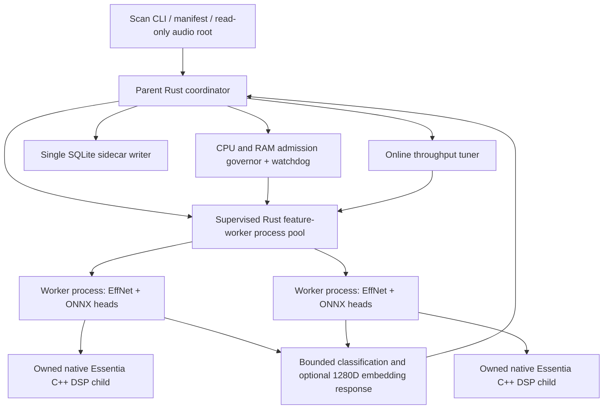

# Isolating ONNX inference in killable worker processes

**Status (28 October 2026): Phase C IPC / supervised-process vertical slice implemented in Draft PR #19, but actual ONNX inference isolation is NOT implemented.** This is the next safety boundary for experimental online autotune, after scan-local cancellation of native Essentia IPC and the experimental FFmpeg child. It must not change model evaluation, preprocessing, embedding sums, classifier scores, or SQLite storage semantics.

## Why cooperative checks are insufficient

Today each Rust worker thread owns an `ort::Session` for Discogs-EffNet and each selected Mood/Genre/Voice head. A RAM alarm sets a scan-local `Arc<AtomicBool>`, but a single `Session::run()` or `commit_from_file()` cannot be reliably preempted by Rust while ONNX Runtime holds memory. The old Rust audio decoder also blocked inside `ffprobe/ffmpeg .output()`; PR #19 now adds an opt-in supervised, bounded, cancellable subprocess path for that decoder. A 250-ms watchdog alone cannot guarantee against sudden allocations between samples, nor reclaim memory already held by an uninterruptible ONNX invocation.

A **killable process boundary** is the straightforward way to reclaim ORT memory when a scan exceeds its resource envelope. This is not yet a claim that out-of-memory events can always be prevented; the OS may terminate a process first. Also distinguish avoiding an OOM from handling a detected OOM cleanly.

## Proposed structure

The parent owns all sidecar writes, task selection and deduplication. Each worker process keeps its **own** persistent ONNX sessions and native DSP child; no ONNX environment is shared between worker processes. A worker can serve many songs. An admission-cap reduction stops new dispatch and lets old requests finish; a watchdog hard-stop kills the **entire supervised process subtree**, not only the Rust worker thread.

## IPC and resource contract

- **Versioned binary protocol** with a strict maximum frame length, request ID and exact selected model identity. Reject unknown protocol versions, excessive counts, malformed floats, truncated responses, duplicate completion IDs and outputs from the wrong worker/request. Use stdin/stdout pipes; keep diagnostics on stderr. Do not serialize/transport raw patch tensors or PCM across the parent-child boundary.
- One request contains sanitized track identity/source path, relevant validated model fingerprints and whether the optional pooled 1280D embedding is required. Parent validates the source root and read-only paths before dispatch; worker never opens Bliss/SQLite databases for writing.
- Worker response includes classifier scores and their labels/model keys (Mood/Genre/Voice), optional 1280D embedding, audio hash, patch count and per-stage timing. The parent is still the sole authority for atomic SQLite persistence. Preserve existing preprocessing/cache fingerprint versions unless **numerical parity** demands an explicitly versioned change.
- **Bounded IPC, outstanding requests and work:** only one in-flight task per worker process; no unbounded response queue; capped stderr, frame sizes and worker startup concurrency. Spawn workers lazily under resource admission. Run a short warmup outside scored probe windows.
- On timeout or memory fault, terminate the *owned* worker process tree and reap it; reject or flag all pending requests for that process as failed. Do not silently retry potentially changed audio. Never persist partial classification/embedding records. Abort the scan on memory-safety violation rather than success-with-missing-tracks.
- Windows: process Job Object with kill-on-job-close for worker plus descendants, retain a handle until confirmed exit. Linux: a supervised process group, with cgroup v2 containment when available; check PID-reuse safety and cgroup OOM events. macOS: verify process-group termination and RSS telemetry independently. Do not claim that merely dropping `std::process::Child` terminates descendants.
- Charge actual observed private/RSS memory and available RAM/cgroup headroom to the parent governor. Worker/child startup may temporarily double load and must fit the budget. Enforce host and process/cgroup CPU limits separately from throughput optimization. When telemetry is missing or inconsistent, fail closed in `autotune`.

## Implemented Phase C vertical slice (experimental, not on the scan path)

- `src/feature_worker_process.rs` provides a **hidden** `internal-feature-worker` mode in the existing `bliss-mood` executable. The child sends a four-byte `FWP1` handshake, then accepts persistent `REQ1` messages and emits `RES1` replies. The wire format is a strict **8-byte header** (four-byte magic, little-endian `u32` length) followed by **bounded JSON**; payloads must be 1–65,536 bytes. The protocol is explicitly versioned (`1`), requests must have a nonzero monotonically increasing `request_id`, and responses must match the request ID and version. Invalid/truncated frames fail closed.
- The supervised parent-side `FeatureWorkerProcess` owns a direct `std::process::Child`, stdin/stdout, hard wall-clock timeout and scan-local `Arc<AtomicBool>` cancellation flag. A small transport thread handles blocking pipes, while the owning thread polls the cancellation token (100 ms) and uses direct Child kill/reap before joining the pipe transport on failure. Persistent workers can serve multiple requests. **No process-group / descendant-tree kill is implemented yet**.
- The only operations are **synthetic `Ping`, `Shutdown` and a bounded `TestDelay`** for timeout/cancellation tests. They process no music, access no SQLite and load no ONNX. TestDelay is strictly limited to 10 seconds, has no path/executable argument and is not part of the public CLI. There is no song-analysis operation or integration with `scan-features` yet.
- `tests/feature_worker_process.rs` starts the **actual compiled CLI binary** and verifies repeated ping replies, shutdown, a delayed child killed before its sleep finishes, isolation of two independent cancellation flags, and oversized/malformed or duplicate-ID protocol failure. Unit tests also check frame bounds, magic/version matching, and serialization. GitHub CI must be inspected at the **exact new head**; these tests cannot establish 56/87/2-head or 1280D embedding numerical parity.
- Existing `scan-features` behavior, its `resource` default, its experimental `autotune` execution, and all SQLite/audio ownership rules remain unchanged. Do not claim that the current implementation resolves ONNX memory spikes or provides an OOM guarantee.

## Migration boundaries

1. **First vertical slice — partial implementation complete:** the hidden same-executable worker, bounded/versioned IPC, repeated synthetic requests, malformed input, direct-child timeout/reap and cross-scan cancellation tests now exist. **Still needed before calling this slice complete:** direct-child crash/restart handling, reliable cross-platform *descendant* termination, full hard-timeout smoke coverage on Windows, and verified CI for the exact implementation. No ONNX or SQLite mutation is performed in the worker.
2. **Extract the complete feature execution engine** into the internal worker: native Essentia C++ decoding plus shared EffNet inference plus selected heads, with optional embedding. Keep the parent as read-only source-selector and sole persistent writer. Maintain the current multi-head single-EffNet-pass algorithm and numerical order.
3. **Supervision/termination:** implement owned worker child/process-tree teardown on all targeted platforms. An injected simulated runaway ORT operation must be terminable without waiting for its runtime call to return. Exercise low-RAM cgroups and Windows Job Object behavior; do not rely on quick cancellation flags alone.
4. **Opt-in A/B parity:** identical private manifest/song metadata + model hashes, fixed same source bytes, compare all 56/87/2 classifier heads, 1280D pooled vectors, hash, model keys and patch counts against the existing native C++ frontend in **exact equivalence** where required. Do not publish local audio, private manifest or sidecars. Compare wall time, startup/idle resource overhead, process-tree private RAM, watchdog response and throughput at each candidate worker count.
5. **Only after the above pass:** let `--adaptive-policy autotune` select process-isolated feature workers. Keep `--adaptive-policy resource` and fixed workers compatible with their validated behavior until separately authorized to change them.

## Open design questions / measurable decisions

The parent will need to choose between prewarming workers and starting them on demand, including the cost of ONNX session allocations on a Raspberry Pi 4B. Consider a memory cost estimate **per selected model set** and observed peak per worker, instead of a universal fixed worker-memory estimate. The current online tuner uses complete-drain probe boundaries and forward/reverse repeated sweeps, but songs' patch counts do not fully normalize decode complexity or NAS load. Throughput optimization needs a measured *whole-scan* objective including startup and worker-transition overhead, and repeated/interleaved comparable song cohorts. Guardrail violations must take precedence over any throughput benefit.

## Related source

- `src/features.rs` — existing parent/worker-thread scan coordination and ONNX FeatureEngine.
- `src/essentia_worker.rs` — owned native C++ IPC child with existing cancel/reap behavior.
- `src/memory_watchdog.rs` — scan-local RAM watchdog and cancellation token.
- `src/audio_decode.rs` — supervised, cancelable FFmpeg/ffprobe path **only when an autotune cancellation token is provided**.
- `src/autotune.rs` — bounded RAM-gated nonmonotonic worker exploration.
- `docs/online-autotune-phase-b.md` — current Phase B implementation and verification limits.
