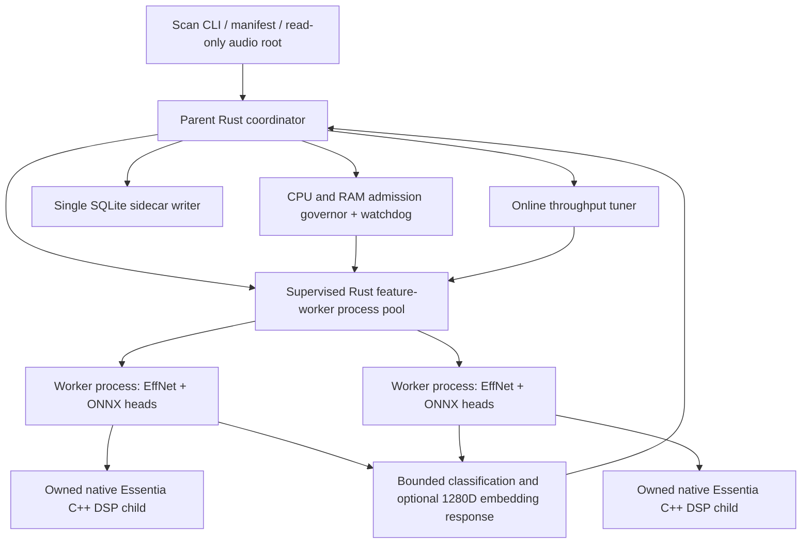

# Isolating ONNX inference in killable worker processes

> **Live implementation/CI audit, 28 October 2026:** See [current Phase C handover](handover-phase-c-isolated-worker-20261028.md). On inspected source `e2b1a0a4bd256d88e8704abcc8bf158878296ddc`, the hidden child actually runs initialized `FeatureEngine` inference and can return optional 1280D pooled embeddings. The exact direct-versus-isolated comparator is implemented but has **no recorded private real-model parity PASS**. The parent `scan-features` remains on the old in-process worker-thread path. Rust tests/Clippy, Windows binary, Genre and Voice workflows passed; **Linux and Windows native Essentia workflows failed**, the former due to missing `crate::resources` in the ONNX-free `rust-mel-reference` crate. Windows pinned-source integrity failure requires investigation, not pin bypass. Unix process-group teardown does **not** equal Windows process-tree containment. Treat older "first synthetic slice" wording below as historical milestones, not the current endpoint.


**Status (28 October 2026): staged real-FeatureEngine child execution is implemented in Draft PR #19, but not integrated into `scan-features`, not numerically parity-validated on real audio and not production RAM-safe.** This is the next safety boundary for experimental online autotune, after scan-local cancellation of native Essentia IPC and the experimental FFmpeg child. It must not change model evaluation, preprocessing, embedding sums, classifier scores, or SQLite storage semantics.

## Why cooperative checks are insufficient

Today each Rust worker thread owns an `ort::Session` for Discogs-EffNet and each selected Mood/Genre/Voice head. A RAM alarm sets a scan-local `Arc<AtomicBool>`, but a single `Session::run()` or `commit_from_file()` cannot be reliably preempted by Rust while ONNX Runtime holds memory. The old Rust audio decoder also blocked inside `ffprobe/ffmpeg .output()`; PR #19 now adds an opt-in supervised, bounded, cancellable subprocess path for that decoder. A 250-ms watchdog alone cannot guarantee against sudden allocations between samples, nor reclaim memory already held by an uninterruptible ONNX invocation.

A **killable process boundary** is the straightforward way to reclaim ORT memory when a scan exceeds its resource envelope. This is not yet a claim that out-of-memory events can always be prevented; the OS may terminate a process first. Also distinguish avoiding an OOM from handling a detected OOM cleanly.

## Proposed structure



The parent owns all sidecar writes, task selection and deduplication. Each worker process keeps its **own** persistent ONNX sessions and native DSP child; no ONNX environment is shared between worker processes. A worker can serve many songs. An admission-cap reduction stops new dispatch and lets old requests finish; a watchdog hard-stop kills the **entire supervised process subtree**, not only the Rust worker thread.

## IPC and resource contract

- **Versioned binary protocol** with a strict maximum frame length, request ID and exact selected model identity. Reject unknown protocol versions, excessive counts, malformed floats, truncated responses, duplicate completion IDs and outputs from the wrong worker/request. Use stdin/stdout pipes; keep diagnostics on stderr. Do not serialize/transport raw patch tensors or PCM across the parent-child boundary.
- One request contains sanitized track identity/source path, relevant validated model fingerprints and whether the optional pooled 1280D embedding is required. Parent validates the source root and read-only paths before dispatch; worker never opens Bliss/SQLite databases for writing.
- Worker response includes classifier scores and their labels/model keys (Mood/Genre/Voice), optional 1280D embedding, audio hash, patch count and per-stage timing. The parent is still the sole authority for atomic SQLite persistence. Preserve existing preprocessing/cache fingerprint versions unless **numerical parity** demands an explicitly versioned change.
- **Bounded IPC, outstanding requests and work:** only one in-flight task per worker process; no unbounded response queue; capped stderr, frame sizes and worker startup concurrency. Spawn workers lazily under resource admission. Run a short warmup outside scored probe windows.
- On timeout or memory fault, terminate the *owned* worker process tree and reap it; reject or flag all pending requests for that process as failed. Do not silently retry potentially changed audio. Never persist partial classification/embedding records. Abort the scan on memory-safety violation rather than success-with-missing-tracks.
- Windows: process Job Object with kill-on-job-close for worker plus descendants, retain a handle until confirmed exit. Linux: a supervised process group, with cgroup v2 containment when available; check PID-reuse safety and cgroup OOM events. macOS: verify process-group termination and RSS telemetry independently. Do not claim that merely dropping `std::process::Child` terminates descendants.
- Charge actual observed private/RSS memory and available RAM/cgroup headroom to the parent governor. Worker/child startup may temporarily double load and must fit the budget. Enforce host and process/cgroup CPU limits separately from throughput optimization. When telemetry is missing or inconsistent, fail closed in `autotune`.

## Implemented Phase C vertical slice (experimental, not on the scan path)

- `src/feature_worker_process.rs` provides a **hidden** `internal-feature-worker` mode in the existing `bliss-mood` executable. The child sends a four-byte `FWP1` handshake, then accepts persistent `REQ1` messages and emits `RES1` replies. The wire format is a strict **8-byte header** (four-byte magic, little-endian `u32` length) followed by **bounded JSON**; payloads must be 1–65,536 bytes. The protocol is explicitly versioned (`1`), requests must have a nonzero monotonically increasing `request_id`, and responses must match the request ID and version. Invalid/truncated frames fail closed.
- The supervised parent-side `FeatureWorkerProcess` owns a direct `std::process::Child`, stdin/stdout, hard wall-clock timeout and scan-local `Arc<AtomicBool>` cancellation flag. A small transport thread handles blocking pipes, while the owning thread polls the cancellation token (100 ms) and uses direct Child kill/reap before joining the pipe transport on failure. Persistent workers can serve multiple requests. **No process-group / descendant-tree kill is implemented yet**.
- Existing synthetic `Ping`, `Shutdown` and bounded `TestDelay` operations remain. **Added `Initialize` and `AnalyzeSong` operations**: the hidden worker calls the existing `features::load_profiles`, `retarget_profiles` and `FeatureEngine::with_backend`, keeps exactly one initialized EffNet/selected-head session set, then calls its normal `analyze` and optional `take_song_embedding`. The initialization reply carries selected model IDs and their **validated existing cache-model fingerprints**; the analysis reply carries a full `FeatureReport` and optional 1280D `SongEmbedding`, serialized to bounded JSON, and does not write SQLite. Re-initialization and analysis without initialized models fail closed. No new ONNX mathematics or preprocessing is introduced.
- `tests/feature_worker_process.rs` starts the **actual compiled CLI binary** and verifies repeated ping replies, shutdown, a delayed child killed before its sleep finishes, isolation of independent cancellation flags, oversized/malformed or duplicate-ID protocol failure, uninitialized song rejection, failed missing-model initialization, and no unwanted SQLite/partial report creation from the hidden parity CLI. Protocol unit tests additionally check frame bounds, magic/version matching, and **bit-exact 1280D float serialization alongside three synthetic classification heads**. The hidden **`internal-isolated-analyze-features`** CLI makes an actual initialize/analyze/shutdown round trip with locally installed models and emits JSON without persistence. `scripts/compare_isolated_feature_worker.py` compares every selected classifier `f32` bit pattern, model fingerprint, head, audio hash and patch count against the ordinary `analyze-features --json` command. With `--embedding`, it additionally runs a **hidden in-process `internal-direct-analyze-features` diagnostic** using the same existing `FeatureEngine`, verifies the direct diagnostic report still matches the original CLI, and compares **all 1280 pooled embedding `f32` components bit for bit** against the isolated worker, alongside embedding fingerprint, pooling, normalization, model and audio identity. This creates a complete **executable parity gate**, but **does not yet constitute a passed real-music parity measurement**; private local audio and official model files are still required. All comparison runs must be performed locally with private audio and model files; their output is never committed. Test-fixture unit cases are included in the Rust CI workflow.
- Existing `scan-features` behavior, its `resource` default, its experimental `autotune` execution, and all SQLite/audio ownership rules remain unchanged. The isolated client now starts its own Unix process group and signals that group **before reaping** the worker on timeout/cancellation, addressing descendant teardown where descendants remain in that group. **Windows Job Object confinement and macOS/Linux process-group stress verification remain open.** Do not claim that the current implementation resolves ONNX memory spikes in the regular scanner or provides an OOM guarantee.

## Private local numerical acceptance procedure (not yet executed)

Run a build compiled from the **same exact PR #19 source SHA**, with the original official ONNX files and original native Essentia C++ executable already available locally. The script reads audio but writes **no** sidecars, scores or embeddings; it prints only aggregate pass/fail and the first differing model/label/dimension. For example, substituting locally verified paths:

```text
python scripts/compare_isolated_feature_worker.py \
  --exe <path-to-matching-bliss-mood-binary> \
  --source <private-track.wav> \
  --models-dir <official-onnx-model-directory> \
  --models moodtheme,genre,voice \
  --audio-backend essentia \
  --essentia-worker <native-cpp-worker-executable> \
  --embedding
```

This executes three read-only analyses when `--embedding` is set: public direct classification, hidden in-process embedding diagnostic, and hidden isolated process analysis. It requires exact classifier `f32` parity for all selected heads and exact `f32` pooled 1280D embedding parity, preserving all model/cache fingerprints. **Timing fields are intentionally excluded** from equivalence because process startup changes them. Repeat across a bounded heterogeneous manifest and compare elapsed time/RSS separately; a PASS for one track is not proof of parity across the whole library. A failed exact comparison must be investigated before considering tolerance changes. The hidden isolated path still lacks Windows descendant kill guarantees and is **not** the normal scanner.

## Migration boundaries

1. **First vertical slice — partial implementation complete:** the hidden same-executable worker, bounded/versioned IPC, repeated synthetic requests, malformed input, direct-child timeout/reap and cross-scan cancellation tests now exist. **Still needed before calling this slice complete:** direct-child crash/restart handling, reliable cross-platform *descendant* termination, full hard-timeout smoke coverage on Windows, and verified CI for the exact implementation. No ONNX or SQLite mutation is performed in the worker.
2. **FeatureEngine extraction — staged, not promoted:** the hidden child can now execute the identical native Essentia/Rust preprocessing + shared EffNet + selected Mood/Genre/Voice heads, returning the original report and optional embedding, with no DB writes. **Still required:** compare real private audio/model outputs for all heads and 1280D embeddings, validate persistent multi-song execution and protocol-envelope capacity, and then integrate the parent-owned process pool into `scan-features` only after all parity/safety gates.
3. **Supervision/termination:** implement owned worker child/process-tree teardown on all targeted platforms. An injected simulated runaway ORT operation must be terminable without waiting for its runtime call to return. Exercise low-RAM cgroups and Windows Job Object behavior; do not rely on quick cancellation flags alone.
4. **Opt-in A/B parity:** identical private manifest/song metadata + model hashes, fixed same source bytes, compare all 56/87/2 classifier heads, 1280D pooled vectors, hash, model keys and patch counts against the existing native C++ frontend in **exact equivalence** where required. Do not publish local audio, private manifest or sidecars. Compare wall time, startup/idle resource overhead, process-tree private RAM, watchdog response and throughput at each candidate worker count.
5. **Only after the above pass:** let `--adaptive-policy autotune` select process-isolated feature workers. Keep `--adaptive-policy resource` and fixed workers compatible with their validated behavior until separately authorized to change them.

## Open design questions / measurable decisions

The parent will need to choose between prewarming workers and starting them on demand, including the cost of ONNX session allocations on a Raspberry Pi 4B. Consider a memory cost estimate **per selected model set** and observed peak per worker, instead of a universal fixed worker-memory estimate. The current online tuner uses complete-drain probe boundaries and forward/reverse repeated sweeps, but songs' patch counts do not fully normalize decode complexity or NAS load. Throughput optimization needs a measured *whole-scan* objective including startup and worker-transition overhead, and repeated/interleaved comparable song cohorts. Guardrail violations must take precedence over any throughput benefit.

## Related source

- `src/features.rs` — existing parent/worker-thread scan coordination and ONNX FeatureEngine.
- `src/essentia_worker.rs` — owned native C++ IPC child with existing cancel/reap behavior.
- `src/memory_watchdog.rs` — scan-local RAM watchdog and cancellation token.
- `src/audio_decode.rs` — supervised, cancelable FFmpeg/ffprobe path **only when an autotune cancellation token is provided**.
- `src/autotune.rs` — bounded RAM-gated nonmonotonic worker exploration.
- `src/feature_worker_process.rs` — versioned IPC, persistent model-worker client, Linux/macOS process-group teardown and hidden child server.
- `scripts/compare_isolated_feature_worker.py` — read-only local exact f32 classifier/identity and optional full 1280D direct-vs-isolated vector comparison; `--embedding` adds a third hidden in-process diagnostic for a direct reference.
- `tests/feature_worker_process.rs` — compiled-binary IPC and missing-model safety integration tests.
- `docs/online-autotune-phase-b.md` — current Phase B implementation and verification limits.

## CI staging gate for the executable process boundary (2026-10-28)

The Linux native Essentia workflow now explicitly executes the existing exact direct-versus-isolated comparator with **actual official ONNX sessions** and generated copyright-free mono WAV/stereo FLAC, including every pooled 1280D f32 embedding component. The check is run only after the original native backend and production Rust CLI have compiled and the matching official model files/metadata have been obtained; it is a test of the hidden `FeatureEngine` child, not `scan-features` workerpool integration. See [current handover](handover-phase-c-isolated-worker-20261028.md). CI success is *not* the private real-song gate and does not prove Windows process-tree containment or OOM immunity.

## Initial actual-model synthetic parity result (28 October 2026)

[Linux native Actions 40681621668](https://github.com/chrober/bliss-mood-poc/actions/runs/40681621668) passed its new three-case direct-vs-isolated `FeatureEngine` check using actual official ONNX weights, including exact f32 equality of **145 classification scores and all 1280 pooled embedding components** for each generated WAV/FLAC fixture. The two original Essentia C++ cases and the Rust frontend case each analyzed five patches. The matching official encoder/three-head SHA256 hashes are now also enforced in Linux CI. This confirms executable numerical parity on those deterministic **nonmusic** stimuli, not broader real-music parity, process-tree safety, or workerpool integration. See [authoritative handover](handover-phase-c-isolated-worker-20261028.md).

## Windows Job Object kill-on-close staged (2026-10-28)

The hidden opt-in Phase-C `FeatureWorkerProcess` supervisor now assigns **each Windows worker to its own unnamed Job Object before sending any initialization or analysis request**, with `JOB_OBJECT_LIMIT_KILL_ON_JOB_CLOSE`. If creation, configuration or assignment fails, the direct child is killed/reaped and no unconfined worker can analyze audio. On timeout, cancellation, normal owner drop and worker retirement, the parent closes its Job handle **before reaping** its child, targeting the entire still-contained process tree (including native Essentia/FFmpeg descendants). Existing Unix process-group logic is unchanged. No new native DLL, Cargo dependency, model arithmetic or production `scan-features` behavior is introduced.

Windows-only regression spawns an actual PowerShell child and grandchild, verifies the grandchild's Job membership via `IsProcessInJob`, closes the owner Job and checks the descendant process handle is signaled within five seconds. The Windows MSVC `cargo test --locked` workflow exercises this test. These are staged source changes **awaiting fresh exact-head Windows CI**. Caveats: the worker itself starts before assignment but cannot receive a request or launch model descendants until assigned; explicit breakaway by descendants and arbitrary third-party orphaning, Windows resource-limit accounting, RAM safety and macOS/Pi testing remain outside this bounded acceptance.
