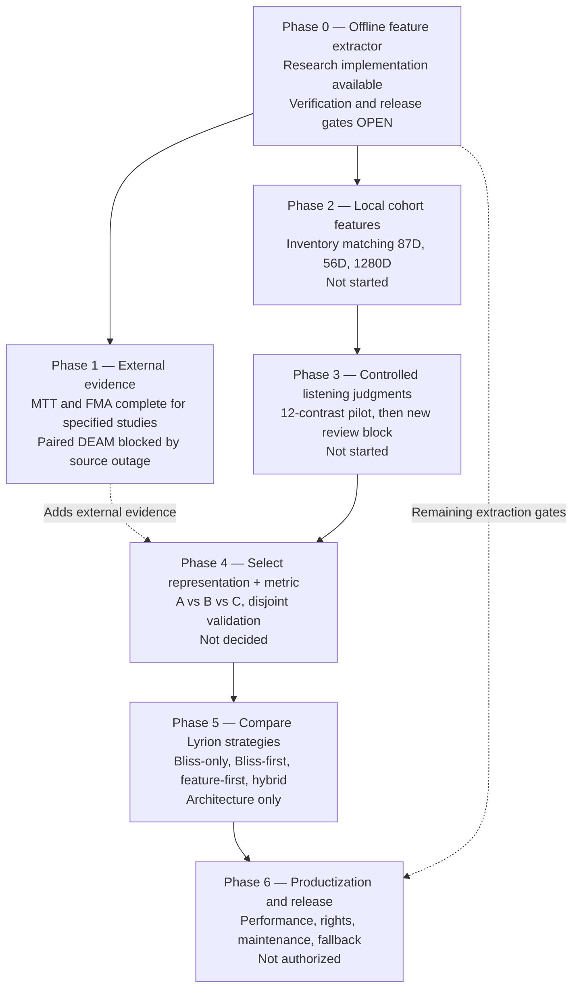
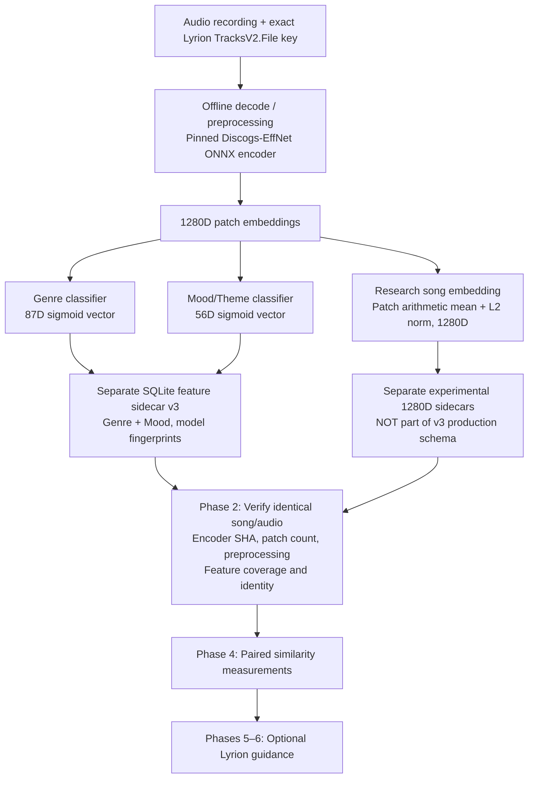
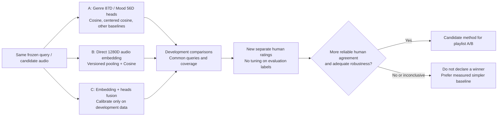
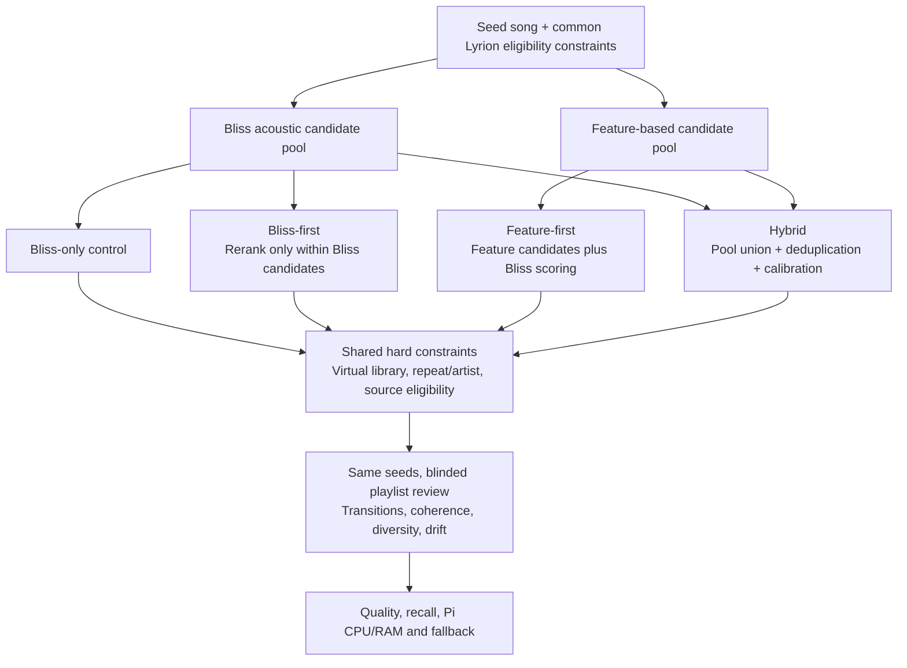

# Roadmap: From song features to validated similarity and Lyrion playlist integration

**Updated:** October 21, 2026 · **Status:** Research and integration roadmap, not a production release plan ·
**Repository:** `chrober/bliss-mood-poc` · **Branch:** `feat/similarity-metric-evaluation` ·
**Pull request:** [#16 (Draft)](https://github.com/chrober/bliss-mood-poc/pull/16)

> **Goal:** Identify a defensible mathematical method for comparing songs in a real
> Lyrion library, then determine whether using it improves real playlists and their
> transitions. Genre proximity, mood/energy, general timbral similarity, and
> suitability as the next track are **distinct targets**. A similarity score is not
> automatically a calibrated probability of a good playlist transition.

## 1. Executive summary and corrected phase-0 status

**Phase 0 must NOT be labelled “completed.”** The research feature-extraction
implementation is available and has passed significant synthetic, single-track,
and dataset-level gates, but not every broader numerical parity, data-quality,
cross-platform, licensing, and product-readiness requirement has been met.

The distinction is essential:

- **Phase 0 — Implement, verify, and harden offline feature extraction.**
  The basic extractor works experimentally; **the phase remains partially
  complete**, with explicit release-blocking parity and operational gates.
- **Phase 2 — Make a small local comparison cohort complete and compatible.**
  Inspect features for **the same library songs** and export missing 1280D
  vectors only for a bounded sample. This does **not** mean scanning the
  entire library or approving the feature extractor for production.
- **Phase 6 — Production feature lifecycle and deployment.**
  Only after method selection, listening evidence, validated runtime behavior,
  rights review, and rollback planning would a production-wide feature inventory
  be built and maintained.

The next small packages are: (N1) verify the DEAM archive source **without
building Rust**; (N2) independently inspect existing library feature
coverage in read-only mode; (N3) run the already-prepared paired DEAM
comparison if provenance is verified; (N4) pilot a controlled local
listening protocol; then proceed to distinct model-selection,
playlist-strategy, and release gates.

### Overall dependency graph

The 0–6 numbers denote logical phases, **not completion percentages**.
Phase 1 and phase 2 can advance separately: an inaccessible DEAM
publisher must not block local, read-only preparation.

## 2. Where do “analyzed song features” belong?

**Producing features is phase 0; inspecting and completing matching features
for a local validation sample is phase 2; operating an approved,
complete production feature catalogue is phase 6.**

### What exists, and what is still missing?

The capability-based CLI already provides offline feature extraction,
a model registry, schema-v3 Genre/Mood storage, and an optional experimental
1280D export derived directly from the same encoder patches in the pinned
Rust-v5 research build. Synthetic numeric smoke tests, ONNX-thread
comparisons, and external-dataset runs have passed for their **declared
scopes**. The successful single-song C++ comparison must **not** be
misrepresented as broad C++ parity over an entire library.

Remaining phase-0 and production-related validation includes: broader
real-audio reference parity across codecs/sample rates and machines;
reproducible model/frontend/decoder provenance; failure and corrupt-input
handling; operational performance/resource controls; distribution and
licensing decisions; and confirmed correctness of any final packaging on
the intended platforms. Some of these checks are relevant during phase 6
as well, but their absence means phase 0 cannot be called fully done.

Locally stored 87D/56D features are **not evidence that corresponding
1280D song embeddings are already persisted**. The latter are presently
separate versioned research outputs and may require targeted extraction.
Never silently modify existing SQLite rows or infer exact track identity
from artist/title strings. Do not run ONNX inference during playlist generation.

## 3. Status and acceptance criteria by phase

| Phase | Current status | Small deliverable | Exit criteria |
| --- | --- | --- | --- |
| **0. Offline extraction foundation** | **Partially complete — research-ready, NOT production-validated** | Audit remaining parity, frontend, model hashes, invalid inputs, deployment/release concerns; keep existing reproducible tests | The required numerical correctness, provenance, and platform gates are explicitly passed before production use |
| **1. External evidence** | **MTT/FMA studies completed; paired DEAM A/B source-blocked** | Isolated official-source/mirror preflight, then frozen DEAM-240 rerun | Complete paired results with exact 240-song sample, 197/43 strata, baseline replay, and coverage |
| **2. Local library cohort** | **Pending** | Read-only bounded audit of matching Genre/Mood/1280D song records; add only missing sample embeddings | Same file identity, compatible model and audio hashes, all requested representations present |
| **3. Human listening evidence** | **Eight-item pilot only; not sufficient** | New ~12-contrast instrument check, then fresh ~24–40-pair review block | Both positive/negative examples, distinct human rating axes, review confidence, predefined analysis |
| **4. Similarity selection** | **No selected winner** | Fair A/B/C paired evaluation and independent review | Human agreement, coverage, uncertainty, stability, understandable trade-offs; no evaluation leakage |
| **5. Lyrion playlist strategy** | **Integration concept only; no product choice** | Compare Bliss-only vs Bliss-first, feature-first, and hybrid under common constraints | Blinded transition/coherence reviews plus candidate recall, drift/repeats, Pi latency, and fallback |
| **6. Deployment/release** | **Not started / not approved** | Controlled opt-in, rights checks, feature lifecycle, resource tests and rollback | Proven build/runtime correctness, rights, repeatability, measured quality, reliable Bliss-only fallback |

### Phase 0: technical implementation vs validation

Research implementation and measurements exist; no new scanner architecture
is needed immediately. Preserve the model/frontend and SQLite contracts
and investigate known remaining reference-parity scope before
production claims. Keep scanner optimization separate from selecting
the similarity representation. The adaptive multiworker `scan-features`
orchestration is not proof that the per-song `analyze-features` benchmark
uses adaptive workers.

FMA's selected-song cache is another **research infrastructure**
milestone, not feature validation:
[cold run 39632517381](https://github.com/chrober/bliss-mood-poc/actions/runs/39632517381)
and [warm cross-workflow run 39633485262](https://github.com/chrober/bliss-mood-poc/actions/runs/39633485262)
passed. Around 74 MB of curated audio was restored instead of
re-downloading the original 7.2-GiB archive. Access to Actions caches
must still be treated as potentially public; source audio licences
are not overridden by successful CI.

### Phase 1: external scientific evidence, with limits

| Dataset / reference target | Measured findings | Interpretive constraint |
| --- | --- | --- |
| **MagnaTagATune (MTT)** — humans choose the odd song in a triple | On 293 human-majority-decidable questions: direct 1280D Embedding Cosine **182/293 = 62.12%**; Mood Centered Cosine **193/293 = 65.87%** | All 346 unique questions have been explored; 53 have human majority ties. There is **no remaining new MTT holdout** |
| **FMA-Small official VALIDATION** — coarse same-genre retrieval | Same 80 artist-distinct songs: embedding P@5 **0.2800**, Genre Cosine **0.3200**, Genre Centered Cosine **0.3225** | Genre labels are a proxy, not musical transition judgments. Previously explored validation cohort, **FMA official TEST left untouched** |
| **DEAM, screened 240-song cohort** — human mean valence/arousal proximity | Earlier filtered Mood Cosine mean-query Spearman against VA **0.28678455**; direct 1280D-vs-head comparison **not yet successfully completed** | Partial artist/title overlap screen does not establish train independence. `cvml.unige.ch:443` was unreachable in the latest source check |

Do not pool these task-specific numbers. The
same-query resampling sensitivity ranges are **not**
independent population confidence intervals when candidates overlap.
MTT already contains direct human triplet judgments but has
no untouched test questions; FMA VALIDATION and DEAM's explored
cohort are development evidence, not independent final tests.

The paired DEAM comparator and its frozen fingerprint regression
passed Linux and Windows tests. A later GitHub Actions run was blocked
**before** inference by the official publisher's unreachable TCP/HTTPS
endpoint; the fast-fail preflight now avoids unnecessary Rust builds.
A substitute source must be verified against source archive SHA256,
contents, and applicable rights. If unavailable, proceed to phase 2,
not another speculative benchmark.

### Phase 2: read-only local cohort audit

1. Select a **small, bounded subset** already analyzed, using exact
   original `TracksV2.File` keys and LMS identity checks.
2. Inspect existing schema-v3 rows for the correct 87/56 dimensions,
   ordered class lists, encoder and head SHA256, preprocessing version,
   patch counts, audio hashes, duplicates, and missing vectors.
3. Determine whether experimental 1280D song-embedding sidecars exist
   for **those same files**. Do not assume the internal 1280D
   encoder pass was ever saved as a song-level vector.
4. When needed, run a targeted, version-pinned export for only those
   songs. Keep the existing feature database untouched. Avoid a full
   library scan, local Windows Rust rebuild, or upstream PR changes.
5. Freeze a private sample manifest before proposing listening pairs;
   do not score pairs with silently incompatible feature provenance.

### Phase 3: listening protocol and new human reference

The earlier eight-pair pilot yielded **zero Genre positives**
and eight Genre negatives; Mood had four positives and four negatives.
Its model-influenced selection and tiny size prevent a credible
general comparison. Preserve the original ratings unmodified.

The next pilot is approximately **12 new contrasts**:
four human-identified similar controls, four clearly different
controls, and four cases on which A/B predictions conflict. The
last category is a selected challenge set, **not** a random or
independent test. Blind participants to model choice, score, rank,
and selection stratum (artists/titles may remain visible for finding
the recordings). Capture separate ratings for (1) style/genre,
(2) mood/energy, (3) overall audible similarity, and (4) suitability
as the immediate next playlist song. Permit „cannot assess“, low
confidence, and comments.

Only after the protocol works should a **separate, unseen
approximately 24–40-pair review block** be frozen, with artist/album
grouping and development/evaluation separation fixed beforehand.
Do not tune methods to its labels or overstate the statistical
precision of a small study.

### Phase 4: choose the representation and mathematical metric

**A** compares the 87D Genre and 56D Mood/Theme sigmoid-head
scores with cosine, centered cosine, and other pre-existing
distance functions. These activations are not calibrated
song-similarity probabilities.

**B** compares direct 1280D Discogs-EffNet song embeddings
currently pooled by patchwise arithmetic mean followed by song L2
normalization. The underlying encoder was not demonstrated to be
specifically trained for this exact pairwise similarity target.
Independently pre-trained contrastive models may be evaluated
later with a frozen protocol; training an entirely new model is
not justified by current evidence alone.

**C** combines A and B only after explicitly defining score
normalization and calibration on disjoint development data.
The prior fixed local MTT rank-fusion ablations are exploratory,
not proof of a transferable global score or optimal weighting.

Evaluate on the same songs, anchor/candidate pools, abstention
denominators, and human axes; check representation coverage,
artist/genre robustness, uncertainty and computational cost.
Avoid selecting a complicated method when the evidence does
not establish a meaningful advantage over a simpler baseline.

### Phase 5: separate choice of *playlist candidate strategy*

**A/B/C are representations and similarity functions.
Bliss-first / feature-first / hybrid describe how Lyrion
*generates and filters candidate tracks*. They are two distinct
decisions: fusion of features is not the same as a union of
candidate pools.**

Bliss-first has lower implementation risk and offers a straightforward
reversible experiment, but its candidate recall is constrained by
Bliss's initial pool. Feature-first requires a separate neighbor
index/retrieval source and host candidate admission support.
Hybrid combines pools and must handle duplicate tracks, evidence
calibration, drift and common eligibility requirements. No model
or strategy is the current product winner. Always include
**Bliss-only** as a listening and performance control.

### Phase 6: operational integration and release gates

Only after phase-4/5 decisions and the outstanding phase-0
correctness gates:

- **Behavior:** Optional plugin/BlissMixerLab experiment, neutral
  default weights, unchanged Bliss-only behavior when disabled,
  read-only sidecars, no ONNX during playlist generation.
- **Correctness:** Verified `TracksV2.File` / LMS mapping,
  model and class ordering, dimensions, preprocessing and
  hash compatibility, deterministic missing-feature fallback.
- **Performance:** Measure Raspberry Pi CPU/memory, P95 query
  latency, end-to-end scan time, index size, updates, and
  playlist construction under realistic collections.
- **Listening quality:** Blinded comparisons with matching
  seeds and restrictions; monitor transitions, diversity,
  artist repeats, stability, mood drift and failure cases.
- **Licensing:** Document original Essentia/ONNX, Rust/C++,
  FFmpeg and platform-runtime terms and distribution choices.
  Research dataset audio must not ship as application assets.
- **Operations:** Opt-in flag, observable diagnostics,
  reversible rollout, upgrade/rollback/backup plan; edit
  separate Lyrion-related repositories **only after
  explicit authorization**.

## 4. Immediate sequence with stop/go decisions

| Package | Dependency | Success criterion | When blocked |
| --- | --- | --- | --- |
| **N1. DEAM source-only preflight** | None | Publisher accessible or byte-for-byte/SHA/licence-verified alternative | Record outage; do N2 without waiting |
| **N2. Local feature inventory (L0)** | Experimental feature DB and exact local track mapping | Small read-only 87D/56D/1280D identity and coverage report | Target only missing research vectors |
| **N3. Paired DEAM-240 replay** | N1 successful | Same sample SHA and 197/43 cohorts, exact Mood-Cosine baseline, common candidate coverage, aggregate A/B report | No invented embedding-vs-Mood scores |
| **N4. Twelve-contrast pilot** | N2 successful | Review protocol usable; positive/negative controls and four human rating dimensions | Adjust prospective method; preserve old labels |
| **N5. New evaluation block** | N4 and predeclared method | Fresh artist-/album-aware observations with paired, untuned A/B/C evaluation | Remain exploratory |
| **N6. Playlist strategy test** | N5 and review | Bliss-only comparison, transition quality and safe candidate constraints | Keep experimental code opt-in |
| **N7. Production release** | N6 plus remaining phase-0 gates | Correctness, rights, platform budgets, feature lifecycle and rollback | No production integration |

**Work discipline:** One narrow change, one measurable acceptance
check, a short CI/result update, and only then the next change.
External source failures should be diagnosed before rebuilding models,
or downloading licensed audio.

## 5. Privacy, research safety, and boundaries

- Modify only `feat/similarity-metric-evaluation` for PR #16;
  keep the PR a draft. Do not merge to `main` or alter PR #13,
  PR #17, upstream Bliss, or the production mixer.
- Use GitHub Actions for Rust builds and cross-platform regression.
  Keep the user's music files, track identities, LMS URLs, private
  feature vectors and human judgments local. A new local study
  must be read-only until its separate procedure is approved.
- Selected MTT and FMA music caches are experimental and licensed;
  **GitHub Actions caches are not private storage**. Cache presence
  is not a redistribution authorization.
- Keep **FMA official TEST untouched**, and do not claim DEAM
  is provably independent of ONNX model training after an
  artist/title catalog-only overlap screen.
- Do not fabricate or edit human ratings from song names,
  class scores or benchmark labels. Distinguish human
  perceptual similarity from the quality of playlist transitions.

## 6. Further technical and historical documentation

- [Three feature representation approaches A/B/C](similarity-three-representation-approaches-handover-2026-10-21.md)
- [Scientific evidence and cross-dataset limits](similarity-cross-dataset-evidence-2026-10-21.md)
- [FMA 80-track paired evaluation and cache evidence](similarity-fma-embedding-ab-2026-10-21.md)
- [DEAM evaluation and official-host outage](deam-similarity-benchmark.md)
- [Local bounded review plan L0–L3](similarity-local-library-retest-plan-2026-10-21.md)
- [Head-vector similarity evaluation](similarity-metric-evaluation.md)
- [Bliss / feature-first / hybrid decision record](lyrion-bliss-mood-genre-integration.md)
- [External research data preflight and budget](similarity-external-evidence-roadmap-2026-10-21.md)
- [Conversation handover and verified runs](chat-handover.md)
