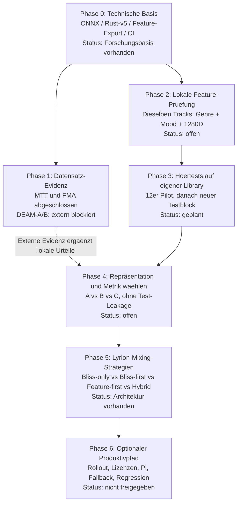
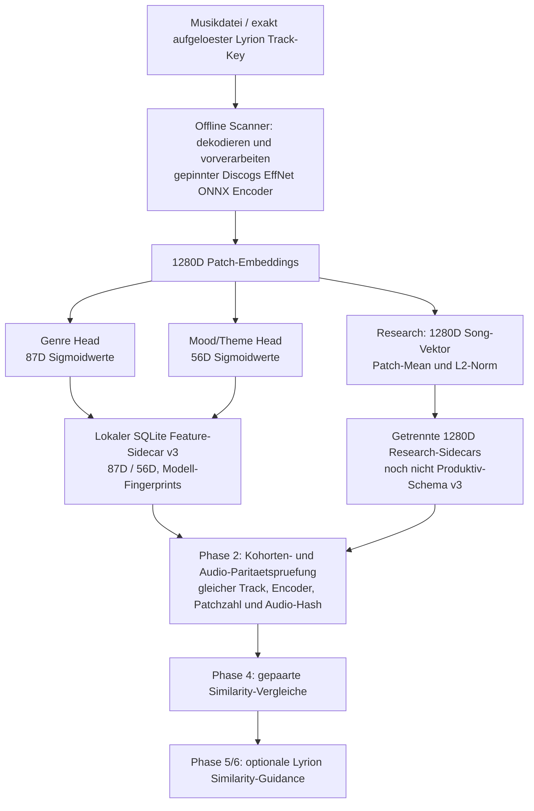
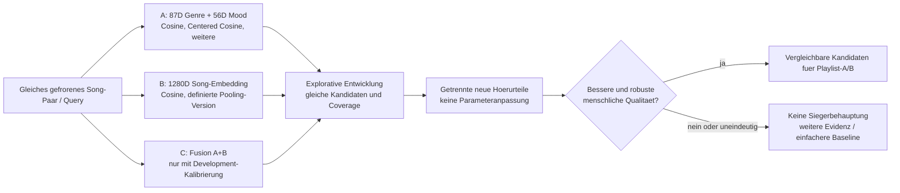
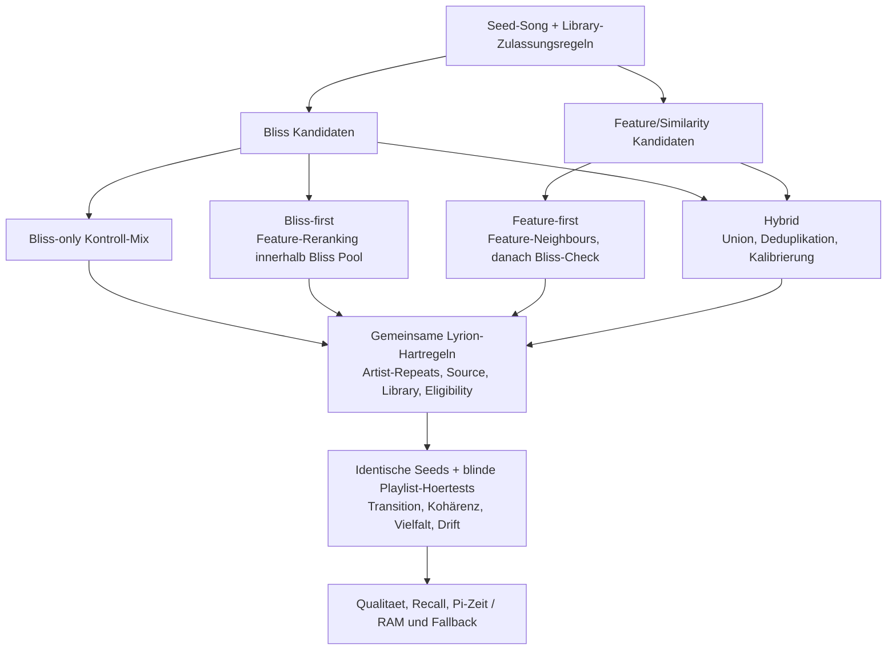

# Roadmap: Von Song-Features zur validierten Lyrion-Similarity und Playlist-Integration

**Stand:** 21. Oktober 2026 · **Status:** Forschungs-/Integrationsplan, kein Produktionsentscheid ·
**Repository:** `chrober/bliss-mood-poc` · **Branch:** `feat/similarity-metric-evaluation` · **PR:** [#16 (Draft)](https://github.com/chrober/bliss-mood-poc/pull/16)

> **Ziel:** Ein belastbar geeignetes Verfahren zur **Song-zu-Song-Ähnlichkeitsmessung**
> auf der realen Lyrion-Musikbibliothek finden und in einer optionalen,
> kontrollierten Lyrion-Playlist-Integration testen. Genre-Nähe,
> Stimmung/Niveau, allgemeine Klangähnlichkeit und Qualität des **nächsten**
> Playlist-Songs sind **verschiedene Zielgrößen**. Keine Ähnlichkeitszahl
> ist automatisch eine Wahrscheinlichkeit für „passt gut“.

## Executive Summary: Was jetzt, was später?

1. **DEAM-Quellencheck, ohne Rust-Build**: Verfügbarkeit des offiziellen Publishers
   prüfen; ggf. alternativen Download **erst nach Lizenz-/Archiv-SHA-Verifikation**
   zulassen. Der gepaarte DEAM-240-Evaluator und seine Tests sind vorbereitet,
   aber der externe Server ist aktuell nicht erreichbar.
2. **Unabhängig davon**: Kleine **read-only** Probe der bereits lokal
   analysierten Lyrion-Tracks hinsichtlich 87D Genre, 56D Mood und optionalem
   1280D-Embedding. Keine gesamte Bibliothek neu scannen.
3. **Lokaler 12-Kontraste-Hörpilot**, um Aufgabenstellung, Musikpräsentation,
   Positiv-/Negativkontrollen und Bewertungsskalen zu überprüfen. Danach
   getrennten, zuvor ungesehenen ca. 24–40-Paare-Block mit vorher fixiertem
   Auswertungsprotokoll planen.
4. Kandidaten **A (Genre/Mood-Köpfe), B (direktes 1280D-Embedding) und
   C (vorsichtig kalibrierte Fusion)** paarweise auf denselben Songs bewerten;
   keine Fusionsgewichte am späteren Testblock anpassen.
5. Erst danach drei eigenständige **Lyrion-Kandidatenstrategien**
   (Bliss-first, Feature-first, Hybrid) gegen Bliss-only überprüfen;
   Integration nur nach Qualitäts-, Ressourcen-, Lizenz- und
   Sicherheitsgates.

**Arbeitsregel:** Kleine, einzeln abgeschlossene Änderungen,
jeweils mit klarer Eingabe/Abnahme, CI-Nachweis und Dokumentationsupdate.
Kein großer Workflow-/Daten-/Mixer-Umbau in einem Schritt.

## 1. Gesamtfahrplan (Mermaid)

Die Prozentzahlen früherer Chat-Visualisierungen waren **nur grobe
Orientierung, kein gemessener Fortschritt**. Verbindlich sind
Status und Abnahmekriterien je Phase.

**Wichtig:** Phase 2 ist nicht von der Wiederherstellung des DEAM-Servers
abhängig. Phase 1 und 2 können in kleinen, getrennten Schritten fortschreiten.
Die übrigen Phasen haben explizite Qualitätsgates; fehlende Datensätze dürfen
nicht still durch bereits explorierte Testdaten „ersetzt“ werden.

## 2. Was bedeuten „analysierte Song-Features“ im Diagramm?

**Featureproduktion = Phase 0. Featurevollständigkeit und -paarung auf
der tatsächlichen Bibliothek = Phase 2. Flächendeckender
produktiver Featurebestand = frühestens Phase 6.**

### Ist die Feature-Analyse schon fertig?

- **Ja, als technische Forschungsfunktion:** Der korrigierte Rust-v5-Pfad
  mit ONNX-Modellen, offline Genre-/Mood-Scores und optionalem
  Forschungs-Embedding-Export existiert und wurde in mehreren
  **synthetischen und datensatzbasierten** CI-Experimenten ausgeführt.
  Die 1.280D-Exporte wurden **nicht als neues Feld in schema v3
  aufgenommen**.
- **Nicht generell für die komplette lokale Bibliothek verifiziert:**
  Die vorliegenden Genre-/Mood-Werte in der SQLite-Feature-DB
  müssen nach Song-Key, Kohorten-/Audio-Hash, Reihenfolge der Klassen
  und korrigiertem Preprocessing verifiziert werden.
  **1280D-Embeddings sind lokal nicht automatisch vorhanden.**
  Gegebenenfalls muss eine **begrenzte** Anzahl von Tracks
  neu/zusätzlich analysiert werden.
- **Kein Echtzeit-ONNX im Mixer:** Der spätere Mixer konsumiert
  ausschließlich vorberechnete, vertrauenswürdige, kompatible
  Vektoren; Scanner und Playlist-Auswahl bleiben getrennt.
- **Noch kein „Produktions-Parität“ behaupten:** Ein nachgewiesener
  numerischer Gleichlauf auf einzelnen oder synthetischen Fällen
  ersetzt nicht die erforderliche breite Original-Essentia-C++-
  Paritäts-/Plattformprüfung; experimentelle Flags nicht
  in validierte Produktivfeatures umdeuten.

## 3. Phasen, Pakete und Abnahmekriterien

| Phase | Status (21.10.2026) | Kleines naechstes Paket | Messbare Abnahme / Gate |
| --- | --- | --- | --- |
| **0: Extraktion** | **Technisch vorhanden; Forschungspfad** | Keine neue Architektur; bestehende CRC-/Hash-/ONNX-/Rust-v5-/CI-Nachweise erhalten | Reproduzierbare Vektoren, korrekte Provenienz, SQLite-read-only im Vergleich |
| **1: Externe Evidenz** | **MTT + FMA done; DEAM A/B blockiert** | DEAM-Quelle *nur* metadata/network/SHA-vorprüfen, danach gepaarten 240er-Lauf | Gleiche 240 Titel, 197+43 Cohorts, Mood-Cosine-Referenz reproduziert, A/B-Abdeckung und VA-Spearman je Cohort |
| **2: Lokale Vektoren** | **Offen** | Read-only Bestandsaufnahme einer begrenzten, bereits analysierten lokalen Songstichprobe | Derselbe Song-Key mit kompatiblen 87D, 56D und 1280D; keine verdeckten fehlenden Daten |
| **3: Hörurteile** | **Pilot 8 Paare, unzureichend** | 12-Paare-Protokollprobe; danach neuer unabhängiger Block | Positiv/Negativfälle vorhanden; vier getrennte Hördimensionen, Unsicherheiten, Ausfälle, fixiertes Protokoll |
| **4: Similarity-Verfahren** | **Noch keine Wahl** | Gleiche Paare für alle A/B/C, erst Development und danach getrennte Prüfung | Gepaarte Qualitätszahlen, Coverage, Robustheit, Sensitivität und dokumentierte Abwägung |
| **5: Mixing** | **Architektur vorhanden, keine Entscheidung** | Bliss-only gegen drei Kandidatenstrategien mit identischen Seeds/Hartregeln | Blinde Playlist-Bewertung plus Recall, Wiederholung/Drift, Pi-Aufwand, Fallback |
| **6: Produktivfreigabe** | **Nicht begonnen** | Erst nach Phase-5-Gates | Berechtigte Modelldistribution, reproduzierbarer Build, breit validierte Extraktion, kontrolliertes Opt-in/Rollback |

### Phase 0 – bisherige technische Basis

Vorhanden: gesonderte Feature-Sidecar-DB,
`analyze-features` und `scan-features`, gepinnter
Rust-v5-/Essentia-Pfad, separate Genre-/Mood-Heads,
optionaler direkt abgezapfter 1280D-Research-Export,
Test-Harness, GitHub Actions und Forschungs-Dataset-Caches.
Der **FMA-80-Selected-Audio-Cache** wurde nach dem
bestehenden MagnaTagATune-1019-Clip-Ansatz gebaut:
[Cold A/B 39632517381](https://github.com/chrober/bliss-mood-poc/actions/runs/39632517381)
PASS,
[Warm-Cross-Workflow 39633485262](https://github.com/chrober/bliss-mood-poc/actions/runs/39633485262)
PASS; ca. 74 MB statt erneuter 7,2-GiB-Download.
Der offizielle FMA-TEST wurde nicht angefasst.

### Phase 1 – wissenschaftliche Evidenz: verifiziert vs. offen

| Dataset / Zielgröße | Vergleich und Ergebnis | Methodische Grenze |
| --- | --- | --- |
| **MagnaTagATune (MTT)** menschlich gewähltes unähnlichstes Element im Tripel | 1.280D Embedding-Cosine **182/293 = 62,12 %**; Mood-Centered-Cosine **193/293 = 65,87 %** | Sämtliche 346 verfügbaren Forschungsfragen sind exploriert; 53 mit Human-Mehrheits-Tie. **Kein neuer Holdout** |
| **FMA-Small, offizieller VALIDATION-Split** gleiche Obergenreklasse | Embedding-Cosine P@5 **0,2800**, Genre-Cosine **0,3200**, Genre-Centered-Cosine **0,3225** auf gleichen 80 Künstler-unterschiedlichen Titeln | Genre ist nur ein Grob-Label-Proxy; Sample bereits im Development gesehen, keine signifikante universelle Überlegenheit behaupten. **Offizieller FMA-TEST reserviert** |
| **DEAM, katalogbereinigte 240er Kohorte** menschliche Valence-/Arousal-Mittelwerte | Bisher Mood-Cosine gegen VA-Nähe: Mean-Query-Spearman **0,28678455**; **neuer 1280D-vs-Head-Vergleich noch nicht erfolgreich** | Der Evaluator-Hash-Fix ist unter Linux/Windows grün, aber offizieller DEAM-Server **`cvml.unige.ch:443` derzeit nicht erreichbar**. Metadaten-Screening ist kein Beweis für Trainingsunabhängigkeit |

**Strikte Trennung:** MTT/Odd-One-Out, FMA/Genre-Retrieval
und DEAM/Emotionsabstand sind verschieden gelabelte
Aufgaben. Zahlen nicht poolen oder als Gleichwertigkeits-
/Produktionsbeweis verkaufen. Query-Resampling mit gemeinsam
verwendeten Kandidaten ist Sensitivitätsdiagnostik,
**kein unabhängiges Populations-Konfidenzintervall**.

Der konkrete nächste DEAM-Schritt besteht **nur** darin,
den Original-Download oder einen lizenz-/SHA-geprüften
alternativen Bezug auf einem kleinen Preflight zu
verifizieren; weder weitere Rust-Builds noch große Downloads
auf ungetestete Quellen. Der vorgelagerte
[Fast-Fail-Workflow 39639506656](https://github.com/chrober/bliss-mood-poc/actions/runs/39639506656)
hat die Server-Nichterreichbarkeit bestätigt.
Ein neuer DEAM-240-Benchmark erst **nach** erfolgreichem Quellen-Gate.
Wenn das Gate blockiert bleibt, Phase 2 unabhängig fortsetzen.

### Phase 2 – lokale Song-Feature-Vollständigkeit

**L0 / erster Ausführungsschritt, nur read-only:**

1. Kleine, bekannte Teilmenge aus der lokal vorhandenen
   schema-v3-Sidecar-DB wählen, inklusive identischer
   `TracksV2.File`-Song-Keys; echte LMS-/Lyrion-
   Dateizuordnung prüfen, nicht per Artist/Title raten.
2. Head-Dimensionen 87/56, Modell-Hash, Klassenreihenfolge,
   Audio-Hash, Patchanzahl, korrektes Preprocessing,
   Duplikate und fehlende Werte prüfen; quantifizieren,
   wie viele Songs vollständig kompatibel sind.
3. Für **dieselben** Songs feststellen, ob separate
   1280D-L2-Sidecars schon existieren. Nicht bloß
   annehmen, dass der 1280D-Encoder bei jeder früheren
   Analyse automatisch songweise gespeichert wurde.
4. Fehlende Embeddings nur für eine **begrenzte Probe**
   und nur durch denselben nachweislich kompatiblen
   Forschungs-CLI-Pfad exportieren. Alte Genre-/Mood-
   Feature-Sidecars **nicht überschreiben**.
5. Privates Sample/Fingerprint vor dem Hörpilot einfrieren;
   ohne kompatible Paar-Features keine Rangfolge berechnen.

### Phase 3 – Hörtestdesign

Das 8-Paare-Pilotresultat war für Genre unbrauchbar
(**0 Genre-positive und 8 Genre-negative Fälle**),
für Mood nur vier Positive und vier Negative; die damalige
Paarselektion war methodenabhängig.
Deshalb **zuerst nur 12 neue Kontraste**:
ca. vier menschlich als ähnlich bekannte Kontrollen,
vier deutliche Gegensätze und vier Fälle, bei denen
Methoden stark widersprechen. Letztere sind **gezielte
Challenge-Fälle**, keine zufällige Validierungsstichprobe.
Modellnamen, Scores, Rangplätze und Selektionsgrund
beim Hören verbergen; Songnamen dürfen zur
Navigation sichtbar sein.

Vier **getrennte** menschliche Bewertungen:
(1) Stil/Genre, (2) Stimmung/Energie,
(3) generelle Klangnähe und (4) Qualität
als direkter nächster Playlist-Song; jeweils
„nicht beurteilbar“ zulassen. Optional
Urteilssicherheit und Kommentar. Historische
acht Bewertungen unverändert lassen.
**Danach** für spätere Evaluation einen frischen,
vorher nie nach Score/Labels optimierten
ca. **24–40-Paare-Block** definieren;
Unabhängigkeit nach Song/Artist/Album
und Protokoll vorab prüfen. Kleine Stichproben
nicht mit „signifikant“ überinterpretieren.

### Phase 4 – Repräsentation **und** mathematische Metrik

- **A:** Die Klassifikationswerte sind Sigmoid-Head-Ausgaben,
  nicht notwendigerweise kalibrierte Ähnlichkeits-
  wahrscheinlichkeiten. Mood und Genre eigenständig auswerten.
- **B:** Das rohe Discogs-EffNet-Embedding (Patch-Mean, L2)
  ist nicht nachgewiesenermaßen spezifisch für
  Song-Similarity kontrastiv trainiert. Eventuell später
  passende **vortrainierte kontrastive Modelle**
  unabhängig evaluieren, aber **kein neues Modelltraining**
  ohne klare Evidenzlücke/Abnahmetest.
- **C:** Eine bereits erprobte, untrainierte
  lokale Rank-Fusion in MTT beweist keine robuste
  globale Distanzskala. Verteilungs- und
  Kalibrierungsstrategie plus mögliche Gewichte
  **nur auf getrenntem Development** festlegen.
- **Methodenkontrolle:** Auch 87D/56D-RMS,
  Weighted Jaccard und Top-K mit
  Zero-Overlap-Abstentions dokumentiert lassen,
  jedoch keine ad-hoc Metrikflut auf denselben
  publizierten Humanfragen optimieren.
- **Gate:** Menschliche positive/negative
  Diskrimination, query-/artist-gruppierte
  Robustheit, identische Songpaare, gemeinsame
  Coverage und Kosten. Falls keine
  belastbare Differenz vorliegt: bewusst
  einfacheren gut verstandenen Ansatz
  **vorläufig** bevorzugen, kein künstlicher Sieger.

### Phase 5 – eine **zweite**, völlig separate Entscheidung

**A/B/C sind Song-Repräsentationen bzw. Similarity-Funktionen.
„Bliss-first / Feature-first / Hybrid“ sind Strategien der
**Playlist-Kandidatengenerierung**. Beides darf nicht
unter demselben „Hybrid“ zusammenfallen.**

Die bisherige **Bliss-first-Bridge** ist ein pragmatischer
Integrations- und Fallback-Prototyp, **kein** Votum
für beste Playlists. Feature-first benötigt eine
separate Candidate-Quelle / Index und
Host-Erweiterungen; Hybrid benötigt
Deduplikation und vergleichbar kalibrierte
Signale. **Bliss-only** bleibt Pflichtkontrolle.
Keine Kandidatenstrategie darf Lyrion-Hartregeln
oder Virtual-Library-Zulassung umgehen.

### Phase 6 – produktiver Einsatz erst nach Gates

- **Funktionen:** Optionales Feature-Guidance-Modul/
  BlissMixerLab-Experiment, Neutralgewichte,
  identisches Bliss-only-Verhalten wenn deaktiviert,
  read-only Feature-Sidecar, keine Live-ONNX-Inferenz.
- **Korrektheit:** Verifizierte Song-Key-LMS-Zuordnung,
  Modell-/Dimensions-/Audio-/Preprocessing-Prüfung,
  Schema-Kompabilität; fehlende Features führen
  zu neutralem Fallback.
- **Performance:** Auf Raspberry Pi unter
  realen Librarygrößen gemessene P95-Latenz,
  Peak RSS, Build-Caches, Mehrworker-Verhalten,
  Scan-Dauer, Kosten für ggf. vollständigen
  Feature-Export und Playlist-Generierung.
- **Qualität:** Mehrere Genres/Sessions/Seeds,
  menschlicher Blindvergleich zu Bliss-only,
  kein unkontrollierter Artist-/Mood-Drift,
  dokumentierte Fehler-/Rollback-Probe.
- **Distribution:** ONNX-Modell- und
  Essentia-/FFmpeg-/MinGW-/Rust/C++-
  Abhängigkeiten inkl. Lizenz, Download-
  und Nutzer-Voraussetzungen prüfen.
  Wissenschaftliche Audio-Archive bleiben
  nicht Bestandteil der Distribution.
- **Rollout:** Separate
  Lyrion-/Guidance-Repositories erst
  **nach** explizitem Freigabeschritt
  bearbeiten; `main`, PR #13,
  PR #17 und Produktivmixer bis dahin
  unverändert.

## 4. Praktische Reihenfolge mit Stop-/Go-Gates

| Naechster kleiner Schritt | Start | Go-Kriterium | Bei Blocker |
| --- | --- | --- | --- |
| **N1 DEAM-Quellen-Preflight** | Sofort; ohne Audio-Inferenz | Identische Quellen/Hashes oder begründet wieder erreichbarer Originalhost | Blocker dokumentieren, **N2 parallel** durchführen |
| **N2 Lokale Features inventarisieren (L0)** | Unabhängig von DEAM | Begrenzter read-only Track-/Head-/Embedding-Provenienzreport | Nur fehlende Vektoren für Probe nachziehen |
| **N3 DEAM-240 gepaart neu bewerten** | Nur nach N1 GO | 240/240 gleicher Cohort-SHA, 197+43, reproduzierte Mood-Cosine-Referenz, vollständiger A/B-Report | Keine erfundenen Embedding-Scores |
| **N4 12er-Hörpilot** | Nach N2 GO | 12 beurteilbare Kontraste inkl. positiven Genres und mehrere Hörziele | Fragen/Skalen ändern, **ohne** alten Labels anzupassen |
| **N5 Neuer Prüfblock** | Nach N4 und fixiertem Protokoll | Gruppengetrennter, noch nicht optimierter Datensatz; A/B/C-Auswertung | Weiter explorieren, keine Freigabe |
| **N6 Mix-Strategie-A/B** | Nach N5 / explizitem Review | Gute Playlist-Urteile und sicherer Bliss-only-Fallback | Kein produktiver Eingriff |
| **N7 Release-Gates** | Nach N6 | Korrektheit, Pi-Budget, Rechte, Rollback geprüft | Forschungsprototyp belassen |

Für jeden Schritt: **eine eng umgrenzte Änderung,
ein überprüfbarer GitHub-Actions-/Lokal-Nachweis,
ein kurzes Ergebnis-/Limitation-Update**.
Bei externen Datenblockern zuerst allein
Netzwerk und Fingerprint verifizieren;
keinen kostspieligen Build voranstellen.

## 5. Datenhaltung, Testpolitik und Grenzen

- **PR #16 Draft**, nur
  `feat/similarity-metric-evaluation` ändern;
  niemals ungefragt nach `main` mergen,
  PR #13/17 oder den laufenden Mixer bearbeiten.
- GitHub Actions statt lokalem Windows-Rust-Build
  für neue Scanner-Binaries und CI-Performance.
  Die lokale Musiksammlung, LMS-URLs,
  Audio- und Label-Dateien bleiben **privat/lokal**;
  kein privater Song-Upload nach GitHub.
- Caches der wissenschaftlichen Audio-Clips
  nur begrenzt, prüfbar und unter expliziter
  Lizenz-/Sichtbarkeitsvorsicht. Actions-Caches
  sind nicht vertraulich, auch wenn nur 80
  bzw. 1019 Originalclips enthalten sind.
- **FMA TEST bleibt unberührt.**
  Für DEAM bleibt exaktes Artist/Title-Screening
  nur teilweise train-overlap-mindernd,
  nie der Nachweis unabhängiger Modell-Ground-Truth.
- Benutzereigene Hörurteile nie aus
  Modell-Scores, Musikdateinamen oder
  Dataset-Annotationen „korrigieren“.
  Nur zuvor vereinbarte, read-only
  Auswertung der persönlichen Musikdateien.
- Die Phasen sind **keine verbindlichen
  Zeitprognosen**. Kein „fertig“, bis
  der zugehörige Abnahmetest nachweislich
  bestanden und dokumentiert wurde.

## 6. Detaildokumente (bestehende Quellen)

- [Repräsentationen A/B/C und bisherige Evidenz](similarity-three-representation-approaches-handover-2026-10-21.md)
- [MTT/FMA/DEAM externe Evidenz und Einschränkungen](similarity-cross-dataset-evidence-2026-10-21.md)
- [FMA gepaarter 80er Benchmark und Cache-Nachweis](similarity-fma-embedding-ab-2026-10-21.md)
- [DEAM Benchmark, Hash-Fix und Datenquelle-Blocker](deam-similarity-benchmark.md)
- [Lokaler Lyrion-Hörvergleich L0–L3](similarity-local-library-retest-plan-2026-10-21.md)
- [Similarity-Metriken auf den vorhandenen Head-Vektoren](similarity-metric-evaluation.md)
- [Bliss-/Feature-first-/Hybrid-Integrationsentscheid](lyrion-bliss-mood-genre-integration.md)
- [Begrenzte wissenschaftliche Dataset-Roadmap](similarity-external-evidence-roadmap-2026-10-21.md)
- [Chat-Handover und aktuelle Forschung](chat-handover.md)
