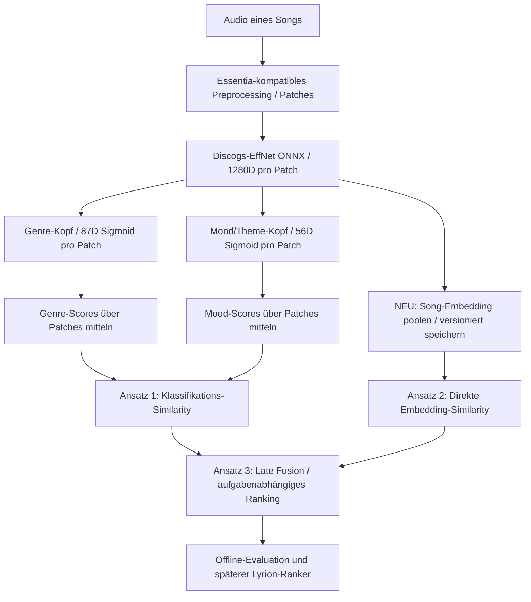

# Handover: Drei Repräsentationsansätze für Song-Similarity

> **Einordnung:** Dieses Dokument ist die ausführliche **technische Ergänzung** zum [maßgeblichen Drei-Ansätze-Handover](similarity-three-representation-approaches-handover-2026-10-21.md). Beide sind inhaltlich kompatibel. Beginne in einer neuen Session mit dem maßgeblichen Handover; verwende dieses Dokument für präzise Formeln, Implementierungs-/Persistenzverträge und Qualitäts-Gates.

**Stand:** 21. Oktober 2026 · **Repository:** [chrober/bliss-mood-poc](https://github.com/chrober/bliss-mood-poc) · **Branch:** `feat/similarity-metric-evaluation` · **PR:** [#16 (Draft)](https://github.com/chrober/bliss-mood-poc/pull/16).

**Kernfrage:** Wie berechnen wir aus offline analysierten Audioaufnahmen musikalisch nützliche **Song-zu-Song-Ähnlichkeit**, und welche Repräsentation eignet sich für welchen Zweck? **Noch keine Produktionsentscheidung.** Die bisherige Forschung testete sieben Distanzen/Ähnlichkeiten auf *Klassifikationsvektoren*. Der nächste wissenschaftlich wichtige Vergleich ist **Klassifikationsvektoren vs. direkte Audio-Embeddings vs. kombinierte Signale**; die Metrikwahl allein löst nicht die Repräsentationsfrage.

## 0. Begriffe und zwei strikt getrennte Entscheidungsebenen

- **Repräsentation:** Welcher Vektor beschreibt einen Track? Zum Beispiel 87 Genre-Scores, 56 Mood/Theme-Scores oder ein 1.280D Audio-Embedding.
- **Similarity-Metrik:** Welche mathematische Funktion vergleicht *zwei Vektoren derselben Repräsentation* (Cosine, Centered Cosine, Weighted Jaccard, RMS usw.)? Die Transformation `1 - cosine_distance` und normalisierte Richtung haben eine andere Semantik als kalibrierte Wahrscheinlichkeiten; absoluter Score ist **keine** Wahrscheinlichkeit für eine gute Überleitung.
- **Fusion/Ranking:** Wie kombinieren wir *verschiedene* Ähnlichkeitsinformationen für eine bestimmte Aufgabe (Genre-Treue, Mood-Treue, allgemeine Klangnähe, Übergangsqualität)?
- **Lyrion-Kandidatengenerierung/Mixing:** **Andere Ebene:** `Bliss-first`, `Mood-/Genre-first` und `Hybrid` sind **drei alternative Quellen- und Mischstrategien** in [lyrion-bliss-mood-genre-integration.md](lyrion-bliss-mood-genre-integration.md). Der hier behandelte **dritte Repräsentationsansatz (Fusion)** ist **NICHT** automatisch die Lyrion-Mixing-Strategie `Hybrid`. Jede Kombination ist technisch mit mehreren Kandidatenstrategien vereinbar.

### Ist-Zustand im Repository (durch Quellcode geprüft)

`model-registry.json` referenziert `discogs-effnet-bsdynamic-1.onnx` als gemeinsamen Encoder (`embedding_dimensions: 1280`) und die beiden MTG-Jamendo-Klassifikationsköpfe `genre` (87 **Sigmoid**-Klassen) und `moodtheme` (56 **Sigmoid**-Klassen); optional `voice` (2 Softmax). Diese unabhängigen Sigmoid-Werte sind **keine auf 1 summierten Wahrscheinlichkeitsverteilungen**.

`src/features.rs::FeatureEngine::analyze` extrahiert **je Patch** einen **1.280-dimensionalen Float32-Embedding-Vektor** (`tensor.len() == 1280`) aus ONNX, übergibt ihn an beide Köpfe und mittelt anschließend **die jeweiligen Klassifikationswerte** über Patches. Die bisherige schema-v3-Persistenz in `feature_tracks.scores_f32_le` speichert **Head-Scores**, **keine persistierten 1.280D-Song-Embeddings**. Daraus folgt: *Ein gemeinsamer 1.280D-Song-Vektor wird derzeit nicht als nachgewiesene Version/Semantik gespeichert.* Für einen Embedding-Vergleich brauchen wir zunächst eine optionale, getrennte, versionierte Ausleitung/Poolung; ein einfaches SQL-Auslesen der bestehenden 87/56D-Sidecars reicht nicht.

Die Rust-v5-Numerik wurde gegenüber der bisherigen Essentia-Implementierung für die bestehenden Klassifikationsköpfe geprüft. **Diese Parität belegt noch keine neue Song-Level-Embedding-Poolung oder deren Cosine-Ranking.**



## 1. Ansatz A — Ähnlichkeit der interpretierten Genre-/Mood-Klassifikationsvektoren

**Daten:** `G(song) ∈ [0,1]^87` und `M(song) ∈ [0,1]^56`, beide bereits in schema-v3-Sidecars vorhanden. Berechnungen pro Kopf getrennt, keine unkalibrierte Zusammenrechnung.

**Sieben derzeit untersuchte Metriken** (siehe [similarity-metric-evaluation.md](similarity-metric-evaluation.md) / `scripts/evaluate_similarity.py`): RMS-basierte Similarity, Cosine, Centered Cosine, Weighted Jaccard, ursprüngliches Cutoff-Top-K Weighted Jaccard sowie rangbasiertes Top-6 und Top-12 Jaccard. *Centered Cosine ist kein Verfahren für embeddingspezifische Zentrierung des gesamten Datensatzes; es subtrahiert den Mittelwert innerhalb jedes Vektors.*

**Stärken:** Interpretiert / diagnostizierbar nach Genre und Mood; direkte Regeln wie „Genre hoch, Mood eher frei“ möglich; kompakt (87+56 Float32 ≈ **572 Byte/Song** vor SQLite-Metadaten); Head-spezifisches Validieren ist sinnvoll.

**Schwächen:** Beide Köpfe komprimieren die reichhaltigere Audio-Information auf ihre jeweiligen Annotations-Taxonomien; allgemeine Klangähnlichkeit (Instrumentierung, Produktion, Sounddesign, rhythmische Feinheiten) wird womöglich nicht vollständig repräsentiert. Mehrere kleine Sigmoid-Outputs können die Metriken verzerren. Genre-/Mood-Kategorien sind nicht automatisch ground truth für *gute Songübergänge*.

**Nachgewiesene Forschung, nicht „Sieger“:**
- MagnaTagATune: **346 unterschiedliche ungeordnete Tripel / 1.019 Clips**, **53 menschliche Mehrheits-Gleichstände** und **293 auswertbare Fragen**. Auf 293 gemeinsamen Fragen, Abstentionen als falsch, Genre: Cosine **65,2 %**, Centered Cosine **65,2 %**. Mood: Cosine **65,5 %**, Centered Cosine **65,9 %**. Cosine minus Centered beim paarweisen Vergleich: **0,0 Prozentpunkte Genre** (5/5 diskordante Richtiger) und **−0,3 Prozentpunkte Mood** (8/9). Der alte Top-K-Cutoff deckt Mood nur **71,7 %** der auswertbaren Fragen ab. Dies ist **explorativ**, kein unabhängiger Holdout. Quelle: [magnatagatune-paired-analysis-2026-10-21.md](magnatagatune-paired-analysis-2026-10-21.md).
- FMA-Small: offizieller **VALIDATION**-Split, 80 Katalog-bereinigte, künstlerunterschiedliche Tracks aus acht groben Genres: Genre **P@5 Cosine 0,3200**, **Centered Cosine 0,3225**, Weighted Jaccard 0,3000; dies ist **eine andere Stichprobe** als die frühere unbereinigte Validation (nicht paarweise vergleichbar). Der offizielle FMA-**TEST**-Split bleibt **unberührt**. Quelle: [fma-mtg-catalog-overlap-2026-10-21.md](fma-mtg-catalog-overlap-2026-10-21.md).
- DEAM: **Valence/Arousal** als *Proxy* für Mood-Nähe, **nicht** als direktes Label für alle 56 Mood-Klassen und **nicht** als menschliche Genre-/Übergangsähnlichkeit; filtrierte Stichprobe von 240 Tracks, Mood-Cosine Spearman **0,2868**, Weighted Jaccard **0,2888**. Quelle: [similarity-cross-dataset-evidence-2026-10-21.md](similarity-cross-dataset-evidence-2026-10-21.md).

**Status:** Ansatz A implementiert und mehrfach extern explorativ untersucht, **keine Produktionswahl**.

## 2. Ansatz B — Direkte Ähnlichkeit von 1.280D Audio-Embeddings

**Daten:** Der **gleiche** vorhandene `discogs-effnet-bsdynamic-1.onnx` erzeugt pro Audio-Patch einen 1.280D-Vektor **vor** Genre-/Mood-Klassifikation. Ein Song-Level-Vektor `E(song) ∈ ℝ^1280` muss anhand einer expliziten Aggregation definiert werden.

**Minimal-Baseline:** Arithmetischer Mittelwert der Float32-Patch-Embeddings in Float64-Akkumulatoren, anschließend optional L2-Normierung für Cosine. **Vorher** festlegen und protokollieren, ob Patch-Embeddings einzeln L2-normalisiert werden oder nur der gepoolte Song-Vektor. Diese Varianten sind **nicht äquivalent**. Eine erste Vergleichsversion: `mean(raw patch embeddings) → L2-normalize(song mean) → cosine`. Nicht unbemerkt durch normierte Patch-Mittel ersetzen.

`cosine(Ea, Eb) = dot(Ea, Eb) / (||Ea||₂ · ||Eb||₂)`, mit endlichen Werte-/Dimensions-/Nullnorm-Checks. Nicht automatisch auf `[0,1]` clampen; ein Cosine über reale Embeddings liegt grundsätzlich in `[-1,1]`. Kann zum Ranking per ANN/Nearest-Neighbor indexiert werden (Index und Suchstrategie sind **separate** Entscheidungen).

**Stärken:** Höhere Ausdrucksstärke und potenziell Klang-/Stilähnlichkeit jenseits der festen 87/56 Tags; gleicher ONNX-Encoder wird bereits aufgerufen, daher prinzipiell **keine zweite Encoder-Inferenz** nötig. Song-Level-Speicherbedarf: **1.280 × Float32 = 5.120 Byte/Song**, etwa **9×** die 87+56D-Head-Nutzdaten; für eine Million Songs ca. **5,12 GB** rohe Vektoren (dezimal, ohne Datenbankindizes/Overhead). ANN und Vorfilterung sind erst für große Kataloge nötig.

**Schwächen:** Weniger erklärbar als Tags; hohe Dimension ist keine Garantie für Mood-/Playlist-Kohärenz; Modelltraining prägt Ähnlichkeit. Bei längeren Songs kann der globale Durchschnitt dramaturgische Abschnitte ausmitteln. Alternative Mehrsegment-/robuste Poolung ist eine **spätere** Hypothese, keine stillschweigende Vorgabe. Numerische Parität für neuen Export muss separat geprüft werden.

**Externe Evidenz (kein direktes Benchmark-Ergebnis für unser Projekt):**
- [cosine.club — About/FAQ](https://cosine.club/about) beschreibt produktiv die Verwendung von **Discogs-EffNet**, **1.280D-Audio-Embeddings** und **Cosine Similarity** für Klangähnlichkeitssuche über einen großen Katalog. Dies zeigt technische Praxistauglichkeit, **nicht** superiority gegenüber unserem 87/56D-Ansatz oder gute Lyrion-Übergänge.
- [Essentia Modellkatalog](https://essentia.upf.edu/models.html) dokumentiert die Discogs-EffNet-Klassifikationsmodelle und **separate kontrastiv trainierte Embedding-Modelle** für Artist-, Label-, Release-, Track- und Multi-Ähnlichkeitsziele (Alonso-Jiménez, Serra, Bogdanov, ISMIR 2022). Diese spezifischen **kontrastiven** Modelle sind **andere Modellgewichte/Ziele** als unser aktueller `discogs-effnet-bsdynamic-1.onnx`; die dokumentierte Existenz ist kein Beleg, dass die bisherige Head-Numerik damit unverändert bleibt.
- Essentia nennt [cosine.club in seinen Demos](https://essentia.upf.edu/demos.html) als Beispiel für Klangähnlichkeitssuche auf Discogs-EffNet-Embeddings.

**Status:** Der 1.280D-Vektor existiert aktuell **intern pro Patch**, aber **Ansatz B ist als Song-Level-Sidecar und Benchmark noch nicht implementiert/evaluiert**. Primärer nächster Implementierungsschritt.

## 3. Ansatz C — Fusion von Audio-Embedding, Genre und Mood

**Idee:** Drei unterschiedliche Evidenzquellen pro Songpaar berechnen und erst **nach separater Definition/Kalibrierung** fusionieren:
`s_E(a,b)` aus 1.280D-Embedding, `s_G(a,b)` aus 87D Genre, `s_M(a,b)` aus 56D Mood. Grundform als **Baseline-Hypothese**: `s(a,b | task) = w_E·f_E(s_E) + w_G·f_G(s_G) + w_M·f_M(s_M)`, `w_i >= 0`, `Σ w_i = 1`.

**Wichtig:** `f_E/f_G/f_M` sind **reproduzierbare, auf Entwicklungsdaten eingefrorene** Normalisierungs-/Kalibrierfunktionen (z.B. trainingsstatistikbasierte rank/quantile-Scores). Rohwerte nicht addieren: Cosine auf Embeddings, Cosine auf Sigmoids und RMS unterscheiden sich in Verteilung und Aufgabe. Naive gleiche Gewichte sind ein **zu testender Baseline-Kandidat**, kein gerechtfertigter Default. Eine alternative robuste Fusion ist **Rank Aggregation** von je Kopf sortierten Kandidaten (nur dann, wenn definierte gemeinsame Kandidatenbasis, Abstention- und Missing-Head-Regel).

**Beispielhafte Aufgabenhypothesen (keine validierten Parameter):**
- **Allgemeine klangliche Nähe:** `w_E` möglicherweise dominant, `G/M` zusätzliche semantische Kontrollsignale.
- **„Ähnlicher Stil/Genre“:** hoher `w_G`, aber Embedding gegen rein taxonomische Fehl-Nachbarn.
- **„Gleiche Stimmung, Genre darf wechseln“:** höherer `w_M` und gelockerter Genreanteil.
- **Playlist-Sequenz/Übergänge:** Neben Songpaar-Similarity auch Stil-Drift, Monotonie, Tempo/Energie, Nachbarabstände, Artist-Repeats und Lyrion-Hard-Constraints im *übergeordneten* Mixing evaluieren; „maximale Similarity überall“ ist nicht automatisch eine gute Playlist.

**Stärken:** Anwendungsfall-spezifische Kontrolle und Interpretierbarkeit mit reichhaltigem Klangsignal; ggf. besserer Trade-off zwischen akustischer Nähe, Mood/Genre-Kohärenz und Vielfalt. **Schwächen:** Zusätzliche Gewicht-/Kalibrierparameter erhöhen Overfitting-Risiko, besonders auf winzigen, nicht unabhängigen Musikdatensätzen. Missing-Vector-Strategie, Korrelation zwischen Embedding und Heads und Verzerrung durch Artist-/Albumwiederholung explizit behandeln.

**Status:** Nur Architekturhypothese, **nicht** in unseren wissenschaftlichen Benchmarks gemessen und **nicht** als gewählte Mixing-Strategie implementiert. Erst nach belastbarer B-Baseline und vorab eingefrorenem Entwicklungs-/Holdout-Plan testen.

## 4. Bereits vorhandene Evidenz und ihre Grenzen

| Korpus | Menschliche / externe Referenz | Für A vorhanden | Für B und C | Harte Grenze |
| --- | --- | --- | --- | --- |
| **FMA-Small** | Acht grobe Genre-Labels, Retrieval P@5/mAP/nDCG | Ja, 80 Validation (unbereinigt sowie anders gezogene katalogbereinigte Stichprobe) | **Noch nicht** | Official **TEST versiegelt**, potentielle MTG-Katalogtreffer, kleine Stichprobe |
| **DEAM** | Kontinuierliche Valence/Arousal-Bewertungen | Ja, 240-Song-Proxy-Benchmark | **Noch nicht** | VA ≠ 56 Mood-Klassen oder Übergangsqualität |
| **MagnaTagATune** | Allgemeine menschliche Odd-one-out-Urteile | Ja, volle 346 Tripel, 293 ohne Menschenmehrheits-Tie | **Noch nicht** | Alle Tripel bereits exploriert, **kein unangetasteter MTT-Holdout**; ein gemeinsamer Artist-Zusammenhang |
| **MTG-Jamendo** | Klassifikationslabels + Modell-/Trainingsprovenienz | Catalog overlap audit | **Noch nicht** | Kein genereller unabhängiger Ähnlichkeits-/Playlist-Referenzdatensatz |

**Nicht verschiedene Metriken aufsummieren:** FMA-Genre P@5, DEAM Mood-/VA-Spearman und MagnaTagATune Odd-one-out-Accuracy erfassen **unterschiedliche Zielgrößen**. Der A/B/C-Vergleich soll **innerhalb jedes Datensatzes** identische Tracks, Patches, Referenzurteile, Evaluationslogik und Missing-Policy verwenden.

**Data leakage / Lizenz:** Ein MTG-Katalogname kann mit FMA oder DEAM übereinstimmen, ohne dass die Aufnahme oder ONNX-Trainingszugehörigkeit belegt wäre. Der Discogs-Encoder hat einen eigenen möglichen Overlap. Die bisherige FMA-TEST-Sperre bewahren; kein privater Lyrion-Audioscan, keine Musikdateien/Vektoren in öffentlich lesbaren Artefakten. Die 1.019-MTT-Clip-Research-Cache-Datei beinhaltet weiterhin lizenzgebundenes Drittaudio und darf nicht als öffentliches GitHub-Artefakt verteilt werden.

## 5. Priorisierter technischer Plan für die nächste Chat-Session

### P0 — Technische Verträge und Regressionen einfrieren

1. Branch `feat/similarity-metric-evaluation`, Draft PR #16, aktuellen Repo-Head prüfen. Keine Merges oder Änderungen an `main`, PR #13/#17 oder dem Produktionsmixer. Quelltexte `src/features.rs`, `src/storage.rs`, `src/main.rs`, `model-registry.json` auf aktuellen Stand prüfen.
2. **Kleines, versionsgebundenes Embedding-Exportformat** entwerfen, nicht die Semantik alter `feature_tracks`-Head-Scores überschreiben: eigenständiges Modell-/Embedding-Profil mit Encoder-SHA256, Layer/Output, Preprocessing, Pooling, Normalisierung, Anzahl Patches, Dimension 1280, Float32-Endian, Audio/Track-Key und Schema-Version. Eine neue Tabelle oder separate Sidecar ist zulässig; proprietäre Original-Track-IDs bleiben lokal.
3. Ein Songanalyse-Durchlauf berechnet patchweise 1.280D-Embeddings **einmal** und speist dieselben unveränderten Patches in Genre/Mood-Head. Für neuen Export `mean(raw patches)`, dann L2-Norm für Vergleich; gegen Nullnorm/NaN/Inf und Ton-/Audio-Längenartefakte absichern. **Keine zweite ONNX-Inferenz für die Baseline nötig.**
4. **Regression/Parität**: Mit exakt fixierter Audiodatei und Modellen prüfen, dass bestehende 87/56D-Head-Vektoren und numerische Rust-v5-Paritätsaussage **unverändert** sind; neue Embedding-Poolung mit Referenzimplementierung in Python/Essentia vergleichen. Unterschiedliche Aggregationsdefinitionen nicht als dieselbe Referenz behandeln. Nullnorm-, extreme Patch-Anzahl-, Determinismus- und mehrere Worker-Tests.

### P1 — Vergleich B gegen A auf identischer Kohorte

5. Erst einen kleinen, **ergebnisblinden** CI-Smoke aus schon legal/correct zugänglichem Audio, dann kostensparende volle MTT-Explorationskohorte mit vorhandenen 1.019-Clip-Cache und gepinnter Rust-v5-CLI wiederverwenden. Keine unberechtigte Behauptung, MTT sei nachträglich held-out.
6. In paralleler Vergleichsausgabe, je identischem Songpaar/Tripel: `cosine(E_mean)` vs beste **bereits eingefrorene** Genre-/Mood-Baselines (`cosine`, `centered_cosine` und je nach Aufgabe `weighted_jaccard`). Ergebnisse durch MTT-Fallgleichheit, gleiche humane Mehrheits-Ties und abstention-inclusive denominator vergleichen. Auch FMA Validation Genre und DEAM VA-Mood auf **denselben jeweiligen** Tracks vergleichen; nicht aus unbereinigt/bereinigt neu gesampelten Gruppen künstlich einen Paarvergleich bauen.
7. Qualität **und** Zeit dokumentieren: Caches nur bei verträglichem Daten-/Lizenzzugriff, Modell-Hash, Feature-Persistenz/Peak-RSS, GH runners mit 1/2/4 isolierten Workern, Patches pro Song und NN-Index erst bei Bedarf. Bestehende GH Workflows bereits mit Audio-Cache (MTT: 1.019 selektierte MP3s ≈114 MiB) und gepinntem Binary; Build- und Download-Time separat messen.

### P2 — Fusion C als Experiment, nicht Default

8. A, B, C als reproduzierbare `representation_id` / `ranking_policy` dokumentieren. Fusionsvarianten nur wenige, **vorher festgelegte** (`E-only`, `G-only`, `M-only`, `E+G`, `E+M`, `E+G+M`, ggf. rank aggregation), mit separatem Genre-/Mood-/General-Human-Evaluationsreport. Gewichtung/Kalibrierung nur an Entwicklungskorpus fitten, unabhängigen späteren Korpus unangetastet lassen.
9. Ergänzend **kontrastive Discogs-EffNet-Varianten** aus dem offiziellen Essentia-Katalog **als eigene Modellstudie** betrachten, nicht als austauschbare ONNX-Schicht des jetzigen Klassifikationsmodells. Vor Einbezug in Rust prüfen: verfügbares ONNX, Lizenz/Verteilung, Feature-Protokoll, Vergleichsreferenz, inferenzseitige CPU/RAM-Kosten.
10. **Finale Entscheidung** erst nach unabhängiger Bestätigung mit getrennten Zielkriterien (Genre Retrieval, VA Mood, allgemeines human similarity, echte Lyrion-Übergänge) und später blindem Lyrion-Playlist-Hörtest, inklusive Drift, Vielfalt und Repeat-Constraints. Kandidatenstrategien `Bliss-first/Mood-Genre-first/Hybrid` **nachgelagert separat** auf identischem Korpus/Seed testen.

### Qualitäts- und Daten-Gates

- Keine neue Modellüberlegenheit oder „bestes Verfahren“ behaupten, bevor B/C **auf echten gemeinsamen Daten** gemessen wurden.
- Bereits untersuchte MTT-Tripel nicht als unabhängiges Holdout deklarieren. FMA offizielles **TEST** nicht für explorative Optimierung öffnen.
- Einheitliche Seed-/Audio-/Modell-/Pooling-Provenienz, exakte Vektordimension und Normalisierung dokumentieren; hohe absolute Cosine-Werte nicht als kalibrierte Prozentwahrscheinlichkeiten ausgeben.
- Keine Audiodateien / Song-Identitäten / per-Song-Vektoren / per-Tripel Rohlabels als öffentliches GH Artifact oder Commit. Kein Scannen privater Lyrion-Musik. Forschung und Produkt-Mixer strikt getrennt.
- Dokumente und Handover im Repository fortlaufend aktualisieren; alle langen GH Workflows nur mit relevanten Pfad-/Workflow-Triggern, Build-Caches, Benchmark-Stufenzeiten. Bestehende Python/Rust CI auf Linux/Windows respektieren.

## 6. Quellen und Wegweiser

**Externe belegte Quellen:**
- Offizielle [Essentia Modelle](https://essentia.upf.edu/models.html) — Discogs-EffNet, Unterschiede zwischen Style-Klassifikation und separat kontrastiv trainierten Artist/Label/Release/Track/Multi-Varianten, 1.280D Embeddings und Head-Anbindung.
- [Essentia Demos](https://essentia.upf.edu/demos.html) — verlinkt Klangähnlichkeitssuche mit Discogs-EffNet.
- [cosine.club FAQ](https://cosine.club/about) — konkretes Beispiel: Discogs-EffNet-Embedding und Cosine-basierte Musikähnlichkeitssuche; **Demonstration, nicht unabhängige Qualitätsstudie**.
- Alonso-Jiménez, Serra, Bogdanov (2022), *Music Representation Learning Based on Editorial Metadata from Discogs*, ISMIR; Referenz im Essentia-Modellkatalog.

**Repo-Unterlagen:**
- [Genre/Mood Metriken und Datenstruktur](similarity-metric-evaluation.md).
- [Datensatzübergreifende Evidenz und methodische Einschränkungen](similarity-cross-dataset-evidence-2026-10-21.md).
- [MTT gepaarte Auswertung und Laufzeiten](magnatagatune-paired-analysis-2026-10-21.md).
- [FMA-MTG-Katalogüberschneidung](fma-mtg-catalog-overlap-2026-10-21.md).
- [Lyrion Mix-Strategien: Bliss-first vs Feature-first vs Hybrid](lyrion-bliss-mood-genre-integration.md).
- [Feature-Provider-Architektur](feature-provider-architecture.md).

**Handover-Status:** Die nächste Session beginnt **nicht** mit einer weiteren reinen Cosine-vs-Weighted-Jaccard-Diskussion. Sie beginnt mit einem **reproduzierbaren, optionalen 1.280D-Embedding-Export aus dem vorhandenen Rust-v5-EffNet-Pfad** und anschließender auf denselben Musiktiteln paarweise vergleichbarer A/B/C-Evaluation. Keine bereits existierenden qualitativen Ergebnisse auf den neuen Embedding-/Fusion-Ansätzen unterstellen.


## Erste Forschungsimplementierung: versionierter Audio-Song-Vektor (21.10.2026)

**Neue Dateien:** `research/song_embedding.rs`,
`scripts/apply_rust_v5_embedding_export.py`,
`scripts/check_song_embedding_smoke.py`,
`scripts/evaluate_mtt_embedding_ab.py`,
`tests/test_evaluate_mtt_embedding_ab.py` sowie die
`research-song-embedding-smoke.yml`- und
`research-mtt-embedding-ab.yml`-Workflows. Bestehender
`mtt_parallel_workers.py` und `benchmark_magnatagatune.py`
haben einen optionalen, standardmäßig **ausgeschalteten** Forschungs-Export.

**Exakte Mathematik der ersten vorregistrierten Baseline B:**

Für rohe EffNet-Vektoren `e_p ∈ ℝ^1280`, in deterministischer Patch-Reihenfolge:

```text
s_j = sum_{p=1..P} float64(float32(e[p,j]))
m_j = s_j / P                     (float64)
L   = sqrt(sum_j m_j*m_j)         (float64)
v_j = float32(m_j / L)            (P > 0, L > 0, finite)
S_B(x,y) = cosine(v_x, v_y)
```

**Kein per-Patch-L2**, keine Median-, PCA-, Whitening- oder
Stundenabschnitt-Aggregation; diese Varianten bleiben separate
Ablationen. Der Klassen-Score-Pfad wird nicht umparametrisiert.

**Eigenständiges JSON-Sidecar v1:** `schema_version`,
`kind=discogs_effnet_song_embedding`,
`validation_status=experimental_unvalidated`,
`dimension=1280`, `patches_analyzed`, `encoder_model`,
`encoder_sha256`, `preprocessing_version`,
`pooling_version=patch_f64_arithmetic_mean_v1`,
`normalization_version=song_f64_l2_then_cast_f32_v1`,
`representation_fingerprint`, `audio_sha256`,
optional `track_file`, `vector_f32`. Der Fingerprint ist SHA256
der kompakten UTF-8-JSON-Array-Serialisierung von
`[1, encoder_model, encoder_sha256, preprocessing_version,
pooling_version, normalization_version, 1280]`. Embedding-Ausgabe
nur über `analyze-features --embedding-out <neue-datei>` im
Runner-Overlay; vorhandene Datei wird nicht überschrieben.
Unveränderte schema-v3-Tabellen bleiben ausschließlich für
Genre/Mood/Voice-Klassifikationswerte.

**Pinned Source:** das Overlay verweigert andere Git-Heads
als `2c3d44401436b3b41b6e067199016a1ed2335fbf`.
`src/features.rs` dieser Revision enthält bereits die
Encoder-Ausgabe pro Patch, von der ein zusätzlicher optionaler
f64-Summenvektor vor den unveränderten Klassifikations-Head-Aufrufen
gebildet wird. Hauptbranch-Quellen und PR #17 werden nicht verändert.

**Technisches Gate:** Rust-Unit-Tests zu Nullnorm, Dimensionsfehler,
NaN/Inf, Skalierungs- und Reproduzierbarkeit;
synthetische WAV-Analyse mit Flag off/on, bytegenaue
Genre-/Mood-Klassifikation und schema-v3-SQLite-Zeilen, direkter
Vergleich mit originalem `embedding-dump` und ONNX-Threadvariation.
Erster Smoke-Build/Unit-Test erfolgreich, Audio-Gate zunächst
wegen fehlendem `ffprobe` blockiert und Workflow korrigiert;
endgültiges Resultat aus GitHub Actions ablesen. Die aktuelle
Smoke-Orakelreferenz ist **dieselbe ONNX-Encoder-Familie**; eine
vollständige TF/C++-Referenzparität über viele Songs ist
**weiterhin offen**.

**A/B-Definition:** genau die 1019 MTT-Clip-Sidecars aus derselben
Analyse wie die 87D/56D-Werte; exakt 346 ungeordnete Tripel, davon
293 mit eindeutiger menschlicher Mehrheit. Fünf Methoden
(`embedding_cosine`, `genre_cosine`, `mood_cosine`,
`genre_centered_cosine`, `mood_centered_cosine`);
ein eindeutiger stärkster Ähnlichkeitspaar-Score bestimmt den
Odd-One-Out; jeder Methoden-Abstention wird auf demselben
293er-Nenner als falsch gewertet. `mtt_paired_evidence.py`
liefert gepaarte Differenzen, naive Resampling- und
Artist-Gewichtungs-**Sensitivität**, keine generalisierbaren
Konfidenzintervalle. Output nur **aggregate** Ergebnisse; alle
MTT-Fragen bereits gesehen, kein unabhängiger Holdout.

**Nicht implementiert:** empirische Fusion C,
separat kontrastive Discogs-Modelle,
unabhängige zweite Ground-Truth für B und die endgültige
Lyrion-Mixer-Entscheidung. Erst den neuen A/B-Run prüfen.

## Verifiziert: erster vollständiger Embedding-A/B auf identischer MTT-Cohort (21.10.2026)

**Achtung – ersetzt die oben noch als ausständig bezeichnete
A/B-Messung.** [Run 39617159250](https://github.com/chrober/bliss-mood-poc/actions/runs/39617159250)
ist **PASS**; 1019 Cache-Clips CRC-validiert, exakt 346
explorative Menschenfragen, davon 293 mehrheitsentscheidbar.
Auf denselben Aufnahmen lieferte **direkte 1280D-Cosine
182/293 = 62,12 %**, Genre-Cosine **191/293 = 65,19 %**,
Mood-Cosine **192/293 = 65,53 %** und
Mood-Centered-Cosine **193/293 = 65,87 %**.
Alle vier hatten wie das Embedding **100 % Abdeckung**.
Das Embedding lag gegenüber Mood-Centered-Cosine um
**−3,754 Prozentpunkte** zurück (nur Embedding korrekt 27,
nur Mood-Centered korrekt 38). Naives gepaartes
95-%-Tripel-Resampling für den Unterschied:
**−9,215 bis +1,365 Prozentpunkte**; wegen
Abhängigkeiten **kein unabhängiges Populations-CI**.
Auch Künstlergewichts-Sensitivitäten sind kein valides
Konfidenzintervall. Die Kausalinterpretation und
Generalisierbarkeit bleiben offen.

Der vorherige unabhängige synthetische Rust-Smoke
[Run 39616222834](https://github.com/chrober/bliss-mood-poc/actions/runs/39616222834)
bestand Rust-Unit-Tests und Release-Kompilierung,
brach aber beim externen Modell-Download wegen
`essentia.upf.edu`-Netzwerk-Timeout ab. Deshalb
wurde ein **synthetisches off/on/Pooling/Threads-Paritätsgate
vor den 1019er-Lauf** des neuen A/B-Workflows
hinzugefügt; dessen nachfolgenden Run erst auf
PASS prüfen, bevor dieses Gate als bestätigt gilt.

Vollständiger Studienbericht mit Methoden,
Paar-Discordanzen, statistischer Unsicherheit,
CI-Runs, Fingerprints, Limitierungen und nächstem
Evidenz-Gate:
[Audio-Embedding vs. Kopf-Baselines: MTT-A/B-Resultate](similarity-audio-embedding-ab-results-2026-10-21.md).
**Keine Fusion-Kalibrierung, keine Produktionsentscheidung,
kein erneuter MTT-Holdout, kein FMA-TEST, kein Merge.**

## C-Fusion: vier gleichgewichtete, **untrainierte** lokale Rangablationen (21.10.2026)

Nach dem ersten B-vs-A-Resultat wurden die vier Kombinationen
Audio+Genre, Audio+Mood, Genre+Mood und Audio+Genre+Mood
als **explorative** und explizit nicht optimierte
Rangfusionen implementiert. Jede Cosine-Verteilung wird
ausschließlich **innerhalb der jeweiligen Drei-Song-Frage**
in die Midranks 0/0,5/1 transformiert, danach werden die
enthaltenen Repräsentationen gleich gewichtet.
Ranggleichstand zählt als Nichtvorhersage (im 293er
Nenner falsch). **Das ist keine global kalibrierte
Song-Similarity und darf nicht als Produktionsmetrik
oder Playlist-Mixer eingesetzt werden.**
Das feststehende Verfahren, die vier Kombinationen,
Datenabhängigkeiten, Split-Grenzen und
Anwendungsszenarien:
[Similarity Fixed-Rank Fusion Research](similarity-fixed-rank-fusion-research-2026-10-21.md).
Implementierung:
[`scripts/fixed_rank_fusion.py`](../scripts/fixed_rank_fusion.py),
optionales Evaluator-Flag `--fixed-rank-fusions`,
separates Aggregate v2 und
[`tests/test_fixed_rank_fusion.py`](../tests/test_fixed_rank_fusion.py).
Python-Tests Linux/Windows [Run 39619643950](https://github.com/chrober/bliss-mood-poc/actions/runs/39619643950)
sind PASS. Ein tatsächlicher Fusion-Lauf
[39619708040](https://github.com/chrober/bliss-mood-poc/actions/runs/39619708040)
wurde ausgelöst; seine Ergebnisse müssen für
wissenschaftliche Schlussfolgerungen **noch abgelesen**
werden. Die 346 MTT-Fragen sind bereits vollständig
exploriert, daher keinesfalls Fusionsgewichte aus ihnen
tunen.

## Verifiziert: vollständiger explorativer A/B/C-Durchgang (21.10.2026)

Die vorab implementierten **vier untrainierten Equal-Midrank-Fusionen**
wurden zusammen mit den fünf bisherigen A/B-Methoden
im [Actions Run 39619708040](https://github.com/chrober/bliss-mood-poc/actions/runs/39619708040)
vollständig erfolgreich auf **exakt denselben 1019
MagnaTagATune-Clips und 293 mehrheitsentscheidbaren
Tripelfragen** ausgewertet. Synthetisches 1280D
Original-Patchpooling-/Head-Off-On-/SQLite-/Thread-
Paritätsgate erneut **PASS**.

Die Fusions-Genauigkeit auf dem gemeinsamen 293er-Nenner
(Abstentions als falsch): Audio+Genre **163/293 = 55,63 %**
(Coverage 234/293), Audio+Mood **170/293 = 58,02 %**
(241/293), Genre+Mood **167/293 = 57,00 %**
(230/293), Audio+Genre+Mood **192/293 = 65,53 %**
(283/293). Der bisherige Mood-Centered-Baselinewert
bleibt **193/293 = 65,87 %** mit 100 % Abdeckung.
Keine der vier einfachen, *tripellokalen* Rangfusionen
verbessert diese Referenz. Die vielen Paargleichstände
der Zweierkombinationen erklären den niedrigen
Gesamtnenner-Erfolg; Quote auf nur vorhergesagten
Fällen darf nicht isoliert verglichen werden.

**Keine Kalibrierung/Optimierung aus diesen
Ergebnissen.** Diese post-hoc MTT-Fusionsexperimente
sind weder eine globale Song-Cosine-Kalibrierung
noch eine unabhängige Validierung oder ein
Lyrion-Übergangstest. Vollständige Rechenschritte,
Gleichstands-/Coverageanalyse, Paardifferenzen,
Caveats und Folgeexperimente:
[Fixed-Rank Fusion Research Results](similarity-fixed-rank-fusion-research-2026-10-21.md).
Das reproduzierbare, nur aggregierte
[GitHub-Artefakt](https://github.com/chrober/bliss-mood-poc/actions/runs/39619708040/artifacts/12354537538)
enthält die Ergebnisberichte v1, v2 und
das synthetische Paritätsprotokoll.

## CI-Fehlerkorrektur und nächster Evidenzschritt (21.10.2026, nach A/B/C)

Der [MTT-Run 39621028716, Job 119294123082](https://github.com/chrober/bliss-mood-poc/actions/runs/39621028716/job/119294123082)
brach **beim erweiterten synthetischen Vierprozess-Paritätsgate** ab
(`AssertionError: Expected all four independent process-level worker outputs`).
Es ist ein **Fehler im Python-Test-Harness**, keine im Log nachgewiesene
Rust-Inferenzabweichung: `glob("process-worker-*.json")` nahm sowohl die
vier Embedding-Dateien `process-worker-1.json` … `-4.json` als
auch die vier JSON-Klassifikationsberichte
`process-worker-heads-1.json` … `-4.json` auf. Der Workflow
hatte vorher bereits Rust-Unit-Tests, Release-Build, Downloads
und vier parallele Prozesse erfolgreich abgeschlossen.

**Korrektur ausschließlich in PR #16:**
- `scripts/check_song_embedding_smoke.py` filtert exakt nummerierte
  `process-worker-N.json`-Embedding-Dateien über `fullmatch`;
  `--require-process-workers` zwingt vier vollständige Ausgaben
  und kann nicht stillschweigend bei komplett fehlenden Dateien PASS liefern.
- `.github/workflows/research-mtt-embedding-ab.yml` setzt das
  zusätzliche Flag im neuen Concurrent-Worker-Gate.
- `tests/test_check_song_embedding_smoke.py` bildet den
  ursprünglichen Fehler nach (vier Embeddings plus vier Heads) und
  überprüft fehlende, zusätzliche und insgesamt fehlende Worker;
  `.github/workflows/python-checks.yml` führt diese Tests auf
  Linux **und** Windows aus.

Ein neuer Workflow wurde automatisch durch den
Änderungscommit ausgelöst:
[MTT-Forschungs-Workflow Run 39622530049](https://github.com/chrober/bliss-mood-poc/actions/runs/39622530049).
Die endgültigen Results und den vierten
Worker-Paritätsnachweis erst dann als PASS berichten,
wenn der Run beendet ist. Die zuvor komplett
erfolgreichen A/B/C-Resultate aus Run 39619708040
bleiben unverändert. Ein bloßer Fehler des Testglobs
widerlegt keine vorangegangene Messung.

**Nächste Forschungspriorität – unabhängige, gleichgepaarte
A-vs-B-Replikation, noch keine weitere MTT-Optimierung:**
erst FMA-Small **katalogbereinigte VALIDATION** (80 Songs)
mit unverändertem offiziellen TEST-Split,
danach DEAM-development/validation (Valence/Arousal
nur als Stimmung-Proxy).
Für jeden Datensatz auf den **identischen** Clipausschnitten
1280D-Cosine gegen vorhandene 87D/56D-Baselines,
identische Grundgesamtheit, gültige Vorhersageabdeckung,
katalog-/künstlerbewusste Abhängigkeitsanalyse und
gepaarte Scores gegenüberstellen.
Trainingskatalogüberschneidungen auch beim Encoder beachten.
MTT (346 vollständig erforschte Tripel) ist **kein Holdout**.
Unabhängige menschliche Klangähnlichkeits- und
Playlist-Übergangsreferenzen bleiben das entscheidende
separate Evidenzziel. Kontrastiv trainierte
Discogs-Embedding-Modelle sind eine spätere **eigene
Modellfamilie** mit eigenen Hashes/Provenienz.
Keine Fusion-Gewichte an MTT nachoptimieren und keine
Lyrion-Mixer-Änderung daraus ableiten. PR #16 Draft;
PR #13, PR #17 und `main` unangetastet.

## FMA-Small katalogbereinigte VALIDATION: eigener Embedding-A/B-Transfer (21.10.2026)

**NEU:** Das nächste kontrollierte Forschungsgate für
Repräsentation A gegen B ist implementiert:
[`scripts/evaluate_fma_embedding_ab.py`](../scripts/evaluate_fma_embedding_ab.py),
optional `--embedding-dir` im bestehenden
[`scripts/benchmark_fma_genre.py`](../scripts/benchmark_fma_genre.py),
[`research-fma-embedding-ab.yml`](../.github/workflows/research-fma-embedding-ab.yml),
synthetische Linux-/Windows-
[`tests/test_evaluate_fma_embedding_ab.py`](../tests/test_evaluate_fma_embedding_ab.py).

Die vorherige **exakte** katalogbereinigte
80-Song-VALIDATION-Kohorte wurde aus
[FMA-Run 39606850307](https://github.com/chrober/bliss-mood-poc/actions/runs/39606850307)
als SHA256 `f4a7a81c0713db7619efdba6eb3d561aa70d6d3cc812b4884793953d93b58509`
übernommen. Ferner sind die drei
Quellen-SHAs (FMA-Metadaten/Audiopaket, MTG-Katalog)
und die früheren Genre-Cosine-Maße
(P@5 0,3200; mAP@10 0,1748759921; nDCG@10
0,2985332322) **als Regressions-Gate fixiert**.
Die neu berechneten direkten 1280D- und
87D/56D-Sidecars stammen im neuen Modus aus
**demselben Encoder-Durchlauf** und werden nach
Audio-SHA, Patchzahl und Modell-/Pooling-Fingerprint
paarweise überprüft.

Jeder der 80 Künstler-distinkten Query-Tracks
vergleicht sich mit exakt denselben 79 Kandidaten;
9 pro Query haben die gleiche FMA-Obergenreklasse.
Verglichen werden Embedding-Cosine, Genre-Cosine
und Centered-Cosine sowie Mood-Cosine/Centered
als **Cross-Task-Kontrolle**. P@5, mAP@10,
nDCG@10, gemeinsame Abdeckung, Abstentions
als 0, stratifizierte gepaarte
Query-Sensitivitätsintervalle. Abhängige Kandidaten,
nur acht Genres und mögliche nicht erkannte
Trainingskatalogüberschneidungen bedeuten:
**kein unabhängiger Holdout/Populations-CI**.
Offizieller FMA-TEST bleibt strikt unberührt.
Audio und Embedding-Sidecars bleiben runner-privat,
Artefakte sind nur aggregierte Reports.

Ausführlicher Studienvertrag:
[Similarity FMA Embedding A/B](similarity-fma-embedding-ab-2026-10-21.md).
Erster Workflow:
[Research FMA 80 Validation A/B](https://github.com/chrober/bliss-mood-poc/actions/workflows/research-fma-embedding-ab.yml).
Solange nicht vollständig `PASS`: **keine neuen
numerischen Ähnlichkeitsresultate behaupten**.
Original FMA-Workflow, Original-Rust-v5-Pin und
PR #13/#17 sowie Mixer unverändert, PR #16 Draft.
Nach FMA ist DEAM Development als nächster
gepaarter Mood-Proxy vorgesehen. Noch keine
Fusion auf FMA VALIDATION optimieren.
