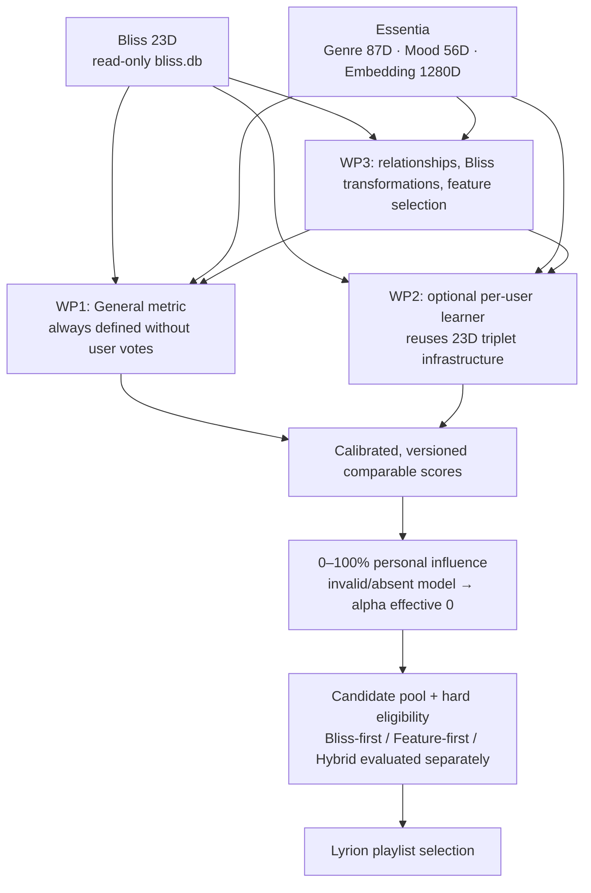

# Unified Lyrion similarity research strategy: General + Personal + Bliss ↔ Essentia

> **WP1-E6/E7 SOURCE COVERAGE + PUBLISHED AUDIO-SCORER BASELINES COMPLETE — 30 OCT 2026:** [E6 actual license/access evidence and source-only coverage ceilings](wp1-e6-ccmsim-source-coverage-and-audio-rights-gate-20261030.md) PASS [CI 41072601751](https://github.com/chrober/bliss-mood-poc/actions/runs/41072601751); 1,130 real human-rated CCMSim pairs require 463 exact clips. FMA-medium provides at most **11** within-source rated pairs for 51 original clips, MTT **10**, Lyra **12**; all three hypothetical source corpora together at most **106 rated pairs**, **100 single-rater**, *subject to legal exact audio availability that has NOT been demonstrated*. Do not infer sound recording permissions from CC BY 4.0 published annotations, FMA code MIT license or Lyra metadata CC BY-NC-SA. [E7 exact source-pinned replay of pre-existing authors' audio-model pair scores](wp1-e7-ccmsim-published-baselines-20261030.md) PASS [CI 41073110130](https://github.com/chrober/bliss-mood-poc/actions/runs/41073110130): original **11 third-party model scorers × 3 human endpoints**, same 1,130 labeled source pairs, overall/within(112)/cross(1018) source strata, tie-aware Spearman; all-pairs overall similarity CLAP Music+Speech 0.369369, SP Melody 0.326620, MERT95 0.297746. This reproduces **already published OTHER models' scores without audio or new inference**; none is original Mood56/Genre87/Essentia1280/Bliss23 or our General Metric. No independent test selected or any source licensing cleared. E5 found only 40 non-leaking song-clip test pairs in primary split, artist disjointness unverified; human metric-weight fitting NO-GO. WP1 remains the primary unfinished General Metric, WP2 optional Personal learning/calibration is synthetic, WP3 Bliss↔Essentia teacher-proxy correlation is not direct human quality. Original MTT 7/30 sparse source barrier and FMA official TEST restrictions unchanged. No additional listening/production/PR#16/main work.


> **WP1-E5 MEASURED CCMSim LABEL-BLIND HOLDOUT QUALITY GATE — 30 OCT 2026:** [Real pinned, source-balanced song-ID-disjoint feasibility audit](wp1-e5-ccmsim-clip-disjoint-split-feasibility-20261030.md) on [GitHub Actions 41070926652](https://github.com/chrober/bliss-mood-poc/actions/runs/41070926652) **PASS**. Five predetermined source-balanced clip splits read *no human similarity values*. Primary 60/20/20 partition on 1,130 original CCMSim human-rated pair endpoints retains 394 train / 47 validation / **40 test** pair edges and quarantines **649** crossing edges; test includes only **5 within-source** and 35 cross-source pairs. Across five fixed seeds, only 38–48 test edges survive; five source-balanced clip-disjoint folds retain just 210–244 edges total (18.58–21.59%), 31–68 per fold. Artist/album/recording family independence, original-audio rights, segment parity and actual same-clip Essentia/Bliss features are NOT verified. **NO-GO to fit/tune General fusion weights on CCMSim labels and claim an independently validated test.** Potential later value is a *fixed, untrained zero-shot external descriptive* General scorer benchmark, after lawful audio identity/access and adequate coverage are proven. MTT sparse source still blocked (7/30), original four global MTT fusions UNMEASURED, FMA official TEST reserved, WP2 Personal synthetic and WP3 teacher proxy not human General truth. No user listening, production, PR #16/main, licensing shortcut or private song changes.


> **WP1-E4 REAL PUBLIC HUMAN-REFERENCE PREFLIGHT — 30 OCT 2026:** [Pinned, reproducible CCMSim 2026 annotation-only audit](wp1-e4-ccmsim-human-reference-preflight-20261030.md) on live [CI 41069144899](https://github.com/chrober/bliss-mood-poc/actions/runs/41069144899) **PASS**. Adds a potentially useful independent **human overall-musical-similarity target**: 1,130 unique pairs from 125 participants across nine culturally diverse source datasets. Crucial limitations: **93.10%** of pairs judged once, **90.09%** of pairs cross source datasets, strong 445/463-clip pair-graph component, actual pinned mapping 486 (54×9) vs paper/README 468 (52×9), audio access and licensing NOT established, none of our Genre87/Mood56/Embedding1280/Bliss23 scores computed on those 463 recordings. The CC BY 4.0 human labels are not a license to redistribute the third-party audio. No independent General Metric validation or fusion winner was measured. Next stop/go gate is *source identity, lawful audio and artist/group-separated coverage feasibility* before any expensive audio work. Original MTT global pair fusion remains blocked after 7/30 range attempts, FMA official TEST reserved; operator's local 11-music-pair correlations remain exploratory; WP2 Personal synthetic and WP3 teacher proxies not equivalent to human perceptual truth. No required new listening/production/PR #16/main changes.


> **WP1-E3 REAL MUSIC-PILOT LOO SENSITIVITY COMPLETE — 30 OCT 2026:** User-supplied aggregate-only WP1-E3 follow-up now includes real **12 vs 11 music-only Spearman changes and every model's music-11 LOO extrema**; [full transcription and bound-based interpretation](wp1-e3-local12-stability-real-results-20261030.md). Mood Centered Next-Track rho 0.769463, LOO 0.687674–0.877186; Mood Centered Genre 0.688558, LOO 0.581534–0.772890; Embedding1280 Timbre 0.765707, LOO 0.674200–0.829370. For Timbre the Embedding's **min LOO exceeds every rival's max LOO**, i.e. it remains superior for each one-more-pair deletion in this deliberately selected 11-song-pair pilot. No comparable complete all-deletions advantage for Mood Centered over *all* Next-Track or Genre candidates is established. No per-deletion paired vectors, confidence intervals or cross-listener significance, **no selection of a universal General Metric**. Results were supplied as anonymized **private workstation's numeric aggregate**, not independent dataset validation, and original human votes/song IDs remain private. Prior WP1-E3 paragraphs below precede this update. WP1 public MTT four-global-fusion experiment still source blocked (7/30), FMA official TEST untouched, WP2 Personal P3/P4 synthetic-only, WP3 R6/R7 teacher proxy nonhuman, production/PR #16/main unchanged.


> **WP1-E3 ACTUAL LOCAL HUMAN-PILOT RESULTS — 30 OCT 2026:** Existing 12 originally rated local pairs have now been analyzed *read-only* by the user; the saved 11-music-only result excludes original nonmusic pair 10 but preserves it in a separate full-12 summary. See [all 20 user-reported music-only Spearman/Kendall correlations](wp1-e3-local12-real-human-pilot-results-20261030.md). Descriptive highest 11-pair Spearman: Mood Centered Cosine Genre/Style 0.688558 and directed next-track 0.769463; Embedding1280 Cosine Timbre 0.765707 and Mood/Energy 0.410857. **These are one listener's deliberately model-selected 11 song pairs; not independent, not statistically proven differences, not a universal winner.** Original private ratings, song IDs and audit remain local; documentation contains only anonymized figures. A read-only [full-12 versus 11 and LOO sensitivity helper](../scripts/summarize_wp1_e3_pilot_stability.py) can examine the *existing safe aggregate* without rereading private originals or requiring new ratings. WP1 General primary and unresolved, WP2 Personal P3/P4 synthetic, WP3 R6/R7 teacher proxy exploratory, MTT full global pairwise fusion source blocked, FMA official TEST reserved. No product/other-repo/PR #16/main edits.


> **LATEST WP1-E3 EVIDENCE IDENTIFIABILITY AUDIT — 30 OCT 2026:** [Original archived public aggregate replay](wp1-e3-sharp-mtt-paired-bounds-and-existing-pilot-20261030.md) verified and sharp 2x2 possible correctness-disagreement bounds derived for all eight existing MTT baseline/local-fusion methods on the *same* 293 human-decisive questions. The 193/293 Mood Centered vs 192/293 Mood Cosine contrast does NOT establish perceptual superiority: missing paired predictions allow 1–201 discordant correctness judgments. The report refuses observed McNemar significance, paired bootstrap, confidence intervals, independent claim or General Metric selection; current FMA and DEAM aggregate-only artifact also lacks query-wise paired inference. [CI 41064623284](https://github.com/chrober/bliss-mood-poc/actions/runs/41064623284) PASS including syntax-only Windows checks of a local **already-rated 12-pair** evaluator launcher (no private material in CI; run not claimed). Independent WP1 General quality remains primary. Original full global MTT fusion replay is source blocked (7/30), FMA official TEST untouched. WP2 optional personal 0–100% blending synthetic P3/P4 and WP3 teacher approximation remain independent, neither allows selecting/deploying General. No additional compulsory listening, no production/worker/source DB/PR #16/main modifications.


> **WP2-P4 FOUR-WAY SYNTHETIC CALIBRATION COMPLETE — 30 OCT 2026:** [Real execution of fictional score calibration and grouped quality gates](wp2-p4-fictional-calibration-validation-20261030.md) on Windows/Linux ([CI PASS 41063403438](https://github.com/chrober/bliss-mood-poc/actions/runs/41063403438), byte-identical aggregate SHA-256 `037aa4fac02a1eb19be74580b5f0349c3408de36b4361d9588a4aa90b8683113`). Fixed partitions: 192 **fictional** training triplets / 48 calibration / 48 model+calibration validation / 96 heldout test, disjoint by artist, album, recording and connected triplets; fixed pair-label target; query-independent monotone logistic mappings fit on calibration only; sample-score model admissibility decided on validation only. Demonstrates 0/25/50/75/100 Personal blend and General-only fallback; no true musical calibration, human preference uplift, actual Rust learner run or Lyrion/BlissMixerLab personal feature changes. **WP1 General remains primary and unselected**; MTT external 7/30 source failure prevents new real global fusion scores. Preserve FMA TEST, WP3 teacher-only claims and all source/privacy boundaries.


> **CURRENT WP2-P3 IMPLEMENTATION STATUS — 30 OCT 2026:** A [fictional, strictly identity-grouped Personal Metric Learning research study](wp2-p3-fictional-grouped-metric-learning-20261030.md) is implemented, reproducible and synthetic CI PASS on Linux/Windows ([41062367997](https://github.com/chrober/bliss-mood-poc/actions/runs/41062367997); identical aggregate SHA-256 `f41689fee4765256b30d2671a67fa5b0d08c65e175d545f025fe7dfeda7f9fbe`). Frozen 48 group x 6 tracks, 384 artificial triplets with 288 train/96 holdout and sample sizes 0/10/25/50/100, comparing untrained Bliss23 vs diagonal and PSD diagonal+rank2; demonstrates synthetic learnability, low-rank overcapacity in axis-aligned data and the potential value of cross-feature geometry in its deliberately constructed oracle. **Not a real-personal-music-quality measurement; the actual Rust learner was not run; no independent score calibration/model activation, license/audio, private votes or new listening task.** The existing General/Personal 0/25/50/75/100 full-query fallback contract is regression-tested with intentionally fictional simulated compatibility. WP1 General stays mandatory and unselected; MTT source remains externally blocked (7/30 stress sample) and the real four equal-weight global fusion scores remain unmeasured. No production/other-repo or PR #16/main modifications.


> **WP1-E1 PUBLIC EVIDENCE AUDIT COMPLETE — 30 OCT 2026:** Read-only GitHub Actions [run 41058917003](https://github.com/chrober/bliss-mood-poc/actions/runs/41058917003) successfully replayed and SHA256-verified historical MTT, FMA screened VALIDATION and DEAM anonymized aggregate artifacts (no audio or new inference). MTT Mood centered cosine 193/293 majority, existing three-head fusion 192/293 is TRIPLET-LOCAL (not global); FMA Genre centered cosine P@5=.3225 (80 artist-distinct validation queries), DEAM Mood weighted Jaccard VA rank correlation=.28885 (240). The **four globally comparable Genre/Mood/Embedding equal-weight pair-score fusions remain UNMEASURED on actual public songs** due MTT selected-clip cache/source blocking; 1280D DEAM paired evidence and identical-recording public Bliss23 also not confirmed. Keep each task separate and official FMA TEST untouched. [Measured status and precise next gate](wp1-e1-verified-public-benchmark-evidence-20261030.md). WP1 remains mandatory, WP2 Personal and the calibrated fallback contract remain a parallel workstream, WP3 R6/R7 teacher proxies do not replace external human-quality assessment. No production promotion or additional compulsory listening.


> **LATEST REAL WP3-R7 RESEARCH RESULT — 30 OCT 2026:** Complete 240-song native R6 and subsequent **no-rescan** R7 evaluation have both been executed. Frozen Mood Ridge student's global teacher-distance Spearman advantage over raw Bliss is +0.0511 Mood ([+0.0145,+0.0851] exploratory song-group bootstrap) and +0.0473 Genre ([+0.0073,+0.0880]). However local Mood Top-5 teacher-neighbor overlap rises only 6.25%->8.58%, while Genre Top-5 worsens 7.92%->5.67%; old-fit Genre PLS2 worsens all tested teacher Top-k retrieval despite teacher-vector MAE benefit. This is **post-hoc teacher-proxy evidence only**, not human musical similarity, multiplicity-adjusted inference or another independent validation. See [R7 measured numerical findings and WP1/WP2 priorities](wp3-r7-real-results-and-next-quality-gate-20261030.md). **No WP1 General winner, no WP2 Personal winner, no production promotion or required extra listening**. Historical status statements below may refer to pre-R6 measurements and are superseded.


> **WP3-R6 COMPLETE NEW 240 TEACHER-COHORT DIRECTION LOCKED (30 OCT 2026, implementation only):** User approved processing the 240 source-group-disjoint and tempo/centroid-balanced R5 songs with original native Essentia C++ Genre87, MoodTheme56 and 1280D normalized embeddings via the existing static multiworker manifest scanner. [Pre-frozen comparison/evaluation protocol and Windows runbook](wp3-r6-native-240-essentia-protocol-20261030.md) now require old100 train-only fixed Ridge Mood student(alpha10), Genre PLS2 and source SHA/model/worker provenance; compare on new240 as teacher-proxy descriptive signal only. The R5 selection completed, R6 scan has NOT run, and old optional 24-pair blind study is deferred. Human/external perceptual labels are still required to claim improved General song similarity; WP1 and optional WP2 personalization with 100% general fallback remain separate. No model deployment, native redistribution approval, PR#16/main changes or adaptive worker tuning.


> **30 Oct 2026 real WP3 R5 source-cohort selection PASS, WP3 R6 blind pilot scaffold (not run yet):** Operator verified and created an ignored, private 240-new-song Bliss23 cohort with exactly 15 songs per 16 Tempo/centroid cells; no overlapping recorded artist/album/MBID with first 100 or within new 240 in supplied source snapshots. New 240 have no Essentia teacher scores and no human labels. Frozen (unfitted architecture) MoodTheme Ridge(alpha 10) WP3 student can be refit on all previous 100 development songs and used with new Bliss23 only to form 24 method-blind optional diagnostic listening pairs. [Actual R5 evidence and R6 protocol](wp3-blind-student-validation-pilot-20261030.md). This is NOT proof of quality; pair selection has disagreement oversampling and does not estimate population effects. User has not executed new R6 runner yet; do not require listening or audio/ONNX analysis without consent. WP1 mandatory General remains default, WP2 Personal learning/blending remains optional, WP3 research independent. main and PR #16 untouched.


> **Next independent validation infrastructure — 30 Oct 2026 (implemented, NOT run on private new cohort):** Based on the real 100-song WP3 teacher-only exploratory result, [the MoodTheme Ridge hypothesis spec](../research/wp3-moodtheme-student-candidate-v1.json) is now fixed as an **unfitted architecture**, and [the research-only source-disjoint 240-song cohort planner](wp3-independent-cohort-validation-plan-20261030.md) has been implemented for existing Bliss23/Lyrion identity sources. It will exclude previously analysed song identities and known shared artist credits (including collaborations), album and MBID, and generate a unique private manifest; it does not run a new Essentia scan, select production weights, evaluate human listening, or change General/Personal Metric decisions. The new cohort has NOT yet been sampled on real data. Any future student fit, additional audio analyses or listener review need a separately controlled protocol/authority. WP1 remains mandatory, WP2 remains optional with full General fallback, WP3 is an independent candidate.


> **CURRENT VERIFIED WP3 REAL EXPERIMENT (30 October 2026):** Genuine Lyrion library and BlissMixerLab artist identity sources enabled a complete 100/100 song exact-key Bliss23 + native Essentia Genre87/MoodTheme56 join with **88 artist/album/recording-connected components**, 75 train and 25 group-disjoint holdout songs. Windows PowerShell Python 3.15 grouped research SQLite build and teacher-only exploratory study completed; prior group-provenance blockers are cleared for this cohort. Teacher-output MAE improved relative to a constant train-mean predictor by **6.92% for Genre (PLS)** and **13.04% for MoodTheme (Ridge)**. MoodTheme Bliss-only Ridge student's teacher-distance Spearman improved **0.4420 -> 0.5407** vs original Bliss Euclidean over 300 *dependent* holdout pairs; Genre only **0.5580 -> 0.5696**. **No human-rated similarity improvement has been shown; the 25 tracks were already part of the earlier entire-cohort correlation exploration, so they do not constitute untouched confirmatory test data.** WP1 General Metric continues to require independent quality selection; WP2 Personal Metric remains optional with exact general fallback; WP3 remains a teacher representation hypothesis, not an adopted metric. [Full source-grounded quantitative report](wp3-real-grouped-teacher-study-results-20261030.md).


> **Data-driven gate update (29 October 2026):** WP3 can now distinguish missing real Lyrion identities, insufficient exact-key Bliss23/Essentia87+56 overlap and missing grouped holdout via the **no-write, stdlib-only `--preflight`** in [the source-derived artist/album/recording adapter](bliss-essentia-lyrion-existing-metadata-source-20261029.md). The full Windows launcher runs this before numerical dependency installation or private feature output. Strict grouped-independent holdout remains mandatory; unknown recording MusicBrainz IDs are deliberately grouped together, which may block the study rather than introduce false independence. Tests are synthetic, not new empirical musical quality evidence. That was the next planned experiment as of 29 October; both the real four-DB readiness check and first grouped teacher-only development study passed on 30 October. The next external evidence gate is a new independent artist-grouped cohort and human/perceptual similarity comparisons. WP1 General remains the fallback; WP2 remains optional but actively developed.


> **WP3 source reuse breakthrough, 29 October 2026:** Existing BlissMixerLab [RepeatIdentitySnapshot.pm and its cache-owned artist-repeat-identities.sqlite plus Lyrion tracks.album](bliss-essentia-lyrion-existing-metadata-source-20261029.md) provide a credible, exact-key artist/album/recording grouping source **if available on the research host**. A read-only, fail-closed [group-metadata adapter](../scripts/derive_lyrion_research_groups.py) now feeds the existing WP3 local grouped analysis without any path-inferred artist guesses. A [complete single-block Windows launcher](../scripts/run_grouped_bliss_essentia_research_windows.ps1) automates verified isolated Git checkout, read-only DB SHA256, Python dependency installation and aggregate-only research, never accessing audio or writing source DBs. Both Windows and Linux CI passed. This was **not** verified on real sources as of 29 October; a real cohort and group split were verified on 30 October, but still **no** independent musical similarity lift; actual source availability, MusicBrainz unknown groups and model training overlap remain blockers. WP2 Personal learning stays active as an independent track and WP1 General retains absolute fallback. No more compulsory listening, native rescans, worker autotuning or changes to Draft PR #16.


> **LATEST WP3-R3 / WP2-P3 update, 29 October 2026:** The independent research branch now has a [real-source, aggregate-only Bliss↔Essentia local-study runner and SHA-pinned train-only Rust learner runner](bliss-essentia-local-study-verified-learner-20261029.md). WP3 requires a read-only existing 23D Bliss SQLite, coherent experimental Genre 87D/Mood 56D Essentia sidecar and **explicit private artist/album/recording groups**; it refuses missing group evidence and publishes no song names/vectors. Its full synthetic two-SQLite integration tests passed Ubuntu and Windows. WP2 execution requires an already staged private train-only database/triplets, their verified hashes and an independently trusted exact native learner binary SHA256; synthetic mocked-binary tests passed Ubuntu and Windows. **No real private data have been read, no Rust learner actually executed, no validated personal model exists, no artist/album-independent musical similarity gain is established.** Next scientific dependency is permissioned real same-recording Bliss+Essentia data and independent task-aligned labels, not another native rescan or compulsory listening session. WP1 General remains active and PR #16 unchanged.


> **IMPLEMENTATION HANDOFF 2026-10-29 — WP3-R2 and WP2-P2:** The separate research branch now includes [grouped, train-only scikit-learn Ridge/PLS/PCA-limited CCA, Bliss-only teacher-geometry distillation, and SHA256-bound private train-only Bliss learner staging](bliss-essentia-teacher-models-train-only-learner-20261029.md). WP3 model fitting is on group-disjoint train data only; the teacher-geometry proxy consumes only 23D Bliss at inference and compares against Essentia **pseudo-teacher** distances (not human musical quality). WP2 isolates the unchanged Rust learner's future inputs to a NEW private SQLite containing ONLY training song features and a training-only triplet JSON. A private manifest records exact input/output hashes; **no learner has run, no personal model or real correlations have been measured, and no additional compulsory listening is requested**. Both synthetic workflow families passed Ubuntu and Windows. Next: permissioned group/source-verified real paired-feature study for Bliss-only downstream quality and separately authorized train-only Rust learner execution with heldout validation. Continue WP1 concurrently; PR #16 and related repos remain unmodified.


> **Implementation advance, 29 October 2026: WP3-R1 and WP2-P1.** The [group-disjoint feature-relationship and personal-triplet protocol](bliss-essentia-grouped-relationships-personal-evaluation-20261029.md) now provides a shared fail-closed artist/album/recording/triplet-connected splitter; train-selected Pearson/Spearman Bliss 23D ↔ Essentia Genre 87D/Mood 56D exploratory associations measured only on a separate group holdout; and read-only, offline evaluation of original Bliss 23D Euclidean and structurally/numerically validated legacy 23x23 learned matrices. **These are synthetic-tested protocols, not results from private music, a newly trained personal model, independently certified uplift or a deployed blend.** A legacy matrix trained on all triplets cannot enter independent heldout testing. Next gates: permissioned grouped paired-feature evidence with real dataset/teacher provenance (WP3-R2) and train-partition-only reuse of the existing Rust learner with manifest provenance (WP2-P2), both parallel with WP1. No more compulsory listening or repeated native scans.


> **WP2-P0 / WP3-R0 implementation update (29 October 2026):** The isolated research branch now includes a [read-only exact-key Bliss 23D ↔ Essentia 87D/56D coverage auditor with optional pinned 1280D sidecars](bliss-essentia-join-personal-contracts-20261029.md), as well as a [quality-gated 0–100% General/Personal pair-score contract and legacy 23×23 learner format inspector](bliss-essentia-join-personal-contracts-20261029.md). Synthetic tests and dedicated Linux/Windows CI validate identities, privacy, refusal to write source DBs, missing/malformed inputs, full-query fallback, and original learner schema. **No real joint feature correlations, Personal training, musical-quality lift or production integration are claimed.** WP3-R1 grouping/correlation and WP2-P1 grouped learner evaluation are the next research slices; original PR #16 and other repos stay untouched.


**Decision / inventory: 29 October 2026.** Research-only, on the separate
`feat/general-pairwise-similarity-research` branch. Does **not** edit Draft
PR #16, `main`, BlissMixerLab, bliss-learner or production code.
The three workstreams below are **all explicit, ongoing research goals**;
General is a required fallback and shared baseline, **not a reason to
indefinitely defer Personal or Bliss ↔ Essentia work**.

This document is the authoritative three-workstream strategy for the
independent research branch; older PR #16 phase plans remain source
material, not instructions to restart completed tests. The original
[general/personal architecture](similarity-general-personal-blending-architecture.md),
[similarity roadmap](similarity-lyrion-roadmap.md) and
[global-pairwise A/B/C research](general-pairwise-similarity-research-20261029.md)
are complementary. The already successful
[real native 100-song comparison](https://github.com/chrober/bliss-mood-poc/blob/feat/native-similarity-cohort-validation/docs/native-similarity-100-real-results-20261029.md)
is a completed **technical continuity gate**, not evidence that a
musically better metric has been found.

## 1. Verified repository inventory and gap analysis

| Workstream | Already verified in current source | Missing or underrepresented |
| --- | --- | --- |
| **WP1 — General Similarity Metric** | PR #16 includes cosine/centered cosine and other 87D Genre/56D Mood benchmarks, 1280D embedding A/B, MTT 293 majorities/346 triplets, FMA screened 80-song VALIDATION and DEAM 240 VA evidence; 12/11 rated-song exploratory pilot; separate branch adds four global label-free G/M/A pair scores | General metric remains undecided; no independent perceptual or transition-quality winner; systematic 23D Bliss-only and Bliss-in-fusion comparisons are missing; MTT is already explored; FMA official TEST remains reserved |
| **WP2 — Personal Metric Learning + Blend** | [PR #16 decision](similarity-general-personal-blending-architecture.md) *already* specifies `S_eff=(1-alpha)S_general+alpha*S_personal`, quality and calibration gates, 0–100% personal influence, fallback at effective alpha=0. [bliss-learner](https://github.com/chrober/bliss-learner) has Rust STE/probit triplet Mahalanobis learner with L-BFGS and lambda CV for Bliss 23D; [BlissMixerLab](https://github.com/chrober/lms-blissmixer-lab) owns survey, triplets, model handoff and old 23D learned blend | Existing learner is **not** a versioned 4-signal per-user general/personal scorer; no independent per-user learning curves or certified calibrated 0–100% general/personal blend; no explicit parallel work package previously; original 12 pair ratings **must not** be fitted into personal weights |
| **WP3 — Bliss ↔ Essentia Feature Relationships** | [Bliss/Essentia Lyrion integration](lyrion-bliss-mood-genre-integration.md) describes read-only data/identity joins and Bliss-first vs feature-first vs hybrid *candidate sourcing*. Bliss learner source confirms 23 columns; Essentia sidecar stores 87D, 56D and optional 2D heads, with research 1280D song embeddings | **New independent research programme needed**: joint paired song-feature dataset, featurewise correlations, conditional relations, CCA/PLS, predictive/distillation analyses, Bliss-only metric transformation and independent evidence of actual similarity improvement; current guidance-only fusion does not test whether Bliss itself can be improved |

### Existing reusable components and important boundaries

- `chrober/bliss-learner` (main `src/main.rs`, `README.md`): reads
  `training_triplets.json` as ordered `[similar_1, similar_2, odd]`
  and joins exact `TracksV2.File` keys from `bliss.db`.
  Its 23 columns are **Tempo, Zcr, Mean/StdDev SpectralCentroid,
  SpectralRolloff, SpectralFlatness, Loudness, and Chroma1..Chroma13**.
  Its optimization factorizes a positive-semidefinite metric
  `M=L L^T`, minimizes STE/probit triplet negative log-likelihood
  with L2 penalty and an L-BFGS-type optimizer, searches a fixed
  regularization grid and writes a 23×23 learned matrix. Its current
  random 80/20 triplet split and fold assignment are **not artist- or
  recording-disjoint**. Learner's internal minimum of five valid
  triplets is **not** a validated personal-model activation threshold.
- `chrober/lms-blissmixer-lab` (`METRIC_LEARNING.md`,
  `BlissMixerLab/Survey.pm`, `Plugin.pm`, `ARCHITECTURE.md`):
  random analysed-song survey, optional user skip, private JSON
  triplets, model build into a temporary file, sidecar mixer handoff
  and existing `learned_blend`. Survey UI asks for **at least ten**
  triplets, a UX threshold distinct from learner's five. The current
  `learned_blend` mixes learned and variance-derived **Bliss
  matrices** for adaptive multi-seed; single-seed can use the learned
  matrix directly. It **is not** the desired general/personal slider.
  Preserve separate Lab ownership, never change upstream Bliss.
- Current Essentia `feature_tracks.track_file` and Bliss
  `TracksV2.File` use **exact original file identity**, but join
  coverage for all requested songs and availability of all 23 Bliss
  numbers **have not yet been established by a paired read-only
  inventory**. Do not join by artist/title, rowid or heuristic basename.
  Require source-file identity, finite values, preprocessing/ONNX
  SHA256, ordered labels, patch count, DSP backend fingerprint and
  frozen feature contracts. Embeddings may be in separate JSON files,
  not necessarily the feature SQLite.
- `Bliss-first / Feature-first / Hybrid` means **candidate source**,
  *not* General/Personal blending, nor statistical Bliss/Essentia
  representation learning. A new similarity metric never overrides
  Lyrion admission, artist-repeat, virtual-library or other hard
  filters.
- Check license obligations when reusing GPL-3.0 learner/host code
  and releasing any combined component; the native Essentia Windows
  kit remains **redistribution-blocked** by unresolved notices.

## 2. Binding three-layer target architecture



The diagram shows research dependencies, not an implemented runtime.
Scoring occurs **after** or within an explicitly bounded eligible
candidate cohort (the graph is logical, not a promise of execution
order). No audio ONNX inference at mixing time.

```text
S_general(i,j): frozen label-free general pair-score, always available
S_personal,u(i,j): separate validated per-user pair-score
alpha_requested = personal_blend / 100
alpha_effective = alpha_requested ONLY if personal model and
                  common-score calibration pass ALL compatibility gates;
                  otherwise 0
S_effective,u(i,j) = (1-alpha_effective)*S_general(i,j)
                   + alpha_effective*S_personal,u(i,j)
```

The two outputs must share a **versioned, query-consistent
orientation and scale**. Applying `(cosine+1)/2` is an affine *range*
mapping but **does not** by itself establish statistical comparability
with a learned Mahalanobis distance or a calibrated personalized
preference score. Do not mix raw distances, cosines, rank-local scores,
or independently evolving per-query calibrators. If a compatible
personal model is unavailable, 0–100% UI settings preserve their
stored value but the *effective* score falls back to exactly General,
never to a trained-looking default matrix. A full-query fallback is
preferred to mixing incompatible score populations within one rank.

## 3. WP1 — General Similarity Metric (mandatory working foundation)

**Question:** what global, reproducible songpair score works well
*without any listener-specific labels*, including Bliss-only,
Essentia-only and combined options?

**Reuse:** PR #16 seven similarity comparators, the original
MTT/FMA/DEAM same-cohort paired evaluators, song fingerprints,
12/11 pilot *diagnostics*, and the four opt-in fixed G/M/A pairwise
fusions in this research branch. Treat all MTT questions and 12/11
labels as explored development evidence, not fresh test.

**Concrete slices:**

1. **Data/benchmark matrix:** inventory which corpus has Bliss
   23D as well as Essentia 87/56/1280D for the *same recordings*.
   Do not impute Bliss availability in public MTT/FMA/DEAM or infer
   23D from Essentia. Include Bliss-only static, variance-weighted
   and existing learned-matrix controls when labels/models genuinely
   exist. Require no-new-audio-scan default; any new independent
   offline corpus needs an explicit separate provenance/licence plan.
2. **Global pair comparisons:** evaluate complete-coverage and
   abstention policies for single signals, task-specific
   cosine/centered cosine, fixed global affine fusion, carefully
   frozen corpus-level calibration, Bliss distance and WP3's
   Bliss transformation. Every final pair score must depend on
   the same two songs and frozen versioned parameters, **not** the
   current shortlist or MTT triplet.
3. **Task-aware independent assessment:** MTT human odd-one-out,
   FMA genre-only VALIDATION, DEAM valence/arousal proximity, and
   truly new independent perceptual/playlist references when
   available; show separate task units and denominators. Do not
   average P@5, VA rho, triplet accuracy and transition ratings.
4. **No premature winner:** reserve any untouched evaluation
   partition until model/hyperparameters/weights are frozen; use
   grouped artist/album splits and external cross-library evidence
   as appropriate. Compare pairwise discordance, calibration,
   coverage, objective-specific benefits and worst strata.
   Never infer a globally optimal Lyrion playlist policy from
   100-song backend continuity or 12 selected listening pairs.

**Deliverables:** reproducible baseline matrix, frozen feature/
scorer specifications, anonymized benchmark aggregates, independent
go/no-go criteria for a deployable label-free default.

**Effort:** **M–L** (existing benchmarking strong, genuinely independent
validation and Bliss coverage are the dominant work/risk).

## 4. WP2 — Personal Metric Learning + General/Personal Blending (parallel, not deferred)

**Question:** does an explicitly *individual* learned scorer improve
held-out personal relative preferences beyond the frozen General
baseline, and can its influence be controlled predictably?

**Reuse first:** `bliss-learner` Mahalanobis/STE/probit likelihood,
L-BFGS and regularization framework; `lms-blissmixer-lab`
existing survey/JSON storage/process management; PR #16's
quality-gated general/personal contract. Reuse algorithm mathematics,
triplet encoding and host integration as far as compatible. Treat
full 23×23 matrix (529 entries) as an **existing baseline with
overfitting risk**, *not* the default minimal-data design; review
optimization stability, model serialization and privacy before reuse.

**Parallel milestones, starting now at protocol/design level:**

1. **P0 contract and offline fixture (does not require new user
   judgments):** versioned optional per-user triplet schema, exact
   feature and song/artist/album identity, skip/ties/repeats,
   purpose label (similarity versus **directed transition quality**),
   timestamp/selection policy, feature fingerprints, model
   compatibility and strict local/private storage. Add
   synthetic tests for absent model, wrong feature ordering,
   stale hashes, corrupted matrix, zero/mid/100 requested
   influence, full-query missingness and byte-equivalent
   `alpha_effective=0` fallback. Existing 12 songpair ratings
   are **not** equivalent to a large independent triplet training set.
2. **P1 predeclared learning baselines:** no-training General;
   old Bliss-only variance/static weights; existing 23D
   `bliss-learner` Mahalanobis baseline; low-capacity
   nonnegative/regularized diagonal Bliss or
   `Bliss+Genre+Mood+Audio` signal-weight alternatives,
   shrinkage toward a General prior. Benchmark learning curves
   on appropriately permissioned independent relative-label
   data if available; **no new mandatory user listening**.
   An unrestricted 23+87+56+1280 dimensional metric is prohibited
   for sparse votes.
3. **P2 held-out personal benefit:** reserve **artist/album/recording
   groups** and repeated-question families before hyperparameter
   search; do not randomly split nearly duplicate triplets sharing
   the same songs. Compare held-out triplet prediction, NLL,
   uncertainty, coverage, calibration and cold-start, learning
   curves at declared budgets (0/10/25/50/100 are *measurement
   points*, not activation guarantees). Distinguish per-user
   adaptation from generic population learning and synthetic
   labels from real personal preferences.
4. **P3 score calibration + blend:** freeze mappings using
   development-only evidence, evaluate `p=0,25,50,75,100`
   on held-out per-user data without choosing optimal p on
   those tests, and verify robust fallback. A future **opt-in**
   personal survey is available if a listener independently
   wishes to train; it is not a prerequisite for WP1/WP3.

**Deliverables:** model/triplet interface, reusability study against
existing learner, synthetic fallback suite, held-out personal
learning comparison when data exist, later separate opt-in
Lab prototype (explicit approval required before editing other
repos). **Effort:** **M** for contract and reuse analysis;
**L** for independent personal evidence/calibration/robust rollout.
**Status:** architecture and reusable functioning 23D
components already exist, but no claimed new General/Personal
product implementation or validated personal lift.

## 5. WP3 — Bliss ↔ Essentia Feature Relationships AND Bliss improvement (new independent package)

**Three questions must not be conflated:**

- **Statistical association:** can Bliss 23D distributions, linear/
  monotonic relations and latent axes co-vary with Essentia heads?
- **Predictability:** can an unseen song's Essentia genre/mood
  probabilities or embeddings be predicted from Bliss **only**?
- **Musical benefit:** does this information improve independent
  human-/task-grounded song similarity using Bliss features alone
  or Bliss+Essentia, without leakage?

**Experimental paired data contract (read-only first):**

```text
joined_song = {
  canonical_track_key: exact TracksV2.File match in both sources,
  audio_sha256_or_verified_identity: ...,
  bliss_23: [finite 23-vector in known stable column order],
  genre_87: [finite 87-vector with ordered classes, model hash],
  mood_56: [finite 56-vector with ordered classes, model hash],
  embedding_1280: optional, versioned raw/song pooling fingerprint,
  voice_2: optional, per-head provenance,
  artist_group: private audit-only opaque group,
  album_group: private audit-only opaque group,
  collection_or_source_group: private audit-only opaque group
}
```

Read `bliss.db`, Essentia SQLite/sidecars and original metadata
**without modifying them**. Every join/coverage decision is recorded
as aggregate counts; no private song identities/vectors are published.
Missingness and class imbalance matter. Check whether the original
100-song technical cohort even has 23D Bliss values before testing.
That private cohort is a convenient *join smoke*, **not** a
representative independent validation set. For broad conclusions,
use permissioned, structurally varied, multi-source music cohorts;
do not optimize to a single machine/library.

**Incremental research ladder (simplest reproducible tools first):**

| Stage | Methods (existing standard packages preferred; no custom ML engine) | Output / limitations |
| --- | --- | --- |
| **R0: join + QC** | exact `TracksV2.File`, SHA/length, nonfinite/constant/outlier rate, Bliss feature order, robust scales, high inter-feature collinearity, label cardinality and artist/album/source metadata | Coverage report and frozen train/development/test groups; never infer cross-source compatibility from a coincidental title |
| **R1: descriptive relations** | Spearman/Pearson feature×genre/mood matrix; effect sizes; within-genre distributions; partial associations adjusting for loudness, length, source and artist/album as *available*; false discovery adjustment and grouped bootstrap; PCA and clustering (k-means/hierarchical) fit on development only | Interpretability and hypotheses, **not** genre ground truth or an improved similarity metric |
| **R2: low-dimensional shared structure** | regularized **CCA** (Bliss↔Genre, Bliss↔Mood, Bliss↔PCA-compressed 1280D); **PLS** and sparse/regularized linear models; nested group-aware selection of component counts, shrinkage; permutations against null data; stability across libraries | Shared/unique predictive subspaces; ordinary unregularized CCA with 1280D on few songs can overfit badly |
| **R3: prediction and distillation** | ridge/multitarget regression, PLS regression, regularized elastic-net, bounded nonlinear trees as challenger; predict Essentia head probabilities/embeddings or weak genre/mood proxies using **Bliss 23D at inference**; out-of-group MAE/R²/rank correlation, calibration and per-label uncertainty vs constant/mean and permuted baselines | Test if Essentia's *outputs*, not necessarily its semantic truth, are recoverable from Bliss; train only on permitted teacher data and never use reference labels from test to tune |
| **R4: improve Bliss itself** | compare (i) original Bliss distance/variance weighting, (ii) standardized/whitened Bliss, (iii) diagonal/regularized Mahalanobis Bliss, (iv) teacher-distilled Bliss transform/projected latent representation **using Bliss-only 23D at inference**, (v) optional direct Bliss+Essentia global fusion | Essential distinction: **Bliss-only improvement** can run with no Essentia sidecar at playlist time; adding an independent Essentia signal is a different variant |
| **R5: independent music-quality gate** | human odd-one-out and genre/mood-specific references where legal/available, plus future optional playlist transition evidence. Compare held-out artists/albums, other libraries, missing features, coverage, category balance, uncertainty, repeated recordings and inference cost | Only independent metric lift—not correlations/pseudo-label reconstruction alone—may justify promoting transformed Bliss to the General or Personal design |

**Special leakage safeguards:**

1. Fit `scaler/PCA/CCA/PLS`, label filters, imputation,
   regression and metric hyperparameters **only** on the inner
   training portion; grouped nested CV and untouched outer
   source/artist/album holdouts. A song appearing in two databases
   or data augmentations cannot cross folds; MTT's 4,950-style
   pair combinations sharing songs are not independent samples.
2. Examine whether apparent genre/mood predictability arises
   merely from artist/album/recording identity, mastering,
   duration, loudness or file format. Stratify and/or control
   confounders only when metadata permits, without leaking
   test-group information via preprocessing.
3. Essentia head outputs are **noisy predictions** learned from
   external labels, **not authoritative ground truth**. Agreement
   with these teachers is a useful *distillation proxy* only.
   Check external, independent human/task labels to prove
   perceptual gain. MTG/Discogs model-training overlap is not
   certified absent by simple artist/title screening.
4. **Neither correlation nor high Essentia-output prediction
   accuracy guarantees a better Bliss similarity geometry.**
   In particular, a 23D student cannot generally recover
   all information in 1280D without loss. Measure downstream
   ranking loss and calibration on unseen sources.
5. Freeze exact Bliss feature order, preprocessing/scaling
   version, transformation matrix, applicable library domain,
   score orientation and missing-feature fallback. Ensure
   transformation is stable across releases, reproducible on
   Linux/macOS/Windows and suitable for Pi; no local hardware
   assumption.

**Deliverables:** read-only paired-feature inventory; anonymized
correlation/partial-correlation heatmap and cluster stability;
regularized CCA/PLS/teacher-student reports with group-aware
validation; **controlled Bliss-only metric A/B** versus untouched
Bliss baseline and direct Bliss+Essentia fusion; versioned transform
contract and limitations. **Effort:** **M** for paired QC +
simple correlations, **M–L** for CCA/PLS/distillation and
**L** for genuinely independent musical-quality validation.
**Status:** no measured Bliss↔Essentia associations or musical
lift are yet claimed.

## 6. Coordinated work order, costs and decision gates

The three workstreams are **parallel, with explicit dependencies**:

| Relative milestone | WP1 | WP2 | WP3 | Required gate |
| --- | --- | --- | --- | --- |
| **Now / foundation** | Preserve validated 87D/56D/1280D baseline and four label-free global A/B variants; do not rerun native scans | Freeze separate personal-triplet schema, read existing learner/host, synthetic missing-model and 0–100% blend semantics | **Start** read-only 23D/Essentia join-spec + QC fixture and data availability audit | No originals written; identity and data licensing documented; no compulsory listener votes |
| **Next / low-complexity research** | Add Bliss-only static/variance controls to same-song evaluation *where 23D available*, retaining MTT/FMA/DEAM limitations | Reuse 23D learner in synthetic/offline fixture; compare with lower-capacity model, grouped folds | Execute R1 Spearman/partial/cluster analyses on eligible pairs, including uncertainty/artist group handling | Paired feature counts, frozen grouping, no invented cross-corpus scores |
| **Middle / controlled modelling** | Test global signal normalization and true Bliss+Essentia fusion | Validate held-out personal improvements only if authorized independent preference sets exist; develop calibration contract in parallel | Execute R2/R3 CCA/PLS/ridge, then R4 `Bliss-only` student/metric A/B against unmodified Bliss | Frozen train/test boundaries, independent label/metric targets and reproducible artifacts |
| **Later / go-no-go** | Choose general default only from suitable independent quality evidence; retain Bliss fallback | Validate 0/25/50/75/100 calibrated blend, cold-start, cross-user isolation, optional opt-in Lab | Promote Bliss transformation only if **independent musical-quality lift** outweighs complexity, drift and missingness | Production and integration separately authorized; no PR #16 merge implied |

**Priority resolution:** run **WP1 and WP3 simultaneously now**,
start **WP2 interface/algorithm reuse now**. WP2's claim of
personalized *quality gain* depends on permitted independently held-out
user preference data, **not** on completing every WP1 study first.
WP3 may also produce a better no-ONNX, Bliss-only General metric
independent of direct Essentia fusion. Each piece must be evaluated
against the same frozen General baseline and Bliss-only controls.
WP1's four currently implemented G/M/A pair fusions remain
**development-only**, not the entire research strategy.

**Research effort guide (relative, not execution time):**
- Near-term **low**: documents/contracts, existing repo algorithm
  inventory, source hash/schema review, synthetic 23D join and
  blend fallback tests.
- **Medium**: exact paired read-only inventory, robust correlations,
  group-split controls, reuse existing learner as baseline.
- **Medium–high**: leakage-safe regularized CCA/PLS/distillation,
  Bliss metric transformations and calibration.
- **High / evidence-constrained**: multi-library independent,
  task-aligned perceptual validation; genuine personal holdout and
  optional plugin integration.

## 7. Binding safety and runtime rules

- **No new compulsory listening tests.** The existing 12
  human-rated songpair diagnostics are complete and may be used
  only as the already-explored diagnostic, not training or new
  test data. Personal ratings remain truly opt-in in the future.
- **No new worker/autotuning experiments**, no repeat of successful
  native scan/preflight/100-song backend compare, no hardware- or
  user-library-only optimizations.
- **Do not alter** Draft PR #16, `main`, original MTT/FMA/DEAM
  records, `bliss.db`, private source audio, original private
  triplets/ratings or upstream/sidecar plugin repos without
  explicit authorization. Work on separate experimental
  branches; cross-repo references are read-only.
- On Windows, when a *local* action is truly necessary, provide
  **one complete copy/paste `& { ... }` launcher** that
  updates the appropriate isolated clean worktree and checks
  CI binary source/run ID, BUILD/SHA256, model/worker/native
  dependency provenance, existing exact known paths and
  fail-closed output targets. No manual assembly of
  Git/checkout/download commands; no local Rust build by default.
- Keep private Bliss/Essentia feature joins and per-user models
  local; publish only non-identifying aggregates, code and
  research methodology. Avoid creating private audio-feature
  CI caches without licensing/security analysis.
- New general-personal blend setting must be a **separate**
  explicitly named control, never silently reuse Lab
  `learned_blend` and never bypass existing candidate filters.
- All publication and metric-selection conclusions require
  separate **engineering correctness**, **predictive
  validity** and **musical-quality** gates. No universal
  winner or personal lift is currently established.

## 8. Immediate concrete research tickets (bounded and reviewable)

1. **WP3-R0 / paired feature availability:** document exact
   Bliss 23D SQL column contract and Essentia 87/56/1280D
   manifest/fingerprint contract; implement *offline synthetic*
   read-only exact-key join and aggregate-only coverage report
   first. Do not inspect or rescan private user library without
   a safe, reproducible, separately authorized local procedure.
2. **WP2-P0 / personal learning compatibility:** compare existing
   `bliss-learner` 23D Mahalanobis format and Lab survey
   with the new versioned general/personal score interface;
   design synthetic 0–100% comparability and fallback tests,
   and document grouped split deficiencies without changing
   the original repositories.
3. **WP1-Bliss control:** preserve external-reference A/B/C
   methodology, add Bliss-only reference proposals and
   track where 23D extraction and human/task labels intersect.
   Keep any ongoing external MTT workflow failure factual;
   a publisher HTTP 206 timeout is **not** a measured
   global fusion result.
4. **WP3-R1 specification:** preregister a small, reproducible
   correlation/partial/CCA/PLS pilot with grouped validation
   and negative controls. Deliver method and synthetic tests
   first; collect real multi-source evidence only through
   licensed, permitted, reproducible procedures.

Once WP3-R0 and WP2-P0 contracts are green, start their
independent experiments **without waiting for WP1 to
determine the perfect general metric**; use the frozen
single-signal General baseline for controls throughout.
